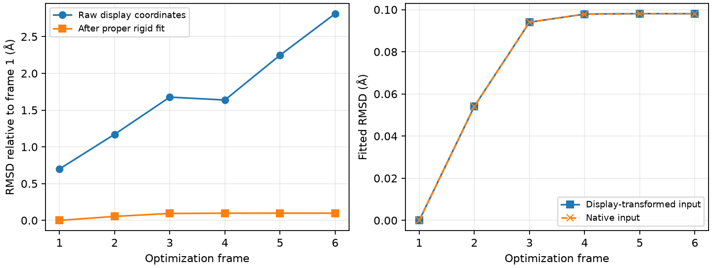

# 轨迹对齐与原子标记

**适用环境：通用；Python、NumPy、Matplotlib。**

这个案例演示对已有优化轨迹去除显示旋转和平移，以及按完整溶剂分子生成原子标记。方法见 [RMSD 与原子映射](../../notes/计算化学/RMSD、原子映射与轨迹对齐.md)。

## 输入与复现

轨迹来自[水分子优化案例](../orca/minimal/scan-and-descent/README.md)中的 `optimization.xyz`：RHF/def2-SVP、6 帧原生 ORCA 优化结构，坐标为 Å，注释能量为 Hartree。原文件保持原样，脚本逐帧人为加入不同刚体旋转和平移，用于模拟显示坐标系变化，再以第一帧为参考拟合全部三个对应原子，采用单位权重。

原子标记使用[溶剂壳层案例](../solvent-shell/README.md)的 `packed-191917.xyz` 与 `analysis.json`，输入顺序为 5 个甲烷原子、64 组各 3 个原子的水。按已有 4 Å 完整分子选择表设置活动水，中心甲烷和其余水固定。换成其他输入时，应重新建立分子映射和选择表，不能沿用这里的顺序公式。

从本目录执行，使用已具备 `requirements.txt` 中依赖的 Python 环境：

```bash
python3 analyze.py --output-dir /tmp/geometry-review-new
```

输出目录必须尚不存在。脚本复用前述案例中的严格 XYZ 读取函数；需保持仓库目录关系。它进行几何后处理，不启动新的量化或分子动力学计算。

## 结果与检查

| 文件 | 用途 |
| --- | --- |
| [rmsd.csv](rmsd.csv) | 原始显示坐标 RMSD、拟合后 RMSD、原生结构拟合值与对应能量 |
| [reoriented.xyz](reoriented.xyz) | 人为改变显示坐标系的派生轨迹 |
| [aligned.xyz](aligned.xyz) | 对齐到第一帧参考结构的派生轨迹 |
| [atom-map.csv](atom-map.csv) | 0/1 起始编号、元素、分子身份与最终优化标记 |
| [coordinate-fragment.txt](coordinate-fragment.txt) | 普通 `元素 标记 x y z` 片段，不含 route、标题、电荷/自旋、MM 类型或多层定义 |
| [analysis.json](analysis.json) | 输入文件摘要、选择定义、旋转行列式、秩及反射数学例 |



最后一帧显示坐标 RMSD 约 2.813 Å，拟合后约 0.0981 Å；后者与原生结构直接拟合的值相同。对齐保留每帧内部几何与原子身份，能量沿用原生帧，不因显示变换改变。优化帧号没有真实时间单位。

水的中心化坐标秩为 2，因为三个原子共面且不共线；正常旋转可将其对齐。另一个四个固定标签数学点的镜像例中，强制行列式 `+1` 后最小 RMSD 约 0.6713 Å，说明正常旋转不能代替镜像反射。该点集不代表实际分子计算。

标记表共 197 行，其中 15 个邻近水原子为 `0`、182 个原子为 `-1`；甲烷 5 个原子全部固定。片段只表达所选区域，完整 Gaussian 输入还需按所选优化方式准备；不能把它直接当作已参数化的 MM/ONIOM 模型。

比较自己的结构时，先建立原子映射，随后明确参考帧、拟合集合、报告集合和权重。脚本的 `fit` 返回行向量约定的旋转和平移，不自动寻找对称原子置换；不同分子不能仅靠元素序列配对。
