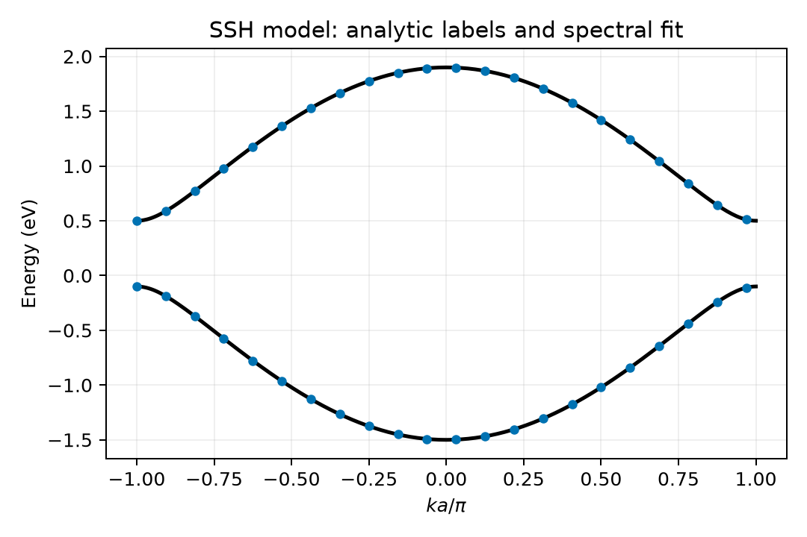
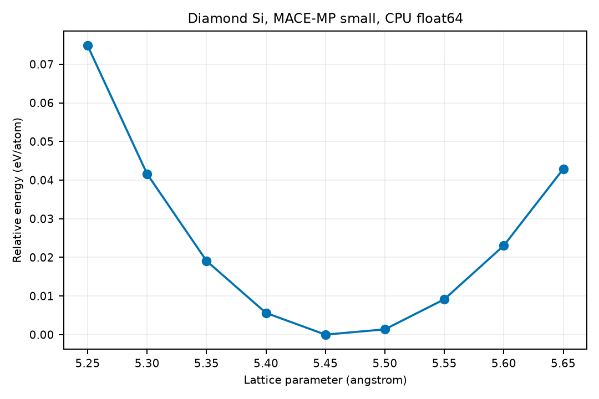

# 原子与电子模型的代码案例

**适用环境：macOS / Linux；Windows 可在 WSL 中运行整套流程。以下案例在 CPU 运行。**

用真实库和明确输入，把专题中的环境表示、等变运算、电子矩阵及能谱学习连接起来。每个脚本可独立运行，结果写入当前目录的 `results/`，不覆盖输入。

## 环境与运行

在本目录创建独立环境，安装[案例依赖](requirements.txt)。这组依赖用于下面的 CPU 案例；原始 DeepH-E3、NequIP、TBMaLT 等训练环境应按各自软件准备，不能全部混装到此环境。

```bash
python -m venv .venv
source .venv/bin/activate
python -m pip install -r requirements.txt
python descriptor_demo.py
python equivariance_demo.py
python molecular_matrix.py
python fit_ssh.py
bash train_mace_emt.sh
python mace_silicon.py
```

以上激活命令和 Bash 训练脚本在 macOS、Linux 或 WSL 中执行。MACE 例子首次需要下载官方 `small` 权重；已有对应权重时运行 `python mace_silicon.py --model /path/to/model`，可避免重复下载。权重不随手册分发。

## 各案例具体检查什么

| 脚本 | 输入和真实实现 | 输出与结果判据 |
| --- | --- | --- |
| [descriptor_demo.py](descriptor_demo.py) | ASE 的 OHH 几何，DScribe 的 ACSF / SOAP，以及一项矩不变量 | `descriptors.json`；键角改变时特征改变，旋转和同种原子交换误差小于 `1e-9` |
| [equivariance_demo.py](equivariance_demo.py) | e3nn `FullyConnectedTensorProduct`，固定随机种子 | `equivariance.json`；输入、输出维数为 5 和 10，旋转误差小于 `1e-8` |
| [molecular_matrix.py](molecular_matrix.py) | PySCF 水分子 RHF/STO-3G 自洽计算 | `water_rhf.npz/json`；七轨道、十电子，广义本征残差小于 `1e-9` |
| [fit_ssh.py](fit_ssh.py) | [ssh.json](ssh.json) 指定的解析 TB 模型，SciPy 最小二乘 | `ssh_fit.json`、能带 CSV/PNG；独立 k 点误差小于 `1e-8` eV，能隙 0.6 eV |
| [train_mace_emt.sh](train_mace_emt.sh) | [生成 Cu/EMT 数据](make_emt_dataset.py)、真实 MACE 训练、[重新加载模型](predict_trained.py) | 四构型验证误差、模型及检查点；EMT 标签与 DFT 区分，100 轮用于小型流程学习 |
| [mace_silicon.py](mace_silicon.py) | ASE 金刚石 Si，真正的 MACE-MP small checkpoint | 晶格扫描 CSV/PNG、权重 SHA256；检查复制晶胞的每原子能与能量–力有限差分 |

ACSF/SOAP 案例的几何用于隔离角度影响，不把它称为优化后的水分子。RHF 案例是实际量子化学计算，但不是 DFT 标签。SSH 以解析能谱作为标签，用来解释监督链和规范歧义，不代表真实材料拟合。MACE 例子使用公开预训练势，也不能替代与独立 DFT 的精度比较。

## 参考数值与检查条件

[参考结果](reference/cpu-results.json)记录 Python 3.13、依赖表所列版本及 CPU float64 条件下的小型计算。ACSF / SOAP 的特征数分别为 7 和 63；RHF/STO-3G 水分子总能约为 −74.96306313 Hartree，电子数为 10；SSH 能隙为 0.6 eV。Cu/EMT 小型 MACE 的四构型验证能量、力 RMSE 约为 0.0113 eV/atom、0.0040 eV/Å；不同数值库可能有末位差异。

MACE-MP-0 small 的 Si 扫描使用 5.25–5.65 Å、步长 0.05 Å；最低采样点为 5.45 Å。每原子能的扩胞误差约为 $1.8\times10^{-15}$ eV，畸变构型的 $F_x=-0.23744610$ eV/Å，与有限差分的差约为 $1.4\times10^{-8}$ eV/Å。具体权重、SHA256 和依赖版本在参考结果中给出；这个检查验证数值一致性，不提供独立 DFT 精度结论。

这些数字用于核对同一输入与流程，不能用来排列不同模型的材料预测精度。Cu/EMT 验证集没有独立化学域，SSH 标签没有第一性原理误差，RHF 水例子也未训练电子矩阵网络。

## 一个完整的训练、保存和推理流程

`bash train_mace_emt.sh` 先由固定随机种子生成 20 个训练构型和 4 个验证构型，再训练一个小型 Cu 模型，最后从磁盘重新加载 `results/models/Cu_EMT_fit.model` 并计算能量、力 RMSE。它使用真实 MACE 代码和 ASE EMT 标签，无需额外数据集或预训练权重；这些验证构型只用于检查同类局部环境上的拟合，不支持跨材料精度结论。

该脚本适用于这里固定的 MACE 0.3.17 接口。未来版本若替换 CLI 或导出格式，应按对应文档更新，不能只用新包读取历史命令。

## 读取输出

水分子数据可直接载入：

```python
import numpy as np
sample = np.load("results/water_rhf.npz")
print(sample["hamiltonian"].shape, sample["overlap"].shape)
```

矩阵、轨道能使用 Hartree，几何输入使用 Å；`trace(P @ S)` 应为 10。闭壳层占据能级之和与总能并列输出，便于检查二者不同。





SSH 的圆点为拟合结果，实线为已知解析模型。[MACE 扫描数据](reference/mace_si_scan.csv)中的能量为 eV/atom；上图的纵轴是相对最低采样点的每原子能，不能把最小采样点直接报告成已收敛的晶格常数；若要获得平衡值，还需更密网格或状态方程拟合及参考比较。

## 环境兼容与来源

e3nn 0.4.4 的包内常数含 Python `slice` 对象，较新 PyTorch 的默认 `weights_only` 加载会拒绝它。脚本仅对这个已知包内常数类型使用 `torch.serialization.safe_globals([slice])`；不会把任意下载文件加入白名单。MACE 自身的 checkpoint 加载策略还应按其版本核对，模型文件只使用可信的官方发布。

接口来源：[DScribe](https://singroup.github.io/dscribe/latest/)、[e3nn](https://docs.e3nn.org/en/stable/)、[PySCF](https://pyscf.org/quickstart.html)、[MACE](https://github.com/ACEsuit/mace)。配套训练输入见[机器学习模型输入](../../../inputs/machine-learning/README.md)。

返回[势函数](../../../notes/机器学习势函数/README.md)、[哈密顿量](../../../notes/机器学习哈密顿量/README.md)或[紧束缚模型](../../../notes/机器学习紧束缚模型/README.md)专题。
