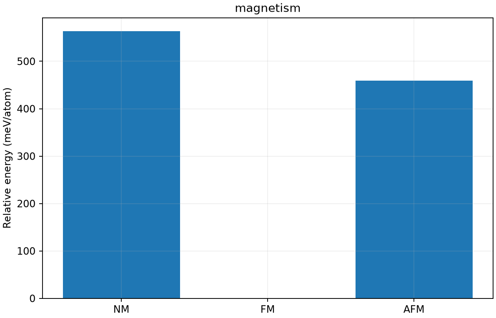

# bcc Fe 的 NM、FM、AFM 比较

**适用环境：macOS / Linux，CPU 计算。**

原理、公式、模型和结果判据见[磁性与自旋：从Fe磁序到SOC与有限温度](../../../notes/材料应用/磁性与自旋/磁性与自旋：从Fe磁序到SOC与有限温度.md)。本例依次生成结构、运行计算、提取数据并绘图。

## 输入与程序

参数文件为[magnetism.json](../../../inputs/materials/magnetism.json)，结构、INCAR 或分子/动力学输入由[运行器](../../../scripts/materials/run_case.py)中同名任务函数生成。以下为该参数文件的内容：

```json
{
  "case": "magnetism",
  "schema_version": 1,
  "a_A": 2.86,
  "encut_eV": 450,
  "kmesh": [
    9,
    9,
    9
  ]
}
```

运行后可以在每个子任务目录直接检查 `POSCAR/INCAR/KPOINTS`、`job.inp` 或 `in.lammps`。软件与 Python 环境选择见[公共运行说明](../../../notes/材料应用/本机运行与结果检查.md)。

## 从仓库根目录运行

```bash
bash scripts/materials/run_local.sh magnetism \
  --output _validation_runs/materials-user/magnetism
```

默认顺序运行，VASP 使用 1 个进程；`--threads 2` 控制相关程序的线程环境。输出目录已存在时脚本会停止。若是原参数、原输入的中断续跑，使用：

```bash
bash scripts/materials/run_local.sh magnetism \
  --output _validation_runs/materials-user/magnetism --resume
```

续跑会核对并复用输入、输出指纹一致的已登记子任务，运行未登记的任务。结构收敛或轨迹步数检查报错时，先检查对应子任务的日志。修改参数、赝势或结构后使用新目录。授权 PAW 势只在本地工作目录拼接，不加入公开数据。

## 输出与检查

| 文件 | 用途 |
| --- | --- |
| `curve.csv` | 实际输出提取的绘图数据，表头注明单位 |
| `results.json` | 物理量、模型和近似说明 |
| `provenance.json` | 输入参数、执行命令、耗时及输入/输出 SHA-256 |
| `result.png` | 从 `curve.csv` 生成的图 |
| 子任务目录 | 原始输入、程序日志与输出，仅保留在运行位置 |

VASP 检查正常结束标记、所有离子步的电子迭代数和所需的结构优化/轨迹步数；ORCA 检查正常结束、优化与频率；LAMMPS 检查结束标记和曲线。通过这些检查只说明本例的执行与定义成立，材料性质仍须按教程进行数值收敛与物理模型检查。

## 数值与图

数据来自本例运行器的实际输出：[结果](data/results.json)、[数值表](data/curve.csv)、[输入与输出指纹](data/provenance.json)。



图的条件以本页参数和结果文件为准；结果的解释范围见配套教程。

## 本例数值

以下数值从本页链接的数据文件读取，适用条件为上述模型和参数。

| 物理量 | 数值 |
| --- | --- |
| FM 总磁矩 | 4.456217 μB/cell |
| FM 局域磁矩 | [2.231, 2.231] μB |
| AFM 局域磁矩 | [1.743, -1.744] μB |

返回[材料案例](../README.md)。
