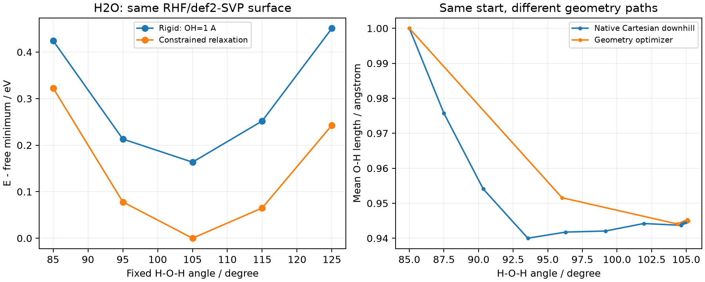
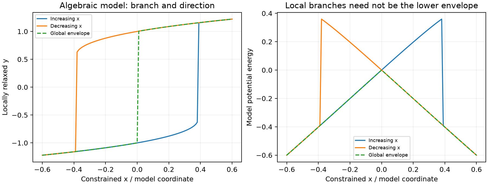

# 水分子的扫描、约束弛豫与自由下坡

**适用环境：macOS / Linux，ORCA 6.1.1；分析需要 [requirements.txt](requirements.txt) 中的 NumPy、Matplotlib。**

用同一个水分子模型比较刚性角度扫描、固定角度的约束优化，以及从同一非平衡结构出发的自由优化与 downhill。约束分支和扫描滞后见[扫描与滞后](../../../../notes/计算化学/势能面扫描、约束与滞后.md)。

## 输入与计算协议

[protocol.json](protocol.json)记录固定的 RHF/def2-SVP、中性单重态和 85、95、105、115、125° 五个键角。初始两根 O—H 均为 1 Å，结构由 [prepare.py](prepare.py)生成，原子顺序 O、H、H。改变计算层级时同步修改输入模板和协议，不能只改记录字段。

- [rigid.inp](rigid.inp)：固定生成的几何，计算单点。
- [relaxed.inp](relaxed.inp)：固定角度，优化其余允许自由度。
- [free.inp](free.inp)：无约束优化后计算频率。
- [downhill.inp](downhill.inp)：从非零梯度结构沿原生 Cartesian 方向下降。

各任务用一个进程、主要工作区 256 MB、`VeryTightSCF` 和 `NoAutoStart`；优化使用 `TightOpt`。五个角度分别从指定的等键长结构开始，属于独立约束点计算，没有宣称完成连续正反向原生扫描。

ORCA 的约束编号从 0 开始，`{ A 1 0 2 C }` 固定输入中的 H—O—H 角度。这个受约束驻点可以保留角度方向受力，不能按自由极小点解读。

## 运行

在本案例目录，给出已配置的 ORCA 驱动绝对路径：

```bash
python3 prepare.py --work-root /tmp/new-water-scan
ORCA_EXEC=/path/to/orca bash /tmp/new-water-scan/run.sh
```

初始阶段包含五个单点、五个约束优化、一个自由优化/频率和一个 downhill，共 12 个任务。生成脚本逐一检查正常结束；是否约束收敛、downhill 达到目标受力还需读原生判据，后处理也会检查。

`Direction down` 不作 TS 负模式初始位移，不要求初始 Hessian。当前设置为初始下降尺度 0.05 Bohr、自适应步长、最多 80 次迭代；原生输出中的步长还受拟合和校正影响，不能解释为等时间采样。终止要求 `TolRMSG=1e-5`、`TolMaxG=3e-5` Hartree/Bohr。

然后用下坡末点做另一个独立的自由优化与频率任务：

```bash
python3 prepare.py --stage endpoint --work-root /tmp/new-water-scan
(cd /tmp/new-water-scan/down-end && /path/to/orca calc.inp > calc.out 2>&1)
python3 analyze.py --work-root /tmp/new-water-scan --output-dir /tmp/water-scan-analysis
```

`prepare.py` 拒绝覆盖已有目录，也会拒绝没有明确收敛的 downhill。全部流程共 13 个原生任务。

## 读图和检查结果

[analyze.py](analyze.py)核对完整输入、结构、每点收敛及约束值；从 `engrad` 读取未投影梯度，并用角度约束的梯度分离允许方向。自由优化和末点优化还需三个正内部频率。它读取原生轨迹的接受帧，不把所有 SCF 能量行当作路径点。

[analysis.json](analysis.json)保存能量、几何、受力、原生源文件摘要及轨迹；图以自由极小点为共同能量零点。



本例自由极小点约为 O—H=0.94496 Å、H—O—H=105.13165°。刚性曲线与约束弛豫曲线之间的差来自两根键的弛豫；固定 105° 的点仍不等于精确自由极小点。85° 点约束优化后的原始梯度模约为 0.07631 Hartree/Bohr，允许方向分量约为 $3.35\times10^{-5}$ Hartree/Bohr。

右图中自由优化有 6 帧，downhill 有 19 个接受点；相同起点和相同终点势能谷，不要求中间路径一致。图中帧数也不代表真实弛豫时间。两个末点的能量和几何按当前模型比较，不能据此推断水分子的实验动力学。

## 导出完整 XYZ 和逐帧表

[downhill.xyz](downhill.xyz)、[optimization.xyz](optimization.xyz)保留原生小型轨迹；[downhill.csv](downhill.csv)、[optimization.csv](optimization.csv)分别按完整帧读取能量和两根键长、键角。轨迹原生坐标打印为 Å，只有六位小数，不补造额外几何精度。

[trajectory.py](trajectory.py)也可独立使用：

```bash
python3 trajectory.py downhill.xyz --coordinate-unit angstrom \
  --energy-format orca --expected-frames 19 --bond 1,2 --angle 2,1,3 \
  --output-dir /tmp/new-water-trajectory-check
```

输出原文件副本、CSV 和清单。坐标单位必须给定；默认不解释注释中的能量，只有明确选择 `orca` 时才读取对应格式。空能量字段表示没有读取，不等于零。工具拒绝截断帧、元素序列变化和非有限坐标，但不能识别同元素原子交换，仍需原子身份映射。

轨迹来源、两侧拼接与重启检查见[XYZ 导出与逐帧核对](../../../../notes/计算化学/反应路径的XYZ导出与逐帧核对.md)。

## 用独立模型解释扫描分支

[branch-model.json](branch-model.json)采用明确给出的无量纲二维势，计算在给定 x 下的各局部极小根，并沿既有分支作正反向延续，另算全局低能包络。它展示滞后与跳变的可能来源，不是对水分子的第二组原生扫描，也不代表所有优化器都选最近根。



模型解析条件、分支终止和分子扫描之间的区别见[势能面扫描与滞后](../../../../notes/计算化学/势能面扫描、约束与滞后.md)。
