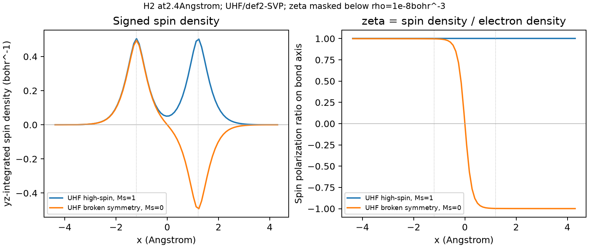

# 拉伸 H2 的自旋密度与自然轨道表示

**适用环境：macOS 或 Linux 的 Bash；ORCA 6.1.1、同版本 `orca_2mkl`、Multiwfn 2026.7.15、Python 3 与 [NumPy/Matplotlib](requirements.txt)。**

在自建 `2.4 Å` H2 几何上分别求 RHF、高自旋 UHF 和破缺对称 UHF 解，再核对密度矩阵、自然轨道、自旋布居及实空间网格。这个两电子教学模型说明不同诊断的含义，不提供精确单重态解或实验磁性预测。

## 计算与导出

从仓库根目录执行，程序应已可从命令行调用，`python` 使用已有依赖环境。选择新的工作目录：

```bash
set -e
case_dir="$PWD/examples/orca/minimal/spin-density"
work_dir="$PWD/_validation_runs/spin-density"

python "$case_dir/prepare.py" scf --work-root "$work_dir"
for mode in rhf hs bs; do
  (cd "$work_dir/$mode" && orca orca.inp > orca.out 2>&1 &&
    orca_2mkl orca -molden > orca_2mkl.log 2>&1)
done

python "$case_dir/prepare.py" post --work-root "$work_dir"
for mode in rhf hs bs; do
  (cd "$work_dir/$mode-export" &&
    multiwfn orca.molden.input -silent < input.txt > multiwfn.out 2>&1)
done
for mode in hs bs; do
  for job in spin-grid rho-grid becke; do
    (cd "$work_dir/$mode-$job" &&
      multiwfn orca.molden.input -silent < input.txt > multiwfn.out 2>&1)
  done
done

python "$case_dir/prepare.py" natural --work-root "$work_dir"
for mode in hs bs; do
  for kind in UNO NSO SNO; do
    (cd "$work_dir/$mode-$kind" &&
      multiwfn scf.fch -silent < input.txt > multiwfn.out 2>&1)
  done
done

python "$case_dir/analyze.py" --work-root "$work_dir" --output-dir "$work_dir/derived"
```

输入使用 HF/def2-SVP、`VeryTightSCF`、一个进程及 `%maxcore 256` MB。`bs.inp` 从几何行指定的三重态开始，用 `FlipSpin 1` 翻转第二个 H，再求 `FinalMs 0`。因此三份 ORCA 作业中，BS 输出包含高自旋与破缺对称两个 SCF 阶段；读取最终对应结果，不能混用阶段。

`prepare.py` 在各阶段检查源文件并拒绝覆盖。后处理共 15 项：三份参考矩阵/FCHK 导出，两种 UHF 解各自的自旋/总密度网格与 Becke 积分，以及两种解各三类自然轨道导出。所有原生数据各用独立目录。

## 解的能量与自旋诊断

| 解 | 能量 / Ha | Ms | ⟨S²⟩ |
| --- | --- | --- | --- |
| RHF | `−0.874949457550` | 0 | 约 0 |
| UHF 高自旋 | `−0.995109442549` | 1 | 约 2 |
| UHF 破缺对称 | `−0.999673433062` | 0 | `0.970150` |

脚本从占据 alpha/beta 轨道和真实重叠矩阵独立重建密度及 UHF 的 `⟨S²⟩`，对照原生输出。BS 虽有 `Ms=0`，仍含非单重自旋成分；不能将较低 HF 能量直接称为精确单重基态。

## 三种自然轨道怎样对应矩阵

Multiwfn 从同源 Molden 导出带 `Total SCF Density`、`Spin SCF Density` 的 FCHK。这个文件记录当前 HF 密度，不是 Gaussian 新算的相关密度。随后 `200 → 16` 选择 SCF，并分别选空间 UNO、alpha/beta NSO、SNO；导出后重新载入 `new.mwfn`。

`analyze.py` 在 S 度量下独立对角化，并检查：

- UNO 重建 `Pα+Pβ`，主要 BS 占据数为 `1.172771`、`0.827229`；
- NSO 分别重建 `Pα`、`Pβ`，本例单行列式的各通道占据接近 0/1；
- SNO 重建 `Pα−Pβ`，主要 BS 权重为 `+0.984962`、`−0.984962`。

当前原生 SNO 文件使用一套空间轨道与有符号权重；不要把它作为普通占据数文件继续求电荷或 OED。

## 布居与空间函数

BS 的 Mulliken 原子自旋布居由 `diag(Pspin S)` 分原子求和，约为 `+0.993368`、`−0.993368`，与 ORCA 最终阶段对应。Becke 对同一自旋密度积分约为 `+0.934444`、`−0.934444`。总和均为零，局部值依赖分区。

总和为零时不使用“占总和百分比”；原生表可能显示星号。直接保留带符号值。更不能把 `Σ|原子自旋布居|≈1.86889`、`∫|m|dr≈1.91735` 和 SNO 谱绝对和约 `1.96992` 当成同一个量。



左图为沿 y/z 积分的 m，右图为键轴上的 `ζ=m/ρ`；虚线标出核位置。网格步长 `0.2 bohr`，ζ 只在 `ρ>10⁻⁸ bohr⁻³` 的点上定义，不修改 Multiwfn 的全局函数设置。高自旋 m 积分为约 `1.999974`，BS 为约 `1.29×10⁻⁶`，两者对应矩阵中约 2 和 0 的自旋电子数差。

派生文件 [analysis.json](analysis.json)、[analysis.npz](analysis.npz)保留矩阵、谱、网格曲线和源摘要。有限文件精度会产生约 `10⁻⁹` 或更小的占据数/自旋残差，原始值保留，不强行归一化或清零。空间积分不代替矩阵检查，也不证明所有网格性质都已收敛。磁矩与自旋量的边界见[自旋密度、布居与磁矩](../../../../notes/计算化学/自旋密度、布居与磁矩的区分.md)。
