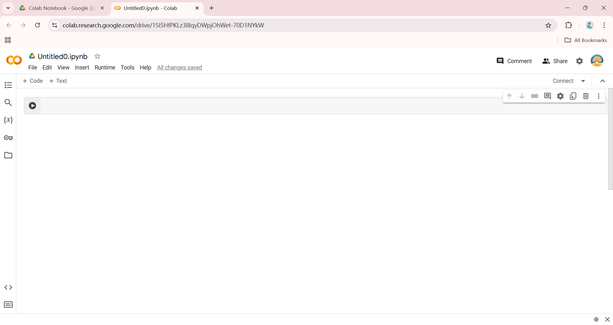
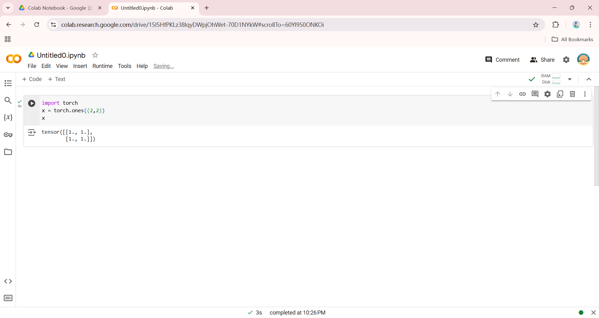
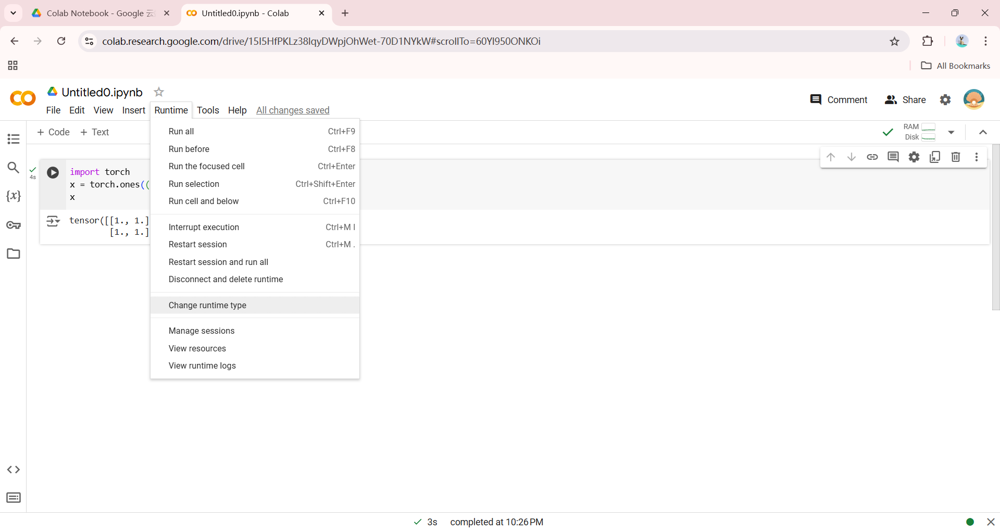
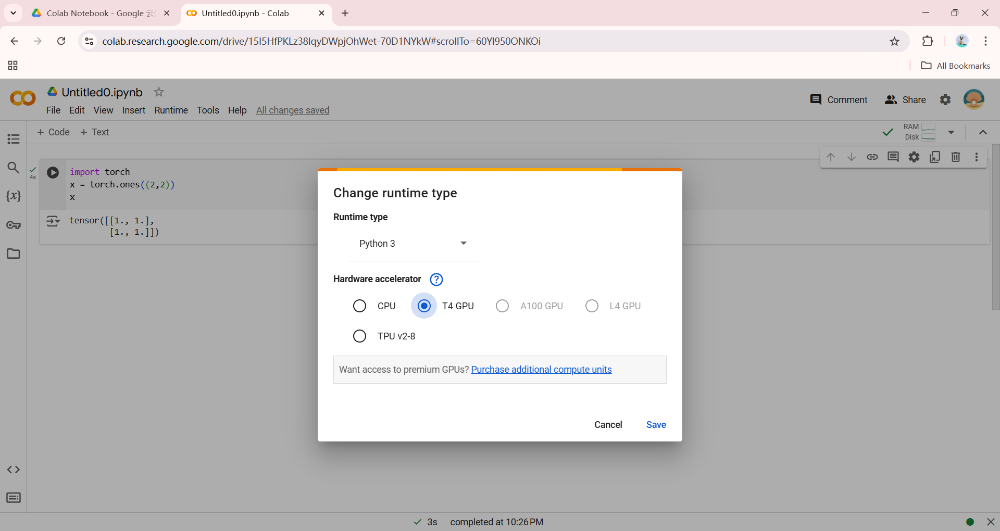
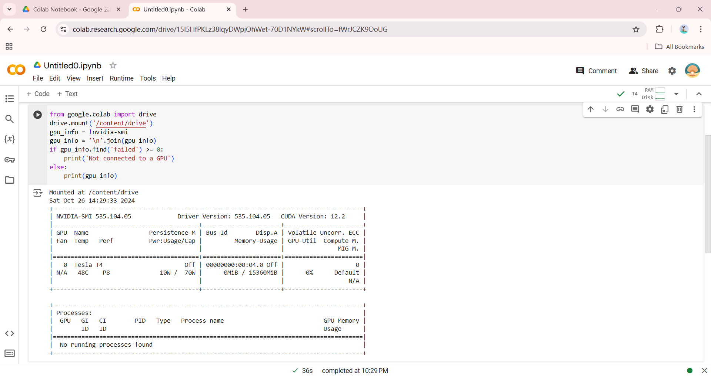

# Colab 入门

**适用环境：通用（Windows / macOS / Linux 浏览器）。**

Colab 在浏览器中提供 Jupyter Notebook 环境，可以编写、运行 Python 代码并分享分析结果。

## 如何使用 Colab

先打开 [Google 账号注册页](https://accounts.google.com/signup)注册账号，已有账号则直接登录。然后在浏览器打开 [Google Colab](https://colab.research.google.com/)，选择新建 Notebook，在代码单元格输入 `print("hello")`，点击运行按钮或按 `Shift+Enter`，检查输出。

Colab 不要求先安装 Python、Jupyter 或 Google Drive 桌面客户端。需要从云端硬盘管理文件时，在浏览器打开 [Google Drive](https://drive.google.com/)，进入“我的云端硬盘”：

<div align="left">

</div>

在 `新建` → `更多` 里选择并创建 `Google Colaboratory`，如图所示：

<div align="left">

</div>

如果没有 `Google Colaboratory` 选项，可以选择 `关联更多应用` 搜索并关联 `Colaboratory`，或直接从 Colab 首页新建。

新建的 `.ipynb` 文件如图所示：

<div align="left">

</div>

Colab 使用 `.ipynb` 格式，可以上传已有的 Jupyter Notebook，再在云端环境中打开和运行：

<div align="left">

</div>

如果要使用 GPU 资源，需要选择 `Runtime` 并 `Change runtime type`，如图所示：

<div align="left">

</div>

<div align="left">

</div>

使用以下代码即可查看当前获取的 GPU 资源：

```python
from google.colab import drive
drive.mount('/content/drive')

gpu_info = !nvidia-smi
gpu_info = '\n'.join(gpu_info)
if gpu_info.find('failed') >= 0:
    print('Not connected to a GPU')
else:
    print(gpu_info)
```

代码执行情况如图所示：
<div align="left">

</div>
