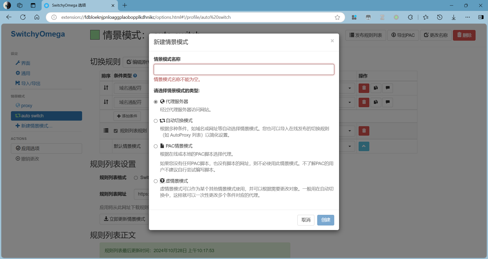
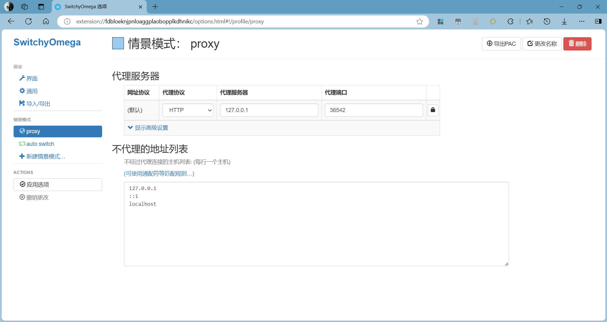
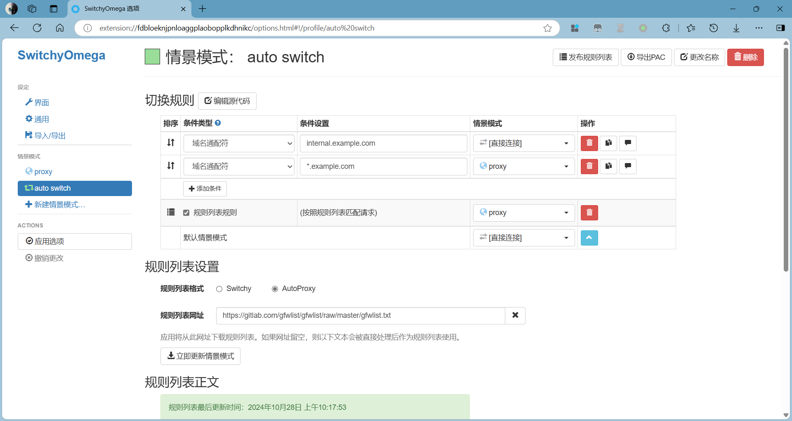
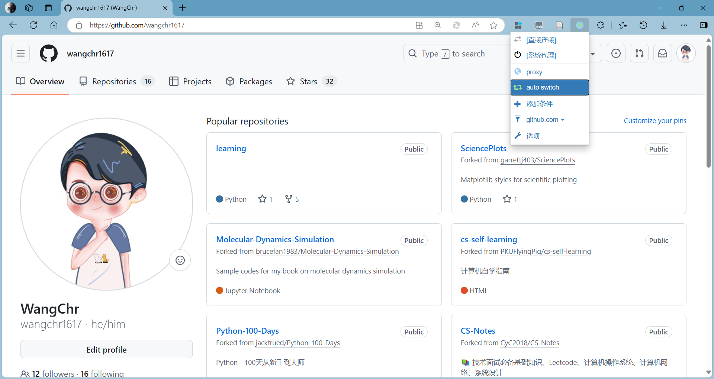

# SwitchOmega 使用教程

**适用环境：通用（Windows / macOS / Linux 浏览器）。**

## 应用场景

先在本机配置好代理客户端，再用 SwitchyOmega 按网站切换代理与直连。插件负责管理浏览器代理规则，代理服务由客户端提供。

---

## 下载安装

原作者于 2025-01-12 声明项目停止维护，原扩展因未迁移到 Manifest V3 而被 Chrome 禁用并从商店移除，见[作者说明](https://github.com/FelisCatus/SwitchyOmega/issues/2513)。下文保留旧版界面，用于理解代理情景模式；实际安装先核对浏览器版本与扩展维护状态，不把拖入旧 `.crx` 当成通用安装方法。

旧安装包可在 [SwitchyOmega Releases](https://github.com/FelisCatus/SwitchyOmega/releases) 查看。代理服务由本机客户端提供，扩展只管理浏览器规则。配置前先从客户端读取监听地址、协议与端口；下列是历史示例值，不是通用默认值：

- HTTP: 1080
- HTTPS: 443
- SOCKS4: 1080
- SOCKS5: 1080

---

## 配置教程

SwitchyOmega 情景模式一共有四种，分别是`代理服务器`、`自动切换模式`、`PAC情景模式`以及`虚情景模式`，新建情景模式的时候有这四种情景模式可选。

我们主要配置 `代理服务器(proxy)` 和 `自动切换模式(auto switch)` 即可。

### 代理服务器

`代理服务器` 指经过代理服务器访问网站。

我们需要根据本地安装的科学上网客户端设置 `代理服务器地址` 和 `代理端口`，如图所示：

### 自动切换模式

`自动切换模式` 指根据域名或网址等自动选择情景模式。

- 在 `切换规则` 中，你可以提前设置好哪些网址和域名需要通过 `proxy` 访问或者通过 `直接连接` 访问，直连即不通过代理服务器访问。`切换规则` 最后一行的默认情景模式，我们使用的是 `直接连接` 情景模式，它代表不在规则列表中网址，不走代理。
- 在 `规则列表设置` 中，`规则列表格式` 选择在线发布的切换规则 `AutoProxy`，
`规则列表网址` 输入 `https://gitlab.com/gfwlist/gfwlist/raw/master/gfwlist.txt` 然后点击 `立即更新情景模式` 即可。

`切换规则` 中的设置和 `规则列表设置` 是可以共存的，一般来说是前者的优先级更高。

最后点击 `应用选项`，保存刚刚的设置。

---

## 使用教程

配置完情景模式后，可以在浏览器地址栏右侧点击插件图标来切换代理的情景模式，推荐选择 `auto switch`。

如果有的网址自动切换失败，需要手动应用或取消代理服务，可以点击插件图标进行代理模式切换，点击 `系统代理` 或 `直接连接` 即可，当然您也可直接关闭 SwitchyOmega 插件。
