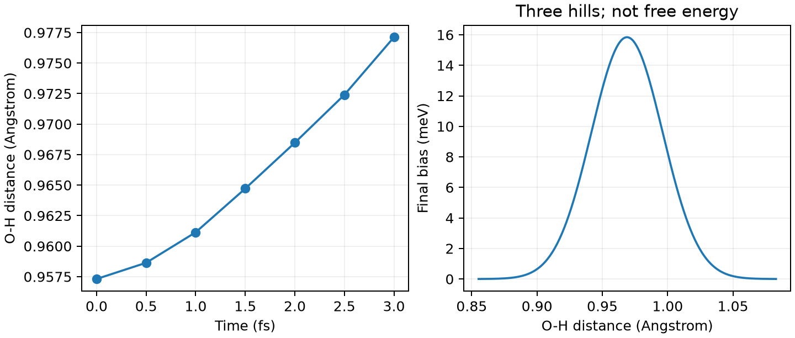

# CP2K Metadynamics 元动力学

**适用环境：Linux + PBS（CP2K）；Windows / macOS / Linux 可绘图。**

一条常规 MD 轨迹可能长时间停在同一个配位状态。如果还不知道合适的窗口中心，可以沿能区分各状态的集体变量累积偏置，帮助体系离开已经访问过的区域。若反应坐标和待采样区间已经明确，也可以用[固定窗口](CP2K自由能窗口与PMF重建.md)分段采样。下面借用约束 MD 的水分子和 O—H 距离，比较固定距离与动态偏置的处理方式。

## 一、给同一条 O—H 距离加上动态偏置

[最小案例](../../../examples/cp2k/minimal/metadynamics)提供 [cp2k.inp](../../../examples/cp2k/minimal/metadynamics/cp2k.inp)、[结构](../../../examples/cp2k/minimal/metadynamics/structure.xyz)和 [PBS 文件](../../../examples/cp2k/minimal/metadynamics/job.pbs)。与[约束 MD](CP2K约束分子动力学.md)一样，在 `SUBSYS/COLVAR/DISTANCE` 中选择原子 1、2；这里不固定距离，而是在 `MOTION/FREE_ENERGY` 下加入：

```text
&METADYN
  DO_HILLS .TRUE.
  NT_HILLS 2
  WW 0.0002
  &METAVAR
    COLVAR 1
    SCALE 0.05
  &END METAVAR
&END METADYN
```

`WW` 使用 Hartree，0.0002 Ha 约为 5.44 meV；距离变量的 `SCALE` 使用 bohr，0.05 bohr 约为 0.02646 Å。`NT_HILLS=2` 表示每两个 MD 步加丘。本例未采用扩展拉格朗日或 well-tempered 方案。

加载 CP2K、安装 [依赖](../../../examples/cp2k/minimal/metadynamics/requirements.txt)后提交 `qsub job.pbs`。300 K、0.5 fs、六步仅用于观察偏置写入；生产采样应根据变量涨落与弛豫时间选择丘宽、丘高和更长的加丘间隔。

## 二、让丘记录和坐标轨迹互相核对

[后处理](../../../examples/cp2k/minimal/metadynamics/postprocess.py)合并 CP2K 分步输出的 `COLVAR`、`HILLS` 日志，将 bohr 换算为 Å，并与坐标轨迹交叉核对。[plot.py](../../../examples/cp2k/minimal/metadynamics/plot.py)绘图。



本例在 1、2、3 fs 写出三个高斯丘，O—H 距离约从 0.9573 变化到 0.9771 Å。右图将三条丘记录按各自的中心、宽度和高度求和，得到最后一步的偏置势。三次加丘相隔 1 fs，距离变化约 0.020 Å，仍小于单丘宽度约 0.026 Å。这里的输出足以核对丘是否写入和叠加，判断化学反应则需要观察配位或成键状态是否改变。

## 三、从加丘测试走向自由能采样

若同一距离下还存在方向、配位等慢变量，先检查这些状态能否互相转换，再决定是否增加集体变量。丘宽可参考局部涨落，丘高和沉积间隔应给体系留出在当前偏置下弛豫的时间。重建自由能时按具体偏置方案处理，并比较分段结果、相关亚稳态之间的反复跨越和独立重复。续算应完整保存 CP2K restart、波函数及偏置历史，并核对丘数与时间连续性。

参考：[CP2K METADYN](https://manual.cp2k.org/trunk/CP2K_INPUT/MOTION/FREE_ENERGY/METADYN.html)、[METAVAR](https://manual.cp2k.org/trunk/CP2K_INPUT/MOTION/FREE_ENERGY/METADYN/METAVAR.html)。
