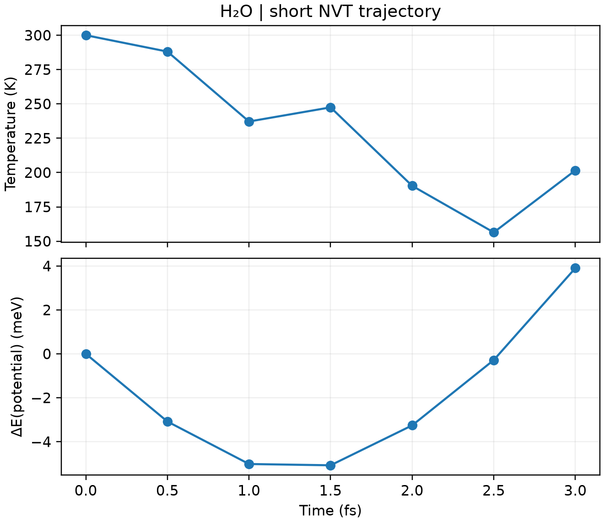

# CP2K 第一性原理分子动力学

**适用环境：Windows、macOS、Linux（查看和准备输入）；Linux + PBS（提交计算）。**

AIMD 在每个时间步计算电子结构和原子受力，再推进原子运动。这里以孤立水分子的短轨迹演示 NVT 输入、PBS 提交和输出检查。

## 输入与提交

先用 Multiwfn 的 `cp2k` 功能选择 `Molecular dynamics`，设置温度、时间步长和热浴。对应最小案例提供 [structure.xyz](../../../examples/cp2k/minimal/molecular-dynamics/structure.xyz)、[cp2k.inp](../../../examples/cp2k/minimal/molecular-dynamics/cp2k.inp)、[job.pbs](../../../examples/cp2k/minimal/molecular-dynamics/job.pbs) 和[检查脚本](../../../examples/cp2k/minimal/molecular-dynamics/postprocess.py)。

```text
&MOTION
  &MD
    ENSEMBLE NVT
    STEPS 6
    TIMESTEP 0.5
    TEMPERATURE 300
    &THERMOSTAT
      TYPE CSVR
      &CSVR
        TIMECON 20
      &END CSVR
    &END THERMOSTAT
  &END MD
&END MOTION
```

`TIMESTEP` 与 CSVR 的 `TIMECON` 默认单位都是 fs；温度单位为 K。含氢体系应从较小时间步长开始，并用短程 NVE 测试能量漂移。本例只运行 3 fs，用来检查流程，不足以讨论平衡温度、扩散或统计性质。

将上述文件放在集群工作目录，加载 CP2K 环境后提交 `qsub job.pbs`。

## 查看轨迹与能量

`molecular-dynamics-pos-1.xyz` 是坐标轨迹，`molecular-dynamics-1.ener` 包含步数、时间、动能、温度、势能等，列名和单位见文件表头。可用 VMD 播放轨迹，再用绘图工具检查温度和能量随时间的变化。

检查是否到达设定步数、每步电子计算是否收敛，以及结构是否出现异常接近或解离。NVT 的势能和动能会交换，并与热浴交换能量，不能要求物理总能像理想 NVE 一样严格守恒。

延长为生产计算时，应先平衡，再统计足够长的轨迹；保存 `.restart` 与波函数等续算所需文件，避免每次从新初速度开始。



图中为六步、每步 0.5 fs 的实际 NVT 轨迹，势能以起始值为参考；单分子短轨迹的温度波动只用于观察运行过程。配套 [plot.py](../../../examples/cp2k/minimal/molecular-dynamics/plot.py)读取实际输出生成，结果检查后自动绘图；需安装 [requirements.txt](../../../examples/cp2k/minimal/molecular-dynamics/requirements.txt) 中依赖。

## 体相、固定应变和表面怎样选系综

系综由研究条件决定：固定体积研究的密度、应变或受限结构，与固定外压下自由调整晶胞的材料是不同模型。

| 研究条件 | 可用的起点 | 需要检查 |
| --- | --- | --- |
| 已知体积或密度、固定应变的晶体 | NVT | 该体积对应的平均应力；不能据此称其处于任意指定外压 |
| 给定温度和外压的均匀体相 | NPT | 平衡体积、晶胞形状、应力及目标相是否稳定 |
| 热膨胀或允许体积变化的相变 | 相容晶胞自由度下的 NPT | 是否允许必要的轴向/剪切变形，有限尺寸与相变滞后 |
| 带真空的 slab、孤立分子或有限团簇 | 固定盒子的 NVT，或按任务选择 NVE | 真空、镜像作用及真实周期方向；真空体积不应交给普通三维压浴自行调节 |
| 规定加载路径或非平衡过程 | 与加载方式匹配的动力学 | 外部驱动方向与压浴自由度是否冲突，热量如何移除 |

CP2K 的 `NPT_I` 对应各向同性晶胞变化，`NPT_F` 允许柔性晶胞，见 [MD 系综定义](https://manual.cp2k.org/cp2k-2026_2-branch/CP2K_INPUT/MOTION/MD.html#CP2K_INPUT.MOTION.MD.ENSEMBLE)。选择时同时考虑结构对称性、外部约束和实际应力条件。`BAROSTAT/VIRIAL` 可在 `NPT_F` 中筛选部分笛卡尔分量，详见 [BAROSTAT](https://manual.cp2k.org/cp2k-2026_2-branch/CP2K_INPUT/MOTION/MD/BAROSTAT.html)；这不等于为任意真空 slab 建好了正确的表面应力模型，斜晶胞中更需区分笛卡尔轴与晶格方向。

初始密度偏离目标外压下的体相平衡值时，可通过适当的 NPT 条件调整，前提是先排除异常短接触，并检查 SCF 和受力质量。是否先用 NVT 稳定结构，取决于初态与热浴、压浴的表现，流程无需固定。若选择实验密度下的 NVT，则记录温度、密度，以及该力模型下的残余应力。

压浴需要可靠应力，AIMD 中还要检查基组、平面波辅助网格与电子收敛对应力的影响。温度或体积快速达到目标附近，不代表这些数值误差已经消失。由 NPT 选择代表性体积后转 NVT 进行固定盒子采样时，应在新条件下重新检查目标量，并说明晶胞的取法。

## 平衡要看目标慢变量，误差要考虑时间相关

先把每步 SCF、积分步长和异常几何检查好，再分析热力学与结构采样。温度、势能、密度的平稳反映部分整体状态；对缺陷、表面重构、混合或成核过程，还应选择相应慢变量。

| 材料问题 | 除温度与能量外可跟踪的量 |
| --- | --- |
| 晶体和局部畸变 | 晶胞与应力、配位数、键长/键角分布、结构序参量 |
| 液体与溶液 | 密度、径向分布、配位数及其分布、组分接触与混合程度 |
| 吸附和表面反应 | 吸附高度/位点占据、关键反应坐标、表面层间距与重构 |
| 缺陷或离子迁移 | 位点驻留、跳跃事件、不同起点的统计；扩散还需长时间输运分析 |

平衡关心的是指定条件下的分布是否平稳。体系仍可切换构象，液体也可持续扩散；而一段没有跳跃的平直曲线，可能只是困在亚稳态。RMSD 对参考、原子选择和周期卷回敏感，先处理分子完整性与允许去除的整体运动，再解释突变；不要把所有突变都自动判成周期显示问题。

划出候选舍弃段，比较后续多个时间块的均值、分布和关键事件，逐渐加长观察窗口。压力瞬时波动通常较大，应结合平均值及其相关误差判断，不能只看某帧是否等于目标压力。移动平均可帮助看趋势，但会隐藏短时变化，不作为独立样本或平衡证明。

线性拟合 $A(t)\simeq a+bt$ 给出的区间漂移为 $b(t_2-t_1)$，只反映所选区间中的线性趋势。例如，先升高再降低的序列可能有很小的净漂移，却仍存在明显变化。先画原始序列并比较分块分布，再结合时间相关误差和目标精度解释斜率。不要统一用“漂移占均值小于 1%”作为门槛：给势能加一个常数会改变该比值，却不改变动力学；平均压力接近零时，比值还会发散。温度、密度、应力和结构序参量应分别按其单位、物理尺度及不确定度判断。

对于平稳、等间隔采样的标量序列 A，统计低效因子可写为

$$
g\approx1+2\sum_{k=1}^{K}C_A(k),\qquad
N_{\mathrm{eff}}\approx\frac{N}{g},
$$

其中 $C_A(k)$ 是归一化自相关，截断 K 需避免把噪声尾部无限累加。均值标准误约为 $s_A/\sqrt{N_{\mathrm{eff}}}$，不能把每个保存帧都当独立样本。相关长度应针对目标量估计；能量的有效样本数不自动适用于稀有跳跃或慢结构序参量。可参考 [PyMBAR 时间序列方法](https://pymbar.readthedocs.io/en/stable/timeseries.html)，自动选择舍弃段也只是针对所输入序列的启发式判断。

对存在慢跃迁的体系，结合独立初态或初速度、延长轨迹与不同时间块的结果，检查是否采到相关状态及其布居。给出实际采样范围、舍弃时间、相关处理和不确定度；某个固定皮秒数或“漂移小于均值的某个百分比”不能普遍证明材料已充分平衡。

## 一次反应事件与热稳定性怎样解释

高温或常温短轨迹中未观察到断键，只说明在该初态、方法、温度和观察时长内没有发生所定义的事件，不能单独证明材料的热力学稳定性或宏观寿命。看见一次质子转移、解离或缺陷跳跃，也只提供一条动力学路径；速率和概率还需要明确的初态分布、足够事件数及相应采样模型。预先将反应物靠近或定向、提高温度，会改变所采条件，应连同初速度和热浴说明。

用固定原子对应的距离、配位或集体变量定义事件，检查短暂越线与回穿，保存反应前后的局部环境和电子态。查看器每帧自动重画的键仅是显示规则，不能替代反应判据。对比独立初速度、初始构型和候选路径；若用较便宜方法预筛，回到目标电子结构方法核对关键结构与反应通道，不把预筛模型的反应时间当作 AIMD 预测。

质心处理也属于动力学条件。仅为观看而在轨迹副本中平移或对齐，与在积分过程中约束质心或周期性删除总动量不同；后者会改变速度和相关函数的定义。记录移除了哪些整体自由度，按相应自由度计算温度。讨论扩散、集体流动或反应碎片分离时，保留原始轨迹与速度，并说明分析所用参考系，避免把显示对齐后的位移直接当作真实输运。

## 孔道客体与表面基团的转动怎样统计

先定义相对主体或基底的有符号转角，固定原子身份、参考轴与正方向，并处理周期映像和角度跨越 ±π 的展开。仅用环平面法向只能跟踪倾斜，不能区分环在自身平面内转过多少；还需选定面内方向或完整取向。对称等价取向的周期也可能短于 2π，应分别说明统计的是原子标签的整圈运动，还是等价构型之间的切换。

对适用的近固定轴运动，$\omega=d\phi/dt$ 的有符号均值反映净转动，而 $\langle|\omega|\rangle$ 描述角运动强度。来回反转可使前者接近零、后者仍很大；将后者除以 $2\pi$ 得到的量不能直接称为单向完成整圈的频率。分别报告净角位移、正逆向事件、角位移涨落及所需取向相关函数。低转动势垒或一段连续旋转动画，也不足以证明存在持续的定向驱动。

保存间隔需足以解析相邻帧的转角，否则展开也可能漏掉整圈。求导与平滑会改变角速度分布及短时相关，报告时间间隔、窗口和原始序列对照。若只统计近水平、仍处于孔道内等选定构型，结果属于该条件下的统计，同时报告入选比例、排除条件与状态切换；不能用筛选后的高速片段代表整个轨迹。两个转子的曲线看起来不相似也不证明完全独立，可进一步比较带时滞的相关及其采样误差。
