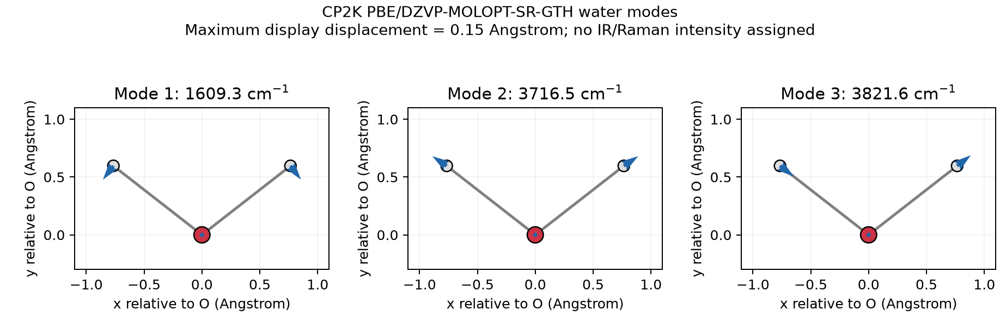

# CP2K 振动 Molden 与 MfakeG 显示转换

**适用环境：通用格式检查；MfakeG 官方提供 Windows/Linux 版本，GaussView 需已有可用许可。**

CP2K 的振动结果可以通过 Molden 文件交给支持该格式的查看器；需要在 GaussView 中观看时，可用 MfakeG 转成 Gaussian 样式的显示文件。转换改变的是可视化接口，不改变频率计算方法，也不会补出原本没有的强度。

## 先输出正确的振动文件

在已有的顶层 `VIBRATIONAL_ANALYSIS` 段中合并：

```text
&PRINT
  &MOLDEN_VIB ON
  &END MOLDEN_VIB
&END PRINT
```

通常得到 `项目名-VIBRATIONS-1.mol`；文件名也受打印设置影响，按实际输出确认，见 [CP2K 2026.2 手册](https://manual.cp2k.org/cp2k-2026_2-branch/CP2K_INPUT/VIBRATIONAL_ANALYSIS/PRINT/MOLDEN_VIB.html)。Multiwfn 的当前频率输入生成器可默认加入这个打印项，但仍应打开生成文件核对。

先看文件内容，再看后缀：这里的 `.mol` 以 `[Molden Format]` 开头，保存振动数据，区别于常见 MOL 分子结构文件和 `MO_MOLDEN` 电子轨道文件。查看器能显示几何后，还要确认是否读到了模式。

## 坐标、向量和强度各看哪个字段

| 字段 | 内容 | 核对重点 |
| --- | --- | --- |
| `[Atoms] AU` 或 `Angs` | 元素、编号、原子序数与几何 | 跟随此处注明的坐标单位 |
| `[FREQ]` | 振动频率，通常为 cm⁻¹ | 与模式数逐项对应，保留负值的意义 |
| `[FR-COORD]` | 振动参考几何 | Molden 约定为 Bohr，不因其它字段写 `Angs` 就自动改单位 |
| `[FR-NORM-COORD]` | 逐模式、逐原子的位移向量 | 核对模式编号、参与原子和归一化约定 |
| `[INT]` | 可选强度数据 | 缺失时保留“没有该数据”，不补成零强度 |

格式定义见 [Molden 说明](https://www.theochem.ru.nl/molden/molden_format.html)。CP2K 当前常规振动输出先将模式转成 Cartesian 位移再归一化；不要把显示向量再次机械除以原子质量平方根。跨程序比较时，检查是否在比较质量加权本征向量、Cartesian 方向或已经缩放的动画向量，详见[正常模式与 Hessian](../../计算化学/Hessian、正常模式与频率复核.md)。

动画可按 $\mathbf R_i(q)=\mathbf R_i^0+q\mathbf d_i$ 展示。$q$ 通常由查看器人为选择，模式整体反号只改变动画相位，不改变物理振型。虚频的正反位移可帮助识别反应方向，但周期播放并不表示鞍点附近有真实稳定的简谐振动。

IR 与 Raman 强度需要相应的偶极或极化率响应计算；`.mol` 中出现 `[INT]` 时也要核对程序给出的单位与定义，不能仅凭格式名认定为某个实验强度单位。只有频率和方向的文件适合看模式，不能据此画有定量峰强的光谱。

## MfakeG 的操作与转换后检查

已有 MfakeG 时，启动后输入振动 `.mol` 的路径，按其输出提示取得同目录的 `*_fake.out`。在 GaussView 载入该文件，通过 `Results → Vibrations` 选择模式、显示矢量或播放动画。获取与接口说明见 [MfakeG 介绍](http://sobereva.com/656)。

对照原文件抽查首、中、末模式：原子数与元素顺序、频率、模式方向及实际存在的强度应相符。转换后的输出明确作为显示副本保留，原始计算身份仍是 CP2K；不将它当成 Gaussian 的计算日志交给依赖方法、质量或热化学元数据的后处理器。

周期体系若要显示晶胞，可按 MfakeG 的扩展约定，在 `.mol` 副本中首行后加入 `[Cell]` 及三行真实晶胞向量。该扩展的向量用 **Å**，与标准 `[FR-COORD]` 的 Bohr 并存，应分别处理。转换后检查晶胞显示信息，不能将用于画框的平移向量计为真实原子或模式自由度。

晶胞边框只帮助观察，不会自动把一个晶胞的 Γ 点振动变成完整声子色散。表面约束、固定原子、平转动投影和声子采样仍由原计算决定；同样不能从查看器里只有三个、六个或更多模式，就直接反推是否正确扣除了所有自由度。

## 仓库水分子的直接读取与显示

[配套案例](../../../examples/cp2k/minimal/structure-modes-path/README.md)保留已有优化水分子的真实振动 `.mol`。它包含三个频率：约 1609.3、3716.5、3821.6 cm⁻¹，没有 `[INT]`。独立读取器核对模式数和单位，按最大原子位移 0.15 Å 输出每个模式的 24 帧 XYZ；这些帧是显示轨迹，不是 MD 或真实热运动。



图中按原模式画弯曲、对称伸缩和反对称伸缩方向，未添加 IR/Raman 强度。原始 `.mol`、读取器、模式 JSON、逐模式 XYZ 和绘图脚本均在案例目录。需要判断频率是否可信时，回到[频率计算与残余受力检查](CP2K振动频率.md)，不能以动画流畅作为收敛证据。
