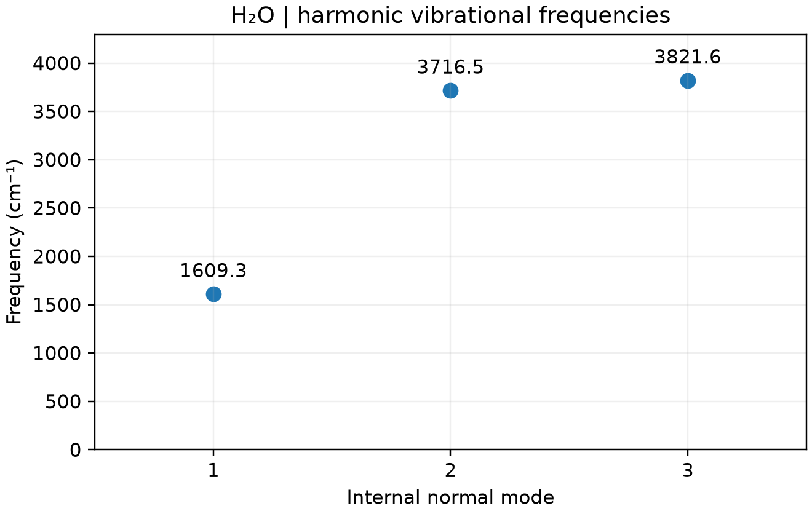

# CP2K 分子振动频率

**适用环境：Windows、macOS、Linux（查看和准备输入）；Linux + PBS（提交计算）。**

CP2K 可用有限差分受力构造 Hessian，求分子的简谐振动。以非线性的水分子为例，扣除整体平动和转动后有三个内部振动模式。

## 准备与提交

先做[几何优化](../结构优化/CP2K几何优化.md)，再计算频率。本例的 [structure.xyz](../../../examples/cp2k/minimal/vibrational-analysis/structure.xyz) 已采用优化后的水分子坐标；配套文件为 [cp2k.inp](../../../examples/cp2k/minimal/vibrational-analysis/cp2k.inp)、[job.pbs](../../../examples/cp2k/minimal/vibrational-analysis/job.pbs) 和[频率检查脚本](../../../examples/cp2k/minimal/vibrational-analysis/postprocess.py)。

在单点输入基础上设置 `RUN_TYPE VIBRATIONAL_ANALYSIS`，并加入顶层段：

```text
&VIBRATIONAL_ANALYSIS
  DX 0.01
  FULLY_PERIODIC FALSE
&END VIBRATIONAL_ANALYSIS
```

`DX` 默认单位为 Bohr，而不是 Å。`FULLY_PERIODIC FALSE` 适用于本例分子，并处理整体转动自由度；晶体频率不能直接沿用这一处理。将文件放到集群工作目录，加载 CP2K 后执行 `qsub job.pbs`。

## 判断振动结果

在 `cp2k.out` 中搜索 `VIB|Frequency (cm^-1)`。本例有三个正的内部频率，对应弯曲和两个伸缩模式；可用结构工具查看正常模式，不能仅凭频率排序识别任意复杂分子的振动类型。

小的负频率可能来自残余受力、网格或数值差分误差，明显的虚频则需要结合模式检查结构是否为鞍点。低频模式尤其要求更紧的几何优化和 SCF 收敛；官方建议采用例如 `EPS_SCF 1E-8` 的严格设置，见[振动分析手册](https://manual.cp2k.org/trunk/CP2K_INPUT/VIBRATIONAL_ANALYSIS.html)。

本例演示简谐频率，不等同于含强度的 IR/Raman 光谱。计算强度还需输出偶极矩或极化率，并配置相应的响应计算。



优化后水分子的三个内部正常模式频率，约 1609.3、3716.5 和 3821.6 cm⁻¹；图中没有赋予 IR/Raman 强度。 由配套 [plot.py](../../../examples/cp2k/minimal/vibrational-analysis/plot.py)读取实际输出生成，结果检查后自动绘图；需安装 [requirements.txt](../../../examples/cp2k/minimal/vibrational-analysis/requirements.txt) 中依赖。
