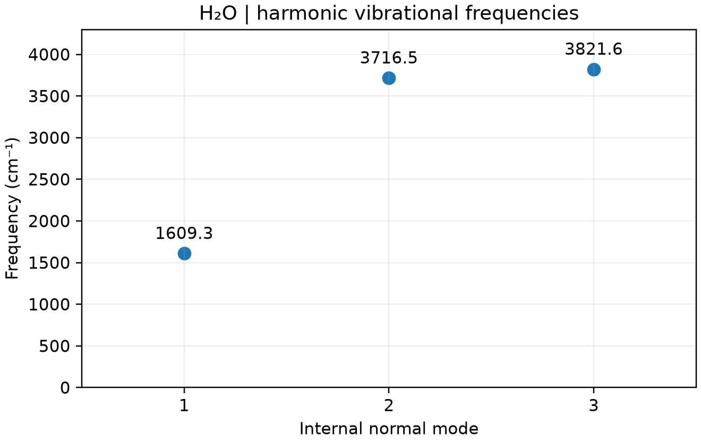

# CP2K 分子振动频率

**适用环境：Windows、macOS、Linux（查看和准备输入）；Linux + PBS（提交计算）。**

几何优化结束后，受力小只能说明结构接近驻点。要判断它是否是局部极小值，可以沿不同方向轻微拨动原子，检查受力是否把它们拉回原位。CP2K 用位移前后的受力差构造 Hessian，质量加权后得到简谐频率和振型。下面用同一份优化后水分子的坐标、频率图与振型文件，说明怎么验收这个驻点。

## 一、从优化后的水分子计算曲率

先做[几何优化](../结构优化/CP2K几何优化.md)，再计算频率。本例的 [structure.xyz](../../../examples/cp2k/minimal/vibrational-analysis/structure.xyz) 已采用优化后的水分子坐标；配套文件为 [cp2k.inp](../../../examples/cp2k/minimal/vibrational-analysis/cp2k.inp)、[job.pbs](../../../examples/cp2k/minimal/vibrational-analysis/job.pbs) 和[频率检查脚本](../../../examples/cp2k/minimal/vibrational-analysis/postprocess.py)。

在单点输入基础上设置 `RUN_TYPE VIBRATIONAL_ANALYSIS`，并加入顶层段：

```text
&VIBRATIONAL_ANALYSIS
  DX 0.01
  FULLY_PERIODIC FALSE
&END VIBRATIONAL_ANALYSIS
```

`DX` 默认单位为 Bohr。本例的 0.01 Bohr 约为 0.00529 Å。位移太小容易放大电子受力中的数值误差，位移太大则会把非谐性带入差分。`FULLY_PERIODIC FALSE` 适用于本例分子，并处理整体转动自由度；晶体频率不能直接沿用这一处理。将文件放到集群工作目录，加载 CP2K 后执行 `qsub job.pbs`。

## 二、把频率和原子的运动对上

在 `cp2k.out` 中搜索 `VIB|Frequency (cm^-1)`。非线性水分子有 $3N-6=3$ 个内部模式。案例的后处理检查 CP2K 正常结束、无 SCF 未收敛提示，并且输出恰好有三个正频率。



图中的 1609.3、3716.5、3821.6 cm⁻¹ 分别对应弯曲、对称伸缩和反对称伸缩。打开[原始振型文件](../../../examples/cp2k/minimal/structure-modes-path/water-vibrations.mol)，看 H–O–H 夹角怎样变，再看两条 O–H 键是一起伸缩还是一伸一缩。识别陌生分子的模式时也用这一步。播放方法见[振动 Molden 与 MfakeG](CP2K振动Molden与MfakeG显示转换.md)。

[绘图脚本](../../../examples/cp2k/minimal/vibrational-analysis/plot.py)读取实际输出，依赖见 [requirements.txt](../../../examples/cp2k/minimal/vibrational-analysis/requirements.txt)。图中只标了简谐频率。若要比较 IR 或 Raman 峰强，还需设置偶极矩或极化率输出和强度计算。[CP2K 振动分析手册](https://manual.cp2k.org/cp2k-2026_2-branch/CP2K_INPUT/VIBRATIONAL_ANALYSIS.html#CP2K_INPUT.VIBRATIONAL_ANALYSIS.INTENSITIES)

## 三、看到虚频先检查振型

若原本期待一个极小值，出现负频率时，先看该模式是整体漂移、柔性扭动，还是明显的内部结构变化。对很软的模式，复查末态残余受力、每个位移构型的 SCF 收敛和差分步长敏感性。本例用 `EPS_SCF 1.0E-8`。如果收紧数值条件后，同一内部虚频仍稳定存在，可沿该模式正反方向小幅扰动，分别优化，看看是否离开原驻点。[低频振动与虚频的处理](../../计算化学/低频振动与虚频的处理.md) · [Hessian 与频率复核](../../计算化学/Hessian、正常模式与频率复核.md)

## 四、晶体和冻结基底需要哪些额外检查

周期晶体的 Γ 点正常模式与整个布里渊区的声子谱不同。`FULLY_PERIODIC T` 避免按孤立分子清除转动，但不会自动生成一般 q 点的动力学矩阵。研究色散、声子态密度或晶格热容时，应通过适当超胞的位移—受力数据建立力常数，再检查超胞、位移、电子精度及声学支；不能只用原胞 Γ 点正频率断言全晶体动力学稳定。已有[声子流程](../../VASP/振动与热力学/VASP声子谱计算.md)可帮助理解数据组织，CP2K 的受力接口和单位则需分别核对。

冻结大部分基底能减少差分自由度，得到的是受限模型的局部或部分 Hessian。它适合定义清楚的吸附物局部振动近似，却会改变模式耦合和低频谱，不能直接作为完整晶体声子自由能。必要时逐步扩大活动区域，检查目标模式与热修正是否稳定；分子 RRHO 热化学也不能直接替代声子布里渊区积分。`THERMOCHEMISTRY` 的气相适用范围见[振动分析参数](https://manual.cp2k.org/cp2k-2026_2-branch/CP2K_INPUT/VIBRATIONAL_ANALYSIS.html)。
