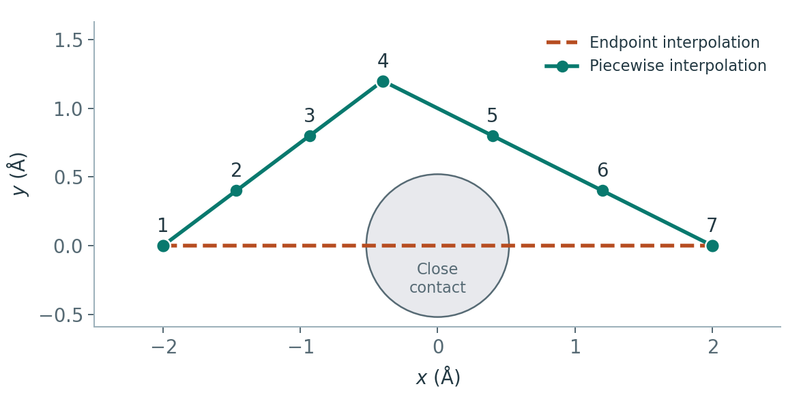

# CP2K 的 NEB 初始插点与路径检查

**适用环境：通用结构准备；sobNEB 官方提供 Windows/Linux 版本，CP2K 输入按 2026.2 核对。**

NEB 从一串初始副本出发优化反应路径。插点工具负责生成这串几何结构；端点是否正确、原子如何对应以及路径是否合理，仍需建模时决定。因此，先统一原子对应、晶胞和周期映像，再选择插值方式与副本数。

## 先确认哪些变化是真正的反应

所有锚点应具有相同原子数、元素顺序和身份对应，电荷、自旋与约束属于相容的计算问题。两个文件都写有相同数目的 Si 或 H，并不能证明同种原子已经正确配对。需要交换原子身份时，明确记录映射，而不是靠文件排序隐式完成。

孤立分子的整体平移、转动常应先消除，再对内部变化插值。周期模型则保留共同晶胞与参考坐标，不能只旋转原子而不旋转晶胞。跨边界迁移先选择连续的周期映像；最短映像不一定是目标反应通道，多跳扩散、绕行和协同运动需单独判断。

对刚性扩散或变胞反应，也不要只在两端分别 wrap 后直接相减。逐原子选择最近映像可能拆开一个分子，变胞任务则还涉及应变路径和所用方法能否处理，不能当作固定晶胞 NEB。

## 原生插值不总是等间隔

CP2K 2026.2 在 `NUMBER_OF_REPLICA` 大于显式 `REPLICA` 数量时，使用迭代二分：找出当前最大的相邻间隔，在其中点插入，重复到所需数量。副本数包括两个端点，见 [BAND 手册](https://manual.cp2k.org/cp2k-2026_2-branch/CP2K_INPUT/MOTION/BAND.html)。

例如，从两个端点补到 7 个副本时，6 个区间可能混合出现 1/8 与 1/4 两种相对长度。因此，相邻间隔相差一倍也可能是二分算法的结果。要精确指定中间锚点的位置和各段点数，可提前生成全部坐标，再按路径顺序显式列出。

## sobNEB 与分段线性插值

已有 sobNEB 时，在其工作目录的 `sobNEB.ini` 中逐行写“XYZ 路径 : 副本序号”。始末锚点必须给出，可选中间锚点。程序会在相邻已提供的结构之间线性插入，产生逐点 XYZ、供 `BAND` 使用的副本列表和 `traj.xyz` 预览轨迹，接口见 [sobNEB 介绍](http://sobereva.com/660)。它不会自动消除整体平转动。

若锚点 a、b 放在序号 $n_a<n_b$，其中第 $n$ 点的坐标为

$$
\mathbf R_n=(1-t)\mathbf R_a+t\mathbf R_b,\qquad
t=\frac{n-n_a}{n_b-n_a}.
$$

每段单独使用自己的起止锚点和区间数。提供一个几何“过渡态猜测”只控制初始路径；该点仍是普通可优化副本，不会因来自手摆结构就成为已验证过渡态，也不会自动在 NEB 中固定不动。

示意中，端点直插经过灰色的短接触区域。加入 4 号锚点后，在 1–4 和 4–7 号间分别插值。图中只表示一个原子的初始位置。

本仓库另提供[独立插值脚本](../../../examples/cp2k/minimal/structure-modes-path/interpolate.py)，读取 JSON 中的锚点与序号，生成明确排序的全部副本和 `BAND.inc`。它采用同样的分段数学形式，不自动修复原子映射、周期路径或碰撞；输出目录必须是新目录，避免覆盖计算结果。

## 写入 BAND 并预览

将全部副本列表放在已有 `MOTION/BAND` 下，保持 `NUMBER_OF_REPLICA` 与实际副本数一致。本仓库[几何准备例子](../../../examples/cp2k/minimal/structure-modes-path/README.md)在 1、4、7 号给出三个锚点，产生 7 个副本，包含两个端点。列表中的相对路径从 CP2K 的运行目录解释，应与实际目录对应。

依次检查：

1. 首末结构与目标端点、原子索引一致，中间给定锚点准确落在指定序号。
2. 固定原子在所有副本保持相同位置；移动原子的路径连续，没有突然跨盒或交换身份。
3. 播放 `traj.xyz` 并检查短接触、键长和角度，不能只看轨迹帧数。
4. 比较各段的 Cartesian 距离或明确的反应坐标；不同指标的“等距”并不相同。
5. 语法检查通过后，再运行 NEB 并检查各副本 SCF、路径受力、爬坡与收敛。

Cartesian 线性插值可能拉短键、让两个原子相穿或把扭转变成压扁。必要时添加有物理依据的中间构型，或采用更适合该结构变化的初始路径方法；增加副本只提高路径采样，不会自动修好错误通道。

`ALIGN_FRAMES` 控制开始时对齐，`ROTATE_FRAMES` 控制路径优化中的旋转处理，两者不同。周期固体案例在共同晶胞中关闭它们；孤立分子按实际几何选择。不要为了让预览图“叠在一起”而改变了原本想研究的表面扩散或分子取向过程。

这些检查只确认初始路径准备。能量最高的初始点不等于势垒，优化后路径最高点也需结合爬坡收敛、受力和振动方向判断；完整计算步骤见[CP2K CI-NEB 教程](CP2K过渡态搜索.md)。
