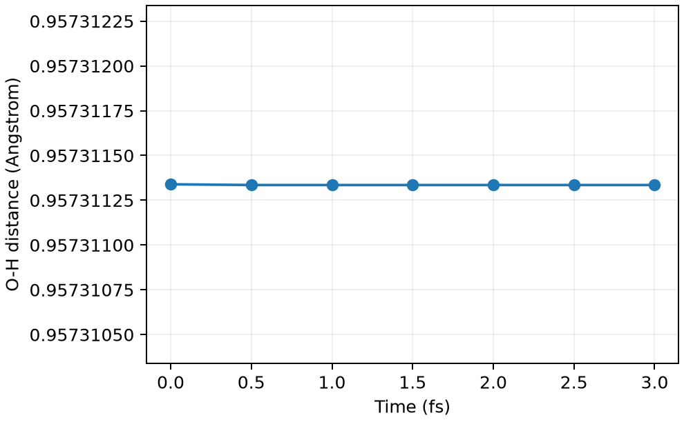

# CP2K 约束分子动力学

**适用环境：Linux + PBS（CP2K）；Windows / macOS / Linux 可绘图。**

约束一个集体变量，可以保留体系其他方向的运动。以水分子为例，固定一条 O—H 键长，另一条键和键角仍可变化。

## 定义距离与约束

[最小案例](../../../examples/cp2k/minimal/constrained-md)提供 [cp2k.inp](../../../examples/cp2k/minimal/constrained-md/cp2k.inp)和 [structure.xyz](../../../examples/cp2k/minimal/constrained-md/structure.xyz)。先在 `FORCE_EVAL/SUBSYS` 中定义：

```text
&COLVAR
  &DISTANCE
    ATOMS 1 2
  &END DISTANCE
&END COLVAR
```

再在 `MOTION/CONSTRAINT/COLLECTIVE` 中设置 `COLVAR 1`、`INTERMOLECULAR .TRUE.` 和 `TARGET`。这里 `COLVAR 1` 是第一项集体变量；原子序号从 1 开始。本例按全局原子编号应用约束，`INTERMOLECULAR` 不表示水被拆为两个真实分子。

`TARGET` 使用距离的内部单位 bohr，对应初始键长约 0.95731134 Å；修改结构时应同步换算。`SHAKE_TOLERANCE=1E-8` 控制约束迭代精度。

## 约束、限制势与固定原子怎样选

选择方法时先确定要保留哪些自由度：

| 方法 | 对运动的影响 | 材料模拟中的常见用途 |
| --- | --- | --- |
| 集体变量约束 | 在数值容差内满足指定几何关系，其余允许方向仍可运动 | 固定反应距离、约束平均力采样 |
| 限制势（restraint） | 在原势能上加入偏置，变量仍会围绕目标涨落 | 伞形采样、柔性定位吸附物或参考层 |
| 固定原子或坐标分量 | 移除选定的位移自由度 | 固定 slab 底层、局部结构弛豫 |

约束分子内部距离通常仍允许整体平动和转动；固定所有原子的位置则会同时消除这些运动。固定表面底层也改变了模型的力学边界，需检查固定层数与可动层厚度对吸附能、结构或反应势垒的影响。被冻结的原子仍参与电子结构与相互作用计算，不能按冻结原子数比例估算 DFT 加速。

CP2K 的 [`FIXED_ATOMS`](https://manual.cp2k.org/cp2k-2026_2-branch/CP2K_INPUT/MOTION/CONSTRAINT/FIXED_ATOMS.html)固定的是选定的**分数坐标分量**。固定晶胞时这对应指定位置；变胞时，同一分数坐标的笛卡尔位置会随晶胞变化。设置 NPT 或晶胞优化前，应先确认这种随胞形变的边界是否符合模型意图。

在 `COLLECTIVE` 下加入 [`RESTRAINT`](https://manual.cp2k.org/trunk/CP2K_INPUT/MOTION/CONSTRAINT/COLLECTIVE/RESTRAINT.html)可切换为谐和限制势。手册给出的形式为

$$
U_{\rm bias}=K(X-X_0)^2,
$$

其中 $X_0$ 对应 `TARGET`。与常见的 $\tfrac12k(X-X_0)^2$ 写法比较时，$k=2K$；力常数的量纲还取决于 $X$ 是距离、角度还是其它集体变量。跨程序移用数值前应核对势函数、单位和周期变量的处理，不能只比较参数名称。

对硬约束检查逐帧约束残差和迭代收敛；对限制势检查变量分布、窗口覆盖及偏置能。把力常数设得很大不会自动变成数值稳定的硬约束，还可能引入更快的运动尺度并要求更小步长。温度统计需使用与实际可动自由度和约束一致的定义；约束平均力或伞形采样的自由能也要按对应方法分析，不能直接把偏置能当作原体系势垒。

## PBS 计算与检查

安装 [依赖](../../../examples/cp2k/minimal/constrained-md/requirements.txt)，加载 CP2K 并确保能找到基组、赝势数据后，执行 `qsub job.pbs`（[PBS 作业](../../../examples/cp2k/minimal/constrained-md/job.pbs)）。本例采用 300 K CSVR 温控，0.5 fs 步长，共六步。

[后处理](../../../examples/cp2k/minimal/constrained-md/postprocess.py)检查初始及六步 SCF、能量时间轴，并从真实轨迹重新计算键长；[plot.py](../../../examples/cp2k/minimal/constrained-md/plot.py)绘图。



本例七帧轨迹的最大距离误差约 4×10⁻⁹ Å，说明约束已生效。如此短的轨迹只检查功能；生产计算需先平衡，并测试时间步长、约束精度和统计长度。

若目标是沿反应坐标求自由能，应安排多个窗口并分析约束平均力及几何修正。把距离固定在一个值并不能直接得到反应势垒。

参考：[CP2K COLLECTIVE 约束](https://manual.cp2k.org/trunk/CP2K_INPUT/MOTION/CONSTRAINT/COLLECTIVE.html)。
