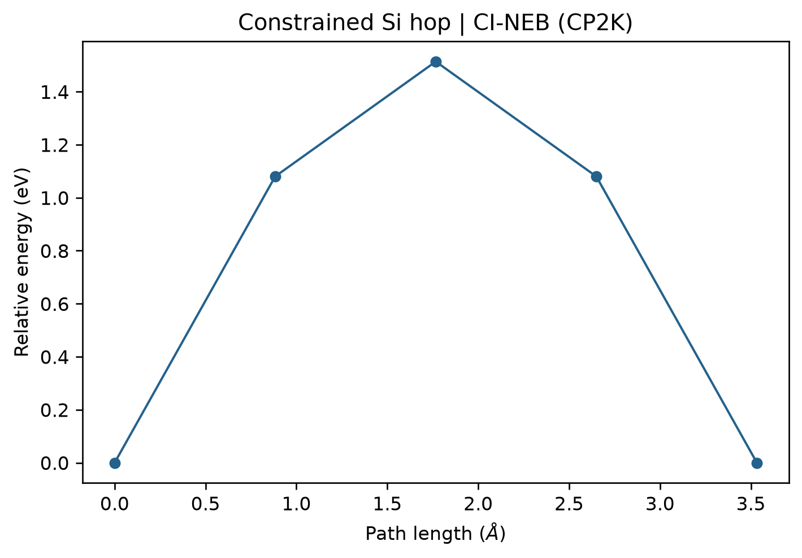

# CP2K CI-NEB 过渡态搜索

**适用环境：Windows、macOS、Linux（准备结构与绘图）；Linux + PBS（CP2K）。**

CP2K 的 `RUN_TYPE BAND` 可计算 NEB 路径。这里固定六个硅背景原子，让一个原子在两个局部能谷之间迁移，用小模型演示端点优化、周期路径处理和 CI-NEB。

## 输入与提交

案例提供 [initial.xyz](../../../examples/cp2k/minimal/neb/initial.xyz)、[final.xyz](../../../examples/cp2k/minimal/neb/final.xyz)、[endpoint.inp](../../../examples/cp2k/minimal/neb/endpoint.inp)、[cp2k.inp](../../../examples/cp2k/minimal/neb/cp2k.inp)、[run.py](../../../examples/cp2k/minimal/neb/run.py)、[job.pbs](../../../examples/cp2k/minimal/neb/job.pbs) 和[后处理脚本](../../../examples/cp2k/minimal/neb/postprocess.py)。Python 依赖见 [requirements.txt](../../../examples/cp2k/minimal/neb/requirements.txt)。

电子结构骨架可先用 [Multiwfn](../基础与准备/用Multiwfn生成CP2K输入文件.md) 准备，再设置 BAND 段。本例采用 PBE、DZVP-MOLOPT-SR-GTH、Γ 点及对角化和电子展宽；晶胞固定为 5.43 Å 的立方胞。基组与势由 CP2K 安装数据目录提供，不随案例分发。

加载 CP2K、MPI 和 Python 环境后，在工作目录提交：

```bash
qsub job.pbs
```

本例使用五个 MPI 进程和 `NPROC_REP=1`，每个副本一个进程。CP2K 的 `NUMBER_OF_REPLICA=5` **包含两个端点**，与 VASP `IMAGES=3` 只计中间点的含义不同。更多并行资源应与副本分组一起调整。

## 端点和周期路径

`run.py` 先用 `GEO_OPT` 分别优化两个端点，固定原子为 `MOTION/CONSTRAINT/FIXED_ATOMS` 中的 `2..7`。确认优化收敛后，脚本读取最终结构，借助 ASE 的最小映像处理将末态放到与初态相邻的周期映像，写出 `replica-00.xyz`、`replica-04.xyz`。

同一周期构型可以有不同的坐标表示，若未先处理映像，直接插值就可能跨过更长的晶胞路径。本例用最小映像选择相邻表示；多原子协同迁移、绕行或原子交换等过程，还需根据目标通道判断路径是否合适。

本例只在输入中列出两端的 `REPLICA`，CP2K 原生插值补齐其余副本。2026.2 补齐缺少的副本时，采用最大间隔迭代二分，不保证任意副本数都等距；需要指定中间锚点位置时，可显式提供全部副本，见[初始插点与路径检查](CP2K的NEB初始插点与路径检查.md)。完整初始路径和原子顺序仍需检查，尤其要避免插值造成原子重叠。

## BAND 参数

```text
&BAND
  BAND_TYPE CI-NEB
  NUMBER_OF_REPLICA 5
  NPROC_REP 1
  K_SPRING 0.05
  ALIGN_FRAMES FALSE
  ROTATE_FRAMES FALSE
  &CI_NEB
    NSTEPS_IT 0
  &END CI_NEB
  # 优化器、约束、收敛条件与 REPLICA 见完整输入
&END BAND
```

周期晶体在共同晶胞中比较，本例关闭整体平移对齐和旋转。`NSTEPS_IT=0` 让这个已知简单路径从首个优化步采用爬坡；复杂路径通常应先用普通 NEB 预收敛，再启用爬坡。

输入还设置了力和位移阈值，以及 `OPTIMIZE_END_POINTS FALSE`。不要只看程序正常结束，应确认 BAND 自身收敛及每个副本的电子计算状态。参数定义见 [BAND 手册](https://manual.cp2k.org/trunk/CP2K_INPUT/MOTION/BAND.html)。

## 提取和查看结果

`neb-BAND1.out` 至 `neb-BAND5.out` 保存各副本的电子计算，`neb-pos-Replica_nr_*-1.xyz` 保存路径结构。后处理检查 BAND 收敛、各副本 SCF 以及六个固定原子是否保持不动。

本例 CP2K 2026.2 的 `neb-1.ener` 第一列为步数，随后为五个能量和四段相邻距离。能量单位是 Hartree，距离是 Bohr；脚本换算后生成 `neb-profile.dat`，再由 [plot.py](../../../examples/cp2k/minimal/neb/plot.py) 绘图。



曲线来自本例五个副本，按初态能量置零。该小胞和固定背景用于学习受约束路径，真实材料势垒还需测试超胞、采样、基组、网格和周围原子弛豫。

已有结果时执行 `python3 postprocess.py` 可重新检查与绘图，无需重算电子结构；`python3 plot.py` 只重画图。识别完整过渡态还需检查最高点构型及振动模式，不能把任意一条路径的最高点自动当作目标反应的过渡态。

NEB 投影力、爬坡副本及一阶鞍点的关系见[过渡态搜索与路径验证](../../计算化学/过渡态搜索与路径验证.md)。本例固定背景原子，验证结论应限于相应自由度；将路径最高构型用于进一步频率分析时，需明确哪些约束仍保留。
