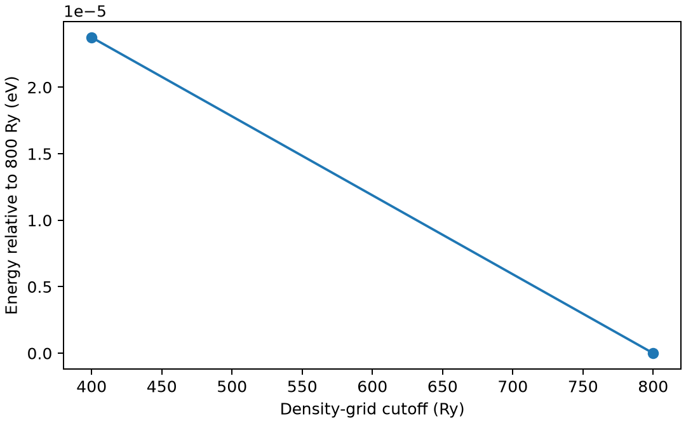

# CP2K GAPW 全电子计算

**适用环境：Linux + PBS 运行计算；Windows / macOS / Linux 可准备输入与分析结果。**

如果要分析近核电子密度，先检查输入是否显式处理芯电子。仓库的赝势水分子单点只计算价电子，提高密度网格截断仍是在细化这个模型。下面切到全电子 GAPW，让水分子的 10 个电子都进入计算，再用同一份结构比较两个网格。

## 一、从赝势 GPW 切换到全电子 GAPW

GPW 常配合平滑赝势，用高斯轨道与辅助平面波网格处理电子结构；GAPW 进一步用原子中心处理恢复核区密度的细节。选择全电子模型还必须同时使用全电子基组和 `ALL` 核势，不能只改 `QS/METHOD`。

全电子与赝势模型的绝对能量零点和芯电子贡献不同。应比较各自一致模型下的目标能量差、结构或性质，而不是把水分子的两个原始总能直接相减解释成化学效应。

## 二、用水分子比较两个密度网格

以中性水分子为例，PBE、`DZVP-ALL`、`POTENTIAL ALL`，显式计算 10 个电子。晶胞 10 Å、非周期泊松边界，分别采用 400 与 800 Ry 辅助密度网格，`REL_CUTOFF 80`；结构与其他参数保持一致。

对比 [400 Ry 输入](../../../examples/cp2k/minimal/gapw-all-electron/grid400.inp)与 [800 Ry 输入](../../../examples/cp2k/minimal/gapw-all-electron/grid800.inp)，只有 `MGRID/CUTOFF` 变化，两者共用 [structure.xyz](../../../examples/cp2k/minimal/gapw-all-electron/structure.xyz)。[run.py](../../../examples/cp2k/minimal/gapw-all-electron/run.py) 按 [stages.json](../../../examples/cp2k/minimal/gapw-all-electron/stages.json) 顺序运行两份输入。

## 三、配套设置方法、基组与核势

加载 CP2K，确保安装数据目录可找到所需基组与势文件，必要时设置 `CP2K_DATA_DIR`；`CP2K_EXEC` 指定程序。本例单进程、单线程顺序计算，数据文件不随案例分发。

| 设置 | 作用 |
| --- | --- |
| `QS/METHOD GAPW` | 选择密度表示方法 |
| `BASIS_SET_FILE_NAME BASIS_SET` | 本例全电子基组的数据文件 |
| `POTENTIAL_FILE_NAME POTENTIAL` | 安装中相应核势定义 |
| `KIND/BASIS_SET DZVP-ALL`、`POTENTIAL ALL` | 二者配套，不沿用 GTH 价电子势 |
| `EPS_DEFAULT/EPS_SCF` | 积分与电子求解精度，独立于网格 |

紧的芯区函数可能使 SCF 和数值积分比同规模赝势任务昂贵，小例不宜一开始大规模并行。

在干净案例目录安装[Python 依赖](../../../examples/cp2k/minimal/gapw-all-electron/requirements.txt)并提交：

```bash
python3 -m pip install -r requirements.txt
qsub job.pbs
```

PBS 中的资源语法和软件加载方式按集群调整。计算结束后自动执行后处理；若只分析已保存的结果，运行 `python3 postprocess.py`。各阶段独立保存输出，便于定位失败步骤。

## 四、总能接近，还要检查哪些量

后处理确认每个分支电子数为 10、SCF 收敛且正常结束，再比较能量与受力。图给出两种网格相对于 800 Ry 的能量变化。

按 `results.json` 中的减法顺序，$E_{800}-E_{400}$ 约为 −2.37×10⁻⁵ eV。图以 800 Ry 为零点，所以 400 Ry 点在零线上方。受力以 Hartree/Bohr 保存；若关心结构优化，接着按原子和方向比较力分量的变化。

这两个网格点展示了测试方法。总能差很小之后，仍需分别检查受力和核区响应；核谱或磁响应的目标精度不能仅由总能变化判断。



[后处理脚本](../../../examples/cp2k/minimal/gapw-all-electron/postprocess.py)从各阶段的实际输出提取末次能量和受力。

## 五、扩展到实际研究

实际任务还需测试全电子基组、原子网格与 GAPW 特定容差。核相关谱学是否可用、是否包含所需相对论和响应效应，需查对应模块；GAPW 全电子本身不能替代专门的性质方法。用 Multiwfn 建输入后，仍应逐项核对方法、势与基组。

选择模型前可按[赝势与全电子的配套检查](../../计算化学/赝势与全电子模型的配套检查.md)核对电子数与近核性质，再按[基组收敛](../../计算化学/基组收敛与完备基组外推.md)区分轨道空间与网格精度。

导出密度用于后处理时，还要区分硬、软密度与近核积分；补芯密度不等于重新得到芯轨道或响应，见[补芯与近核分析](../../计算化学/赝势密度、补芯与近核分析.md)。

参考：[CP2K QS/GAPW 参数](https://manual.cp2k.org/trunk/CP2K_INPUT/FORCE_EVAL/DFT/QS.html)。
