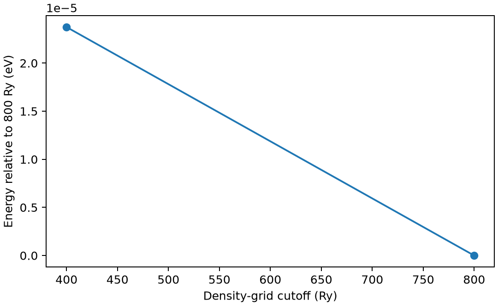

# CP2KGAPW 全电子计算

**适用环境：Linux + PBS 运行计算；Windows / macOS / Linux 可准备输入与分析结果。**

GAPW 将核附近的快速变化密度与较平滑部分分开处理，使 CP2K 能进行相应全电子计算。GAPW 与 GPW 的区别涉及密度表示，单独提高 GPW 截断能不能替代这一方法。

## 方法与物理量

GPW 常配合平滑赝势，用高斯轨道与辅助平面波网格处理电子结构；GAPW 进一步用原子中心处理恢复核区密度的细节。选择全电子模型还必须同时使用全电子基组和 `ALL` 核势，不能只改 `QS/METHOD`。

全电子与赝势模型的绝对能量零点和芯电子贡献不同。应比较各自一致模型下的目标能量差、结构或性质，而不是把水分子的两个原始总能直接相减解释成化学效应。

## 最小模型与输入

以中性水分子为例，PBE、`DZVP-ALL`、`POTENTIAL ALL`，显式计算 10 个电子。晶胞 10 Å、非周期泊松边界，分别采用 400 与 800 Ry 辅助密度网格，`REL_CUTOFF 80`；结构与其他参数保持一致。

[案例目录](../../../examples/cp2k/minimal/gapw-all-electron)包含以下科学输入：

[grid400.inp](../../../examples/cp2k/minimal/gapw-all-electron/grid400.inp)、[grid800.inp](../../../examples/cp2k/minimal/gapw-all-electron/grid800.inp)、[stages.json](../../../examples/cp2k/minimal/gapw-all-electron/stages.json)、[structure.xyz](../../../examples/cp2k/minimal/gapw-all-electron/structure.xyz)。

结构写在坐标文件或各输入的原子/晶胞段；`stages.json` 列出计算阶段。配套 [run.py](../../../examples/cp2k/minimal/gapw-all-electron/run.py) 顺序组织任务，[job.pbs](../../../examples/cp2k/minimal/gapw-all-electron/job.pbs) 提交作业，[postprocess.py](../../../examples/cp2k/minimal/gapw-all-electron/postprocess.py) 检查结果并绘图。

## 参数与提交

加载 CP2K，确保安装数据目录可找到所需基组与势文件，必要时设置 `CP2K_DATA_DIR`；`CP2K_EXEC` 指定程序。本例单进程、单线程顺序计算，数据文件不随案例分发。

| 设置 | 作用 |
| --- | --- |
| `QS/METHOD GAPW` | 选择密度表示方法 |
| `BASIS_SET_FILE_NAME BASIS_SET` | 本例全电子基组的数据文件 |
| `POTENTIAL_FILE_NAME POTENTIAL` | 安装中相应核势定义 |
| `KIND/BASIS_SET DZVP-ALL`、`POTENTIAL ALL` | 二者配套，不沿用 GTH 价电子势 |
| `EPS_DEFAULT/EPS_SCF` | 积分与电子求解精度，独立于网格 |

紧的芯区函数可能使 SCF 和数值积分比同规模赝势任务昂贵，小例不宜一开始大规模并行。

在干净案例目录安装[Python 依赖](../../../examples/cp2k/minimal/gapw-all-electron/requirements.txt)并提交：

```bash
python3 -m pip install -r requirements.txt
qsub job.pbs
```

PBS 中的资源语法和软件加载方式按集群调整。计算结束后自动执行后处理；若只分析已保存的结果，运行 `python3 postprocess.py`。各阶段独立保存输出，便于定位失败步骤。

## 结果与判断

后处理确认每个分支电子数为 10、SCF 收敛且正常结束，再比较能量与受力。图给出两种网格相对于 800 Ry 的能量变化。

本例 800 与 400 Ry 的能量差约 −2.37×10⁻⁵ eV；受力也由脚本保存，可进一步比较分量。

两个网格点只展示测试思路，不足以证明能量、力和核区响应全部收敛。也不应由总能几乎不变就认定核谱或磁响应精度已经满足。



图由案例后处理脚本读取实际计算输出生成。

## 扩展到实际研究

实际任务还需测试全电子基组、原子网格与 GAPW 特定容差。核相关谱学是否可用、是否包含所需相对论和响应效应，需查对应模块；GAPW 全电子本身不能替代专门的性质方法。用 Multiwfn 建输入后，仍应逐项核对方法、势与基组。

参考：[CP2K QS/GAPW 参数](https://manual.cp2k.org/trunk/CP2K_INPUT/FORCE_EVAL/DFT/QS.html)。
