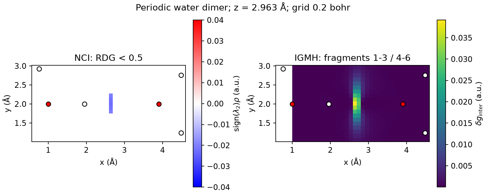

# CP2K 周期 NCI 与 IGMH 的边界和网格

**适用环境：已有 CP2K 和 Multiwfn 的 Windows、macOS、Linux；配套命令使用 Bash。**

看晶体中的接触区，需要同时保留电子密度的周期定义和恰当的显示范围。裁掉重复图像可以让图更清楚，但计算这些场时仍要采用正确的晶胞与周期边界。

## 按手里的数据选择分析

| 输入与问题 | 合适路线 | 需要核对 |
| --- | --- | --- |
| 只有晶体结构，初步看接触位置 | 准分子 NCI、IGM 或 mIGM | 几何、周期邻居、经验原子密度；不能据此声称包含体系真实的电荷重排 |
| 有周期波函数，分析密度与曲率 | NCI/RDG | 晶胞、赝势、密度梯度与 Hessian、网格和筛选条件 |
| 有周期波函数，只突出两个片段的接触 | IGMH | 上述信息及明确的片段定义、跨胞原子归属 |

基本方法与读图见[弱相互作用可视化](../../计算化学/弱相互作用可视化的方法选择与读图.md)、[RDG 网格与筛选](../../计算化学/NCI与RDG的网格、筛选和散点图.md)和[IGMH 片段分析](../../计算化学/Multiwfn的IGMH片段分析.md)。不同指标各有用途，不能只根据图面是否连续来决定方法优劣。

## 从 CP2K 输出到正确读入

按[波函数输出说明](CP2K波函数输出与Multiwfn分析.md)生成 Molden。CP2K 2026.2 的 `WRITE_CELL T`、`WRITE_PSEUDO T` 可以写入元数据；仍要在读取端检查三条晶胞矢量、单位、显式电子数和总电荷。

本例使用 `8 Å` 立方盒中的中性水二聚体，O `q6`/H `q1`，应有 16 个显式电子、总电荷 0。Multiwfn 2026.7.15 的本机构建会读取其 `[Cell]`，但未将这个 CP2K 文件的 `[Pseudo]` 应用于核电荷，显示 `+4`。在分析副本前部、`[GTO]` 之前补入：

```text
[Nval]
O 6
H 1
```

再载入，应显示 O 有效核电荷 6、16 个显式电子和总电荷 0。这是本例的映射；同一元素有不同芯大小时，应使用读取器支持的逐原子设置。不能为了触发 ORCA 专属读取规则给 CP2K 文件伪造来源标签。配套 [prepare.py](../../../examples/cp2k/minimal/periodic-response/prepare.py)检查实际 `[Pseudo]` 后生成副本，保留原始导出。

赝势轨道密度不含被消去的芯电子；程序的近似补芯应按功能和输出核对，见[赝势密度与近核分析](../../计算化学/赝势密度、补芯与近核分析.md)。本例读入正确有效核电荷后，自动加载两个 O 各 2 个芯电子的 EDF；后面的密度场是在此近似补芯设置下生成。它不把赝势波函数变成全电子波函数。

Γ 点 Molden 与 k 点复轨道是不同接口。如果目标分析只支持 Γ 点，应建立合适超胞并测试采样，而不是将小原胞直接改成 Γ 点。基组、CP2K 截断和 SCF 收敛后，还需分别测试 Multiwfn 的周期图像求和范围与实空间网格；一个参数的收敛不能覆盖其他误差。

## 固定边界，单独控制绘图盒子

RDG 由密度及梯度构造，着色量 \(\operatorname{sign}(\lambda_2)\rho\) 还用到密度 Hessian。关闭某个方向的周期求和会改变场值及其导数；缩小 Cube 盒子则只减少采样位置。两者不能当成等价的“去重影”按钮。

保留模型对应的三维周期性后，可在 Multiwfn 中选择局部盒子，或生成网格后裁剪显示。若研究对象确实具有表面或孤立方向，则应先改变计算模型与边界条件，再采用匹配的后处理。

记录网格原点、三条步进矢量、点数和单位。手工盒子的坐标/步长常按 Bohr 输入；`8 Å ≈ 15.117809 Bohr`。非正交晶胞应使用实际晶格和 Cube 步进矢量，不能只取三条边长拼成正交盒子。用于等值面和着色的两个网格必须完全对齐。

## 周期水二聚体的局部场

[案例](../../../examples/cp2k/minimal/periodic-response/README.md)从同一自建波函数计算 NCI 和两片段 IGMH，并提供 `0.3`、`0.2 Bohr` 的局部网格。片段 `1–3` 和 `4–6` 分别是一个水分子，避免把分子内共价键混入片段间图。



左图只显示 `RDG < 0.5` 的点，颜色为 \(\operatorname{sign}(\lambda_2)\rho\)；右图为 \(\delta g_{\mathrm{inter}}\) 的同平面切片，两者展示的不是同一标量。图中白区包括网格外区域和被筛掉的点，不能解释为该处没有电子密度。

把粗网格原点沿 x 平移一个晶胞，保持波函数和周期求和设置，导出的 RDG、着色场和片段间 IGMH 数值在当前 Cube 打印精度下逐点一致。这个检查验证了平移和网格对应，不能代替周期图像截断、基组与网格收敛。本模型的默认图像范围仍有小晶胞提示，定量工作要逐项测试求和范围。

## 筛选和颜色怎样解释

高密度阈值可能将 RDG 设成很大的占位值，等值面因此被排除；这不是原始 RDG 真有相应的巨大值。保留未进一步遮罩的导出网格、阈值和日志，再为展示单独生成掩膜。几何范德华重叠筛选、密度筛选与删除正着色区域各有不同含义，应分别记录并检查目标等值面和积分。

负的 \(\operatorname{sign}(\lambda_2)\rho\) 描述局部曲率特征，不是跨体系通用的吸引能刻度。离子接触、氢键和色散接触不能仅凭同一色标的深浅排强弱；正值区域也不能直接积分成 Pauli 排斥能。删除一种颜色只改变显示内容，不能证明相应物理效应不存在。
