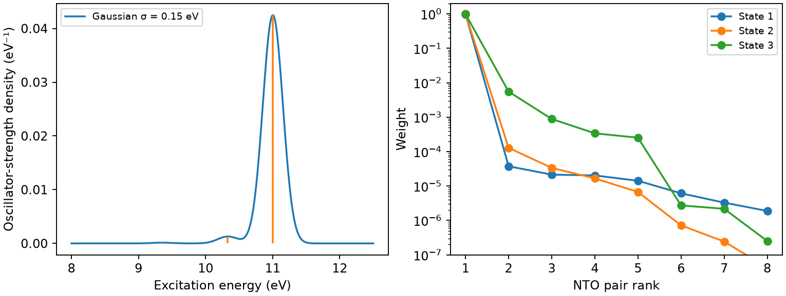

# CP2K 周期激发、跃迁系数与 NTO

**适用环境：已有 CP2K、Multiwfn 和 Python 科学计算依赖的 Windows、macOS、Linux；配套命令使用 Bash。**

周期体系的离散激发能、展宽谱、NTO 和空穴—电子图回答不同问题。先保证它们来自同一结构、晶胞、基组和轨道空间，再把谱峰与空间分布联系起来。孤立分子入门见[CP2K 电子激发态](CP2K电子激发态.md)。

## FULL 响应核与 TDA 是两个层次

这里按 CP2K 2026.2 的 Γ 点 TDDFPT 路线讨论。`KERNEL FULL` 保留所选模型的完整响应核，区别于 `NONE` 的独立粒子近似或 `STDA` 简化核；其响应方程仍采用 Tamm–Dancoff 近似（TDA）。它不等于恢复完整 TDDFT 的激发—退激发耦合。TDA 会影响能量和强度，不能把不同程序的差异一律归为振子强度相差二倍。

当前版本也有受限的 k 点 `KERNEL NONE` 路线，要求复波函数，并对偶极计算及可用分析功能施加限制；不能把它当作本篇 FULL 核、普通 Γ 点 Molden 的直接替换。实际 k 点能力见[CP2K 方法说明](https://github.com/cp2k/cp2k/blob/master/docs/methods/properties/optical/tddft.md)及所用版本手册。Γ 点超胞方案还要检查晶胞大小和采样，不能仅因计算能启动就认定描述了体相激子。

## 五个容易混淆的空间与阈值

| 设置 | 控制什么 | 怎样检查 |
| --- | --- | --- |
| `SCF/ADDED_MOS` | 对角化 SCF 中额外求出的空轨道 | 实际可用轨道数与 SCF 算法 |
| `MO_MOLDEN/NLUMO` | 导出到波函数文件的空轨道数 | 文件内真实系数，不能用零占位轨道补齐 |
| `TDDFPT/NLUMO` | 响应方程考虑的空轨道空间 | 对激发能、强度和态成分的收敛 |
| `NSTATES` | 请求的响应根数 | 最大激发能是否覆盖目标能窗 |
| `MIN_AMPLITUDE` | 文本中打印的最小跃迁幅度 | 保留系数的范数、最大虚轨道编号与空间分析稳定性 |

`MIN_AMPLITUDE` 不会缩小实际响应方程，却可能让后处理丢失很多小项。2026.2 默认值为 `0.05`，适合看主要成分，定量 NTO/空穴—电子分析通常需更低阈值。固定用 `0.001` 也不是普适保证：大体系可能有大量小幅度项，应累加遗漏量的影响并继续降低阈值比较。

完整示例输入见[周期响应案例](../../../examples/cp2k/minimal/periodic-response/cp2k.inp)。它导出所有 46 个轨道，用三个单重根、`MIN_AMPLITUDE 10⁻⁶` 演示系数核对。参数含义见[TDDFPT 手册](https://manual.cp2k.org/cp2k-2026_2-branch/CP2K_INPUT/FORCE_EVAL/PROPERTIES/TDDFPT.html)。

## 波函数必须与响应系数配套

保存同一次作业的 CP2K 输出和 Molden，按[周期边界与元数据检查](CP2K周期NCI与IGMH的边界和网格.md)核对晶胞、赝势、电荷和电子数。系数表里的最高虚轨道编号必须在波函数中具有真实系数。

如果改了泛函、几何、基组或对角化设置后重新生成一份 Molden，即使轨道编号范围相同，也不能直接配旧跃迁表。轨道次序、相位以及近简并空间中的旋转都可能改变。需要重新获得匹配的响应系数，或做有依据的轨道空间变换；只比较几个轨道能量相近不足以证明兼容。

本例 CP2K 闭壳层单重态表以 \(\sum_{ia}X_{ia}^2\approx1\) 打印；Multiwfn 为统一内部约定将幅度除以 \(\sqrt2\)，相应范数为 0.5。比较不同程序前先核对这一约定，不能把它当成丢了一半电子或分析出错。

## NTO 是对一个跃迁矩阵的压缩

在正交的占据/虚轨道基底中，对 TDA 跃迁幅度矩阵作奇异值分解：

\[
X=U\Sigma V^{\mathrm T},\qquad w_k=\sigma_k^2.
\]

\(U\) 和 \(V\) 分别给出空穴端、电子端 NTO 的轨道组合。权重之和对应采用约定下的跃迁矩阵范数；要报百分比时明确是否按总权重归一化。保留前 k 对时，遗漏的平方范数是其余 \(w_k\) 之和。

一对权重接近 1 表示可用一对轨道近似这个跃迁；多对权重显著通常反映多通道、对称性或简并，不能据此认为 NTO 失效。近简并对之间的轨道图可能随旋转改变，应比较合计权重和子空间。导出 NTO 文件的 `Energy`/`Ene` 栏常保存 NTO 权重，不是基态 Kohn–Sham 能量，不能拿去画原来的 DOS。

在 Multiwfn 中载入匹配的周期波函数，进入 `18 → 6`，提供 CP2K 输出并选态，可保存 NTO 波函数。本例第一态的原生导出权重与独立 SVD 最大差约为 `2.9×10⁻¹⁰`。

### NTO 权重不是振子强度的百分比

NTO 权重描述跃迁矩阵平方范数怎样分配。第一对占归一化权重的 99%，是否就贡献了 99% 的振子强度？并非如此：跃迁偶极还包含每对 NTO 的算符矩阵元，振幅需按相容相位相加，强度再由总偶极的模方得到。

对于相互抵消的弱跃迁，小权重通道也可能产生明显的相对影响。因此选择保留多少对 NTO 时，同时检查权重残差和目标跃迁性质。基本思想见[原始研究](https://doi.org/10.1063/1.1558471)。

NTO 的编号随所分析的电子态和导出器排序而变，不等于原 HOMO/LUMO 编号。同样标为第一对的两个激发也可能有完全不同的空间性质；比较态时核对能量、自旋、对称性和空间特征。NTO 的权重字段不提供原正则轨道本征能，若需讨论算符期望值应另行定义，不能以两个 NTO 字段之差作为激发能。

对完整 TDDFT、开壳层或自旋翻转过程，先确认分解的是哪一跃迁矩阵、激发/退激发幅度组合及自旋块；平方系数乘二等规则不能跨程序照搬。多对权重显著时，可保留主要对与整个子空间，同时用空穴—电子密度作汇总；后者便于展示总体分布，但并未让多通道的轨道与相干信息失去意义。

## 激发类型按不同维度分别指认

π→π*、n→π* 等标签描述主要轨道特征，局域激发（LE）与电荷转移（CT）描述空穴、电子分布的相对位置。两套标签可以同时使用：π→π* 既可能是 LE，也可能是 CT。LE 也可以覆盖整个共轭片段，并不要求局限在一个原子附近。对表面—吸附物或金属—配体模型，先定义片段，再结合主要 NTO 对、空穴/电子分布和片段指标判断混合程度；不设一个通用的轨道贡献或质心距离阈值强行二分。

对有限簇、带真空的 slab 或孔道模型，电子端分布弥散时，检查它位于材料、孔隙还是模型外部，并改变基组弥散程度及相关边界尺寸作比较。分子 Rydberg 态需要足够的弥散基组描述，见 [ORCA 方法说明](https://www.faccts.de/docs/orca/6.1/manual/contents/spectroscopyproperties/tddft.html#valence-versus-rydberg-states)；周期材料中的真空态、表面态或延展导带则按各自模型辨认，不能只凭形状都叫作 Rydberg 态。删去弥散函数可能改变态能和排序，不等于物理上消除了这类激发；比较基组后仍需跟踪同类态。

## 从有限共轭链外推到周期材料时检查什么

研究链长依赖时，先固定端基、几何优化条件、电子态及环境。用对称性、偏振和 NTO/跃迁子空间跟踪同一类激发；链长增加后根的能量排序可能改变，不能一直比较名为 S1 或第七根的态，就认为它们具有相同性质。最强吸收带、最低亮态、最低激发态与 Kohn–Sham 能隙也分别定义。

有限链两端与中部的键长交替、局部电子态和响应可以不同，应保存逐键或逐区域结果，检查中部是否随链长收敛。选定几个短链得到很高的拟合 R²，不足以确定无限链极限；比较有物理依据的外推形式、改变拟合长度范围，并保留更长链作为独立检查。一个额外长度吻合只验证该点附近的预测，拟合残差与无限长外推的不确定性分别报告。对波长拟合再取倒数，与直接对激发能拟合，采用了不同误差模型，也应检验其敏感性。

环、链或超胞序列出现奇偶振荡、对称性变化或换态时，先按实际电子结构分组，不把不同分支强行拟合成一条光滑曲线。二次多项式的极大值只表示拟合曲线在有限自变量处转向；只要高次项系数非零，它就不会在尺寸趋于无穷时收敛到该极大值。需要有限极限的物理量，应采用具有相应渐近行为且经过验证的模型，而不是用曲线峰顶代替无限尺寸极限。

有限分子的总振子强度可以随链长增长，转为周期材料比较时需明确每重复单元或相应体积的归一化、偏振及响应定义。再以相容的周期模型检查晶格参数、键长交替、磁态、k 点与目标光学量，区分分子边界消失和电子响应模型变化。孤立链的外推吸收峰不自动等于体相吸收边、准粒子带隙或实验颜色；晶间耦合、介电环境、激子与振动效应需按所研究材料处理。

## 一个固定周期模型的结果

自建水二聚体置于 `8 Å` 立方周期盒，Γ 点、PBE/DZVP-MOLOPT-SR-GTH、O `q6`/H `q1`；计算条件和完整重建命令见[案例说明](../../../examples/cp2k/minimal/periodic-response/README.md)。

| 态 | 激发能 / eV | 振子强度 | 第一对 NTO 权重 |
| --- | --- | --- | --- |
| 1 | 9.35049 | 0.0000536535 | 0.999894 |
| 2 | 10.33149 | 0.000485409 | 0.999814 |
| 3 | 11.00357 | 0.0159781 | 0.992975 |

展宽采用面积归一化的能量域高斯，标准差 `σ=0.15 eV`，`FWHM=2√(2 ln 2)σ`；纵轴为振子强度密度。紧凑基组、三个根和人工固定周期盒只用于演示接口及后处理，不能据此给液态水或材料指定定量吸收边。

## 从离散根到光谱和空间图

能量与波长满足 \(\lambda/\mathrm{nm}\approx1239.841984/(E/\mathrm{eV})\)。若把能量域的谱密度变为波长域且要求保持面积，应乘 \(|dE/d\lambda|\)，不能只换横轴标签；选择“在波长域重新展宽”则是另一种核定义。说明展宽变量、宽度定义、归一化和偏振分量。重叠根共同形成的峰顶，不一定等于某个离散根的能量。

比较不同超胞、原胞或方向时，应明确强度按晶胞、体积还是化学单元归一化，并采用相同偏振和能窗。每胞振子强度的原始数值不能直接作为不同大小模型的强弱排名。有限根数的谱也不满足全能域求和；混合泛函可能改变态的排序和性质，不能默认把所有 PBE 根统一平移就得到正确谱。

Multiwfn 的 `18 → 1` 可分析所选态的空穴、电子和跃迁密度，要求同一响应数据及覆盖完整轨道的波函数。空穴/电子描述该跃迁的两端；TDA 未弛豫的电子减空穴密度不等于重新优化并弛豫后的激发态—基态密度差。跃迁密度也不是电子减空穴密度，其整体相位任意，不能按正负直接当作电子增减。

若电子与空穴跨越晶胞边界，直接用包裹坐标计算质心距离会产生人为跳变。需要明确周期拼接、参考原点、片段和适用的周期描述符，并检查跨边界平移后的解释。轨道图、NTO 权重和静态电荷转移指标也不直接给出激发态布居、寿命或传输速率。

同一波函数的原生空穴、电子网格和 NTO 重建见[后处理案例](../../../examples/multiwfn/excitation-analysis/README.md)。片段净收支不能唯一确定成对转移通道；跨晶胞的质心指标还需检查周期拼接。
