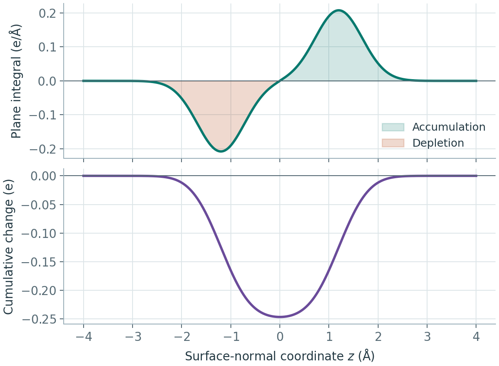

# CP2K 密度差与平面曲线

**适用环境：Windows、macOS、Linux（准备输入与分析）；CP2K 计算在已配置的本机或 Linux 集群运行。打印项按 2026.2 分支手册说明。**

以表面 A 吸附分子 B 为例，先得到同一几何下的 \(\rho_{AB}\)、\(\rho_A\)、\(\rho_B\)，再求密度差。三维图用于定位变化，沿表面法向的曲线用于比较不同层的重排。定义、单位和积分关系见[密度差与电荷位移](../../计算化学/密度差、平面平均与电荷位移.md)。

## 准备整体与片段参考

1. 完成目标模型的结构优化，取最终结构、晶胞及边界设置，另建三个单点工作目录。若需平移体系以便显示，三个参考采用同一平移；平移后重新核对网格原点。
2. AB 保留全部原子；A 仅删除吸附分子，B 仅删除表面原子。保留剩余原子在整体中的位置及原来的晶胞，不分别弛豫或为片段重新生成一个小盒子。
3. 按参考态分别设置净电荷和自旋。等电子数相减需满足 \(N_{AB}=N_A+N_B\)；金属表面、开壳层片段或人为带电参考还需说明占据与展宽方案。孤立原子和周期子晶格的密度通常不同。
4. 保持交换相关模型、主基组与赝势、网格、静电边界、外场、k 点及有关数值近似一致，逐个确认 SCF 收敛。不同原子数的片段使用相容的初猜，不直接读取整体波函数充作片段波函数。

可用 [Multiwfn 生成输入](../基础与准备/用Multiwfn生成CP2K输入文件.md)，但删除原子后仍要检查电荷、自旋与 KIND 对应关系。含真空的三维周期 slab 与真正二维静电边界是不同模型，三个计算采用同一种选择。

局域 Gaussian 基组随片段删除也会改变可用 AO 空间。需要区分密度重排与基组影响时，可另设计相同基组空间的片段对照，并明确鬼原子和赝势处理；密度差图本身不是相互作用能的 Counterpoise 校正。

## 输出电子密度 Cube

在每个任务的 `&DFT` 内合并以下打印段，给三个任务不同 `PROJECT` 或分目录保存，避免相互覆盖：

```text
&PRINT
  &E_DENSITY_CUBE ON
    STRIDE 1 1 1
  &END E_DENSITY_CUBE
&END PRINT
```

`STRIDE 1 1 1` 请求逐网格点输出；默认步进通常为 `2 2 2`。较细输出会明显增加文件和 I/O，应根据需要的密度分辨率测试，而非只追求小文件。`CUTOFF`、`REL_CUTOFF` 相同仍需核对最终 Cube：原子、基组和自动网格选择可能影响实际网格，不能仅凭三个输入中写了相同数字就开始相减。

GPW 配合赝势时，输出是价电子密度，积分检查使用显式价电子数。GAPW 还涉及 `DENSITY_INCLUDE`：默认 `TOTAL_HARD_APPROX` 近似处理硬密度，`SOFT_DENSITY` 只给软部分，`TOTAL_DENSITY` 的高频硬密度可能受到有限网格截断而出现尖峰。三份参考使用同一种定义，跨 GPW/GAPW 比较也先对齐所讨论的密度。选项见[E_DENSITY_CUBE 手册](https://manual.cp2k.org/cp2k-2026_2-branch/CP2K_INPUT/FORCE_EVAL/DFT/PRINT/E_DENSITY_CUBE.html)。

自旋极化任务还可能输出自旋密度。检查 Cube 注释、文件名称与积分，确认加载的是总电子密度还是自旋差，不把两种文件相减。电子密度、静电势和轨道值也不能仅按扩展名混用。

## Multiwfn 中相减并保存

先核对三份 Cube 的原点、网格点数、三个步进向量与单位，再进行网格运算。可在工作目录将三份单场密度副本命名为 `AB.cub`、`A.cub`、`B.cub`，在 Multiwfn 中操作：

1. 载入 `AB.cub`，进入主功能 `13` 的网格处理。
2. 进入网格运算菜单 `11`，选择减去另一网格，读入 `A.cub`；再减去 `B.cub`。
3. 将当前网格导出为 `EDD.cub`，保留原始三份参考不变。菜单编号按版本提示确认。

检查 \(\int\Delta\rho\,dV\) 是否等于预期电子数差，并抽查若干网格点的差值。画等值面时正负采用相同绝对阈值，说明颜色与单位。吸附物内部极化、成键区积累和表面重排应结合结构一起解释，不只从某个原子附近的一块颜色推断净转移量。

## 平面平均、截面积分与累计积分

若表面平行 xy、网格的第三向量沿 z，载入 `EDD.cub` 后进入网格处理的曲线功能，常见入口为 `13 → 18`。选择 `Z`，按实际范围设置积分区间，再分别选择平面平均、局部积分和积分曲线。起点应与图中所定义的真空区或分界基准一致。

导出 `pleavgcurve.txt`、`locintcurve.txt`、`intcurve.txt` 后，逐列核对屏幕说明。当前输出通常同时给 Bohr 和 Å 两列坐标，第三列为相应函数值；不要因选用了 Å 坐标列，就假定第三列也自动变成 Å 对应的单位。累计电子数无需长度单位换算，密度与截面积分则分别涉及长度的三次方和一次方。

斜晶胞中，先判断目标表面法向与网格向量的关系。当前 Multiwfn 对该功能有方向条件；若不满足，可在相容的正交分析网格上重新求值并验证插值误差，或使用保留晶胞几何的积分。仓库[NaCl 平面曲线脚本](../../../examples/vasp/minimal/charge-density-difference/plane_profile.py)演示了沿网格晶面法向的做法，不能把任意第三数组轴直接标为笛卡尔 Z。



示意图上方是截面积分 $A\bar{\Delta\rho}(z)$，单位为 e/Å。下方从左端累计，单位为 e。等面积的正负两瓣在积分末端抵消。

## 结果怎样比较

报告时同时给出差分定义、片段电荷和自旋、坐标方向、表面积、积分起点及分界面。横向扩胞或吸附物数目改变时，说明展示的是总累计电子数、每个分子还是单位面积结果。

如果曲线末端的积分与总电子数不符，先检查加载的物理量、单位、网格和数据完整性；如果总量守恒而局部异常，再检查坐标错位、片段参考、SCF 与网格精度。不要通过减去一个人为常数强迫闭合，以此掩盖差分错误。

需要从轨道文件重新求密度网格时，可使用[CP2K 波函数输出](CP2K波函数输出与Multiwfn分析.md)配合 Multiwfn 的同一分析网格；这样仍须核对占据、有效核电荷与周期性。三维图的阈值、势的符号和显示尺度见[结果可视化](../基础与准备/CP2K结果文件与可视化.md)。

## 加入一个电子后，它分布在哪里

研究缺陷俘获、表面还原或局域电子时，可在同一核坐标、晶胞和计算条件下，比较 N+1 与 N 电子态：

$$
\Delta\rho=\rho_{N+1}-\rho_N,
\qquad \int\Delta\rho\,dV=1.
$$

这里的 N 指显式电子数，两态的净电荷相差 −1；自旋与占据应分别按目标态设置。差值包含新增电子和原有电子的自洽弛豫，因而可以同时有正、负区域。若两态分别优化再相减，还混入结构变化；研究电子俘获与晶格弛豫耦合时，可分别列出固定几何和弛豫后的对照。

| 用来画分布的量 | 它直接描述什么 | 解读条件 |
| --- | --- | --- |
| $\rho_{N+1}-\rho_N$ | 加电子前后的净密度变化 | 核坐标和边界一致，积分为 1；包含电子重排 |
| 自旋密度 | 所用自旋定义下的不平衡分布 | 开壳层极化也有贡献；加入电子后成为闭壳层时，它可为零 |
| 选定缺陷态或能窗的密度 | 这些态在空间的权重 | 核对自旋、占据、简并、k 点及归一化；不是总密度差 |

CP2K 的静态 `MO_CUBES` 通常给轨道值，使用时确认是否需取模平方；实时任务的输出定义不同，见 [MO_CUBES 手册](https://manual.cp2k.org/cp2k-2026_2-branch/CP2K_INPUT/FORCE_EVAL/DFT/PRINT/MO_CUBES.html)。VASP 可由收敛波函数按能带或能窗生成部分密度，见 [LPARD](https://vasp.at/wiki/LPARD)。简并态可在子空间内重新组合，单个轨道图可能随表示改变，必要时比较完整目标子空间的密度。不要仅因某个 HOMO 看起来局域，就认定它唯一代表过剩电子。

### 回转半径需要一个定义清楚的非负分布

对所选非负场 f，令其积分为 W，分布中心与归一化二阶矩为

$$
W=\int f\,dV>0,\qquad
\mathbf c=\frac{1}{W}\int\mathbf r f\,dV,
\qquad
C_{ij}=\frac{1}{W}\int(r_i-c_i)(r_j-c_j)f\,dV.
$$

回转半径 $R_g=\sqrt{\operatorname{Tr}C}$，单位为长度；C 的三个本征值还可区分不同方向的扩展。积分和中心必须来自同一个 f。Multiwfn 的 `200 → 11` 可计算函数中心与矩，需先将算得的中心用于后续统计；程序打印的未归一化二阶矩与这里的 C 相差 W，不能把两种本征值混用。

密度差或自旋密度含有正负值，直接当作概率分布可能产生抵消、零分母或不合理的二阶矩。采用 $|\Delta\rho|$ 可定义“总重排范围”，采用 $\max(\Delta\rho,0)$ 则描述积累区域；两者都要重新归一化并注明定义。

为什么只取正部也不是“新增电子本身”？若耗尽部分的电子数为 q，净加入一个电子时，正部积分为 1+q，绝对值积分为 1+2q。它们包含原电子重排的贡献，不能分离出一个有独立身份的新增电子。自旋密度取绝对值时也有相同的解释边界。

周期盒子切在局域分布中央时，普通位置矩会把一团分布拆成远离的两部分。先选择连续镜像和变化可忽略的切面，再检查盒子、网格及尾部分布；体相延展态不具有这种有限局域云的唯一普通回转半径。带电超胞还需说明静电边界、补偿处理与镜像作用，区分真实束缚、周期重复和盒子限制；扩大超胞后若分布持续随盒子扩展，就不能仅凭一张等值面宣称电子已被缺陷俘获。

最终把密度分布与局域结构、自旋、能级及不同电子解的能量比较放在一起。对轨迹逐帧保持态选择和中心处理一致，再统计半径与各向异性的分布；不以单帧半径或一个可视化阈值代替局域态稳定性的判断。

### 空间范围与径向分布：先确认原点和归一化

有些程序将总电子密度的 $\int|\mathbf r-\mathbf o|^2\rho\,dV$ 输出为 electronic spatial extent 或 `⟨r²⟩`，其中没有除以总电子数。它与单电子归一化期望值、以分布中心为原点的宽度并不相同。沿用前面的非负场 f、积分 W、中心 c 与回转半径，有

$$
M_2(\mathbf o)=\int|\mathbf r-\mathbf o|^2 f\,dV
=W\left[R_g^2+|\mathbf c-\mathbf o|^2\right].
$$

因此，平移参考原点会改变 $M_2$，而以自身中心计算的 $R_g$ 不变；增加电子数或扩大结构也会增大总矩。比较不同组成、芯电子处理或超胞大小时，不能仅由总矩较大推断缺陷电子更弥散。逐原子空间矩若以各核为原点，也不能未经平移与一阶矩修正就相加成公共原点下的总矩。

对指定原点 o，定义电子场的球壳分布

$$
P_{\mathbf o}(r)=r^2\int f(\mathbf o+r\hat{\boldsymbol\Omega})\,d\Omega,
\qquad
\int_0^\infty P_{\mathbf o}(r)\,dr=W,
\qquad
M_2(\mathbf o)=\int_0^\infty r^2P_{\mathbf o}(r)\,dr.
$$

它表示各径向球壳中有多少所选场的积分量；这里的 RDF 不是 MD 中按体密度归一化的原子对关联函数 $g(r)$。即使场并非球对称，上述角积分仍有定义，但会丢掉方向信息，不能代替二阶矩的主轴分析。

查看 $r^2P(r)$ 可以定位远处尾部对空间矩的贡献。导出文件若同时含 Bohr、Å 两列径向坐标与原子单位函数值，应先统一单位再积分；横轴改为 Å 后，积分微元也随之改变，曲线面积不能原样读成 Bohr²。径向上限、盒子和网格要覆盖尾部，并检查累计积分趋近 W。对周期延展场，球壳扩展会不断包含重复晶胞，仍须遵守前述有限局域分布的适用条件。
