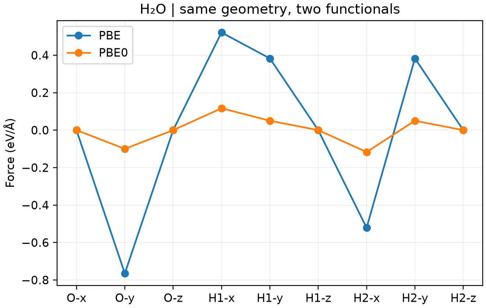

# CP2K 杂化泛函 PBE0

**适用环境：Linux + PBS（带 Libint 的 CP2K）；Windows / macOS / Linux 可绘图。**

杂化泛函把部分半局域交换替换为精确交换。PBE0 采用 25% Hartree–Fock 交换与 75% PBE 交换，保留全部 PBE 相关；它与带短程屏蔽的 HSE06 不同。

## 水分子对照

先用 [Multiwfn](../基础与准备/用Multiwfn生成CP2K输入文件.md)准备单点计算骨架，再调整交换相关部分。[最小案例](../../../examples/cp2k/minimal/hybrid-pbe0)提供 [structure.xyz](../../../examples/cp2k/minimal/hybrid-pbe0/structure.xyz)、[PBE 输入](../../../examples/cp2k/minimal/hybrid-pbe0/cp2k.pbe.inp)、[PBE0 输入](../../../examples/cp2k/minimal/hybrid-pbe0/cp2k.pbe0.inp)及 [PBS 脚本](../../../examples/cp2k/minimal/hybrid-pbe0/job.pbs)。

PBE0 输入中，`&PBE` 的 `SCALE_X = 0.75` 与 `&HF` 的 `FRACTION = 0.25` 配套使用，避免重复计入交换。`SCALE_C = 1.0` 保持 PBE 相关。非周期水分子使用完整库仑算符；周期晶体需另外选择合适的交换作用形式和截断/采样设置。

这里的 25% 指交换项的混合系数，泛函、轨道基组与加速近似分别定义，见[HF 交换与范围分离](../../计算化学/交换相关泛函与HF交换的选择.md)。不能按 HF 百分比直接判断结构、带隙或自旋能差的精度。

本例使用 PBE 的 GTH 势、DZVP-MOLOPT-SR-GTH 基组及 900/80 Ry 网格，目的是在固定结构上演示泛函切换与受力检查。用于定量研究时，还应测试基组、网格、积分筛选精度及赝势选择。

确认 CP2K 版本信息含有 `libint`、数据目录可找到基组和势文件，安装 [Python 依赖](../../../examples/cp2k/minimal/hybrid-pbe0/requirements.txt)，在案例副本中提交：

```bash
qsub job.pbs
```

[run.py](../../../examples/cp2k/minimal/hybrid-pbe0/run.py)依次运行 PBE 与 PBE0。[检查脚本](../../../examples/cp2k/minimal/hybrid-pbe0/postprocess.py)核对电子收敛、完整原子受力、孤立分子净力，以及输出中实际出现的非零 HF 交换能，再调用 [plot.py](../../../examples/cp2k/minimal/hybrid-pbe0/plot.py)。已有输出可单独执行 `python3 postprocess.py`。

## 受力对比



图中比较同一构型的九个原子受力分量，并非两组各自优化后的结构。泛函切换会改变能量面，生产计算通常需要重新优化和核对频率；不能仅凭某个总能更低判断哪一种方法更准确。

本例直接计算四中心交换积分，未引入 ADMM。扩大体系后，可考虑 ADMM 或其他加速方法，但需为辅助基组和近似误差另做对照。

周期晶体的截断半径、初始密度屏蔽和内存预算，继续见[周期杂化泛函设置](CP2K周期杂化泛函的截断、屏蔽与内存.md)。当前 CP2K 也有 RI-HFXk 路径，小原胞可按版本与目标任务选择 k 点方案，不必为使用杂化泛函一律扩成 Γ 点超胞。

参考：[CP2K 的 HF 设置](https://manual.cp2k.org/trunk/CP2K_INPUT/FORCE_EVAL/DFT/XC/HF.html)、[交换作用算符](https://manual.cp2k.org/trunk/CP2K_INPUT/FORCE_EVAL/DFT/XC/HF/INTERACTION_POTENTIAL.html)。
