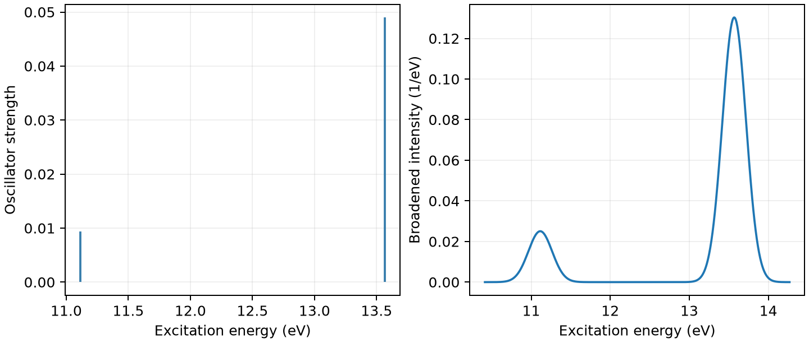

# CP2K TDDFPT 电子激发态

**适用环境：Linux + PBS（CP2K）；Windows / macOS / Linux 可绘图。**

分子的光学激发能通常不等于 Kohn–Sham 轨道能量差。TDDFPT 在线性响应中引入电子密度变化的耦合，输出激发能、跃迁偶极和振子强度。

## 水分子的三个单重激发态

[最小案例](../../../examples/cp2k/minimal/tddfpt)提供 [cp2k.inp](../../../examples/cp2k/minimal/tddfpt/cp2k.inp)、[structure.xyz](../../../examples/cp2k/minimal/tddfpt/structure.xyz)和 [PBS 作业](../../../examples/cp2k/minimal/tddfpt/job.pbs)。基态使用 PBE、DZVP-MOLOPT-SR-GTH 基组和非周期边界；在 `FORCE_EVAL/PROPERTIES` 中增加：

```text
&TDDFPT
  NSTATES 3
  CONVERGENCE 1E-6
  MAX_ITER 50
  KERNEL FULL
&END TDDFPT
```

`NSTATES` 指定求解的激发态数；`CONVERGENCE` 默认单位为 Hartree；`KERNEL FULL` 保留此实现的完整响应核，并非只取独立轨道能量差。闭壳层默认计算单重态，三重态需另设 `RKS_TRIPLETS`，不应把两者的光学强度混用。

CP2K 的这条 TDDFPT 路线采用 TDA；`FULL` 指核的选择，不代表恢复激发—退激发耦合。周期模型的虚轨道空间、幅度打印阈值、NTO 及谱线归一化见[周期激发分析](CP2K周期激发、跃迁系数与NTO.md)。

安装 [依赖](../../../examples/cp2k/minimal/tddfpt/requirements.txt)，加载 CP2K 并配置基组、赝势数据路径后执行：

```bash
qsub job.pbs
```

## 激发能与强度分别看

[后处理](../../../examples/cp2k/minimal/tddfpt/postprocess.py)同时检查基态 SCF 和 TDDFPT 收敛，提取三个单重激发态及振子强度。[plot.py](../../../examples/cp2k/minimal/tddfpt/plot.py)绘出离散谱，并用标准差 0.15 eV 的高斯核展宽。



本例在 5 次 Davidson 迭代后收敛，三个激发能约 11.1142、11.5347、13.5683 eV；对应振子强度约 0.00943、接近零、0.04900。第二态虽然有激发能，却几乎没有偶极光学强度。

图中展宽只便于阅读，不是计算得到的寿命；纵轴也不是绝对吸收系数。水的高激发态具有明显的弥散/Rydberg 特征，当前紧凑基组不足以给出定量光谱。正式研究应测试含弥散函数的基组、泛函、边界与激发态数，再结合跃迁成分判断峰的物理来源。

需要电子、空穴空间分布时，可进一步输出相应轨道或密度，用 Multiwfn、VESTA 等工具分析；单凭一个峰位不能确定电荷转移性质。

参考：[CP2K TDDFPT](https://manual.cp2k.org/trunk/CP2K_INPUT/FORCE_EVAL/PROPERTIES/TDDFPT.html)。
