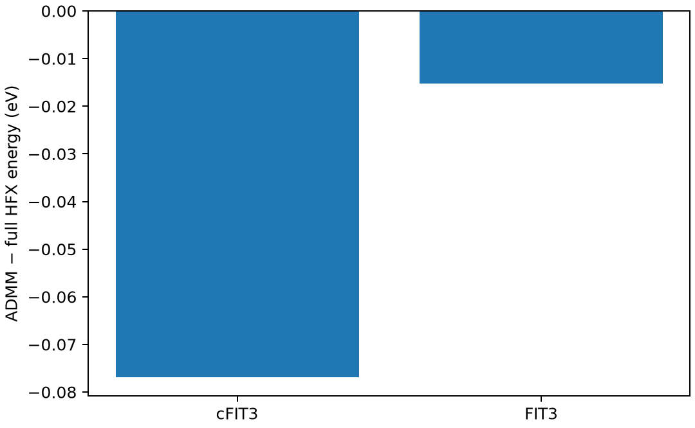

# CP2K 的 ADMM 杂化泛函

**适用环境：Linux + PBS 运行计算；Windows / macOS / Linux 可准备输入与分析结果。**

杂化泛函的精确交换常成为大体系计算瓶颈。ADMM 用较小辅助基组近似交换密度，并补充相应修正，降低部分 HFX 成本。

## 方法与物理量

ADMM 是精确交换求值的近似，不是新的杂化泛函，也不是把主轨道基组换成辅助基组。主基组描述轨道，AUX_FIT 描述辅助密度；两个层级分别引入误差。

比较时应以相同几何、主基组、泛函比例和积分设置的 full-HFX 为基准。总能误差、相对能误差与力误差并不总是同步，尤其做优化和 AIMD 时要检查受力。

## 最小模型与输入

使用水分子 PBE0，主基组 DZVP-MOLOPT-SR-GTH，网格 900/80 Ry。分别计算不使用 ADMM、使用 cFIT3 和使用 FIT3 的三个分支；数据来自安装中的 BASIS_MOLOPT、BASIS_ADMM 和 GTH_POTENTIALS。

[案例目录](../../../examples/cp2k/minimal/admm-hybrid)包含以下科学输入：

[cfit3.inp](../../../examples/cp2k/minimal/admm-hybrid/cfit3.inp)、[fit3.inp](../../../examples/cp2k/minimal/admm-hybrid/fit3.inp)、[full.inp](../../../examples/cp2k/minimal/admm-hybrid/full.inp)、[stages.json](../../../examples/cp2k/minimal/admm-hybrid/stages.json)、[structure.xyz](../../../examples/cp2k/minimal/admm-hybrid/structure.xyz)。

结构写在坐标文件或各输入的原子/晶胞段；`stages.json` 列出计算阶段。配套 [run.py](../../../examples/cp2k/minimal/admm-hybrid/run.py) 顺序组织任务，[job.pbs](../../../examples/cp2k/minimal/admm-hybrid/job.pbs) 提交作业，[postprocess.py](../../../examples/cp2k/minimal/admm-hybrid/postprocess.py) 检查结果并绘图。

## 参数与提交

加载 CP2K，确保安装数据目录可找到所需基组与势文件，必要时设置 `CP2K_DATA_DIR`；`CP2K_EXEC` 指定程序。本例单进程、单线程顺序计算，数据文件不随案例分发。

| 输入 | 本例选择 |
| --- | --- |
| `HF/FRACTION` | 0.25，同时 PBE 交换系数为 0.75 |
| `AUXILIARY_DENSITY_MATRIX_METHOD/METHOD` | `BASIS_PROJECTION` |
| `ADMM_PURIFICATION_METHOD` | `MO_DIAG` |
| `KIND/BASIS_SET AUX_FIT` | cFIT3 或 FIT3 |
| `HF/MEMORY/MAX_MEMORY` | 每 MPI 进程的 HFX 模块预算，非总内存上限 |

其他 ADMM 变体还涉及交换修正与标度方案，应明确记录，避免将名称相似的近似混作一组。

在干净案例目录安装[Python 依赖](../../../examples/cp2k/minimal/admm-hybrid/requirements.txt)并提交：

```bash
python3 -m pip install -r requirements.txt
qsub job.pbs
```

PBS 中的资源语法和软件加载方式按集群调整。计算结束后自动执行后处理；若只分析已保存的结果，运行 `python3 postprocess.py`。各阶段独立保存输出，便于定位失败步骤。

## 结果与判断

相对 full-HFX，本例 cFIT3 与 FIT3 的能量差约为 −0.07695 与 −0.01526 eV；最大力分量差分别约 0.0907 与 0.0536 eV/Å。

这些差值足以说明辅助基组选择不能省略验证；不能因某一个总能差更小就断言该方案对所有结构和反应都最好。水分子太小，本例不用于证明 ADMM 一定加速；性能优势应在代表性较大体系上测量。



图由案例后处理脚本读取实际计算输出生成。

## 扩展到实际研究

从多种代表构型比较相对能、力与 SCF 稳定性，再扩展到优化或 AIMD。密度网格、主基组、HFX 筛选和辅助基组应分别控制。已掌握普通杂化输入可回看[PBE0 笔记](CP2K杂化泛函PBE0.md)，再选择适合目标精度的 ADMM 变体。

参考：[CP2K ADMM 参数](https://manual.cp2k.org/trunk/CP2K_INPUT/FORCE_EVAL/DFT/AUXILIARY_DENSITY_MATRIX_METHOD.html)。
