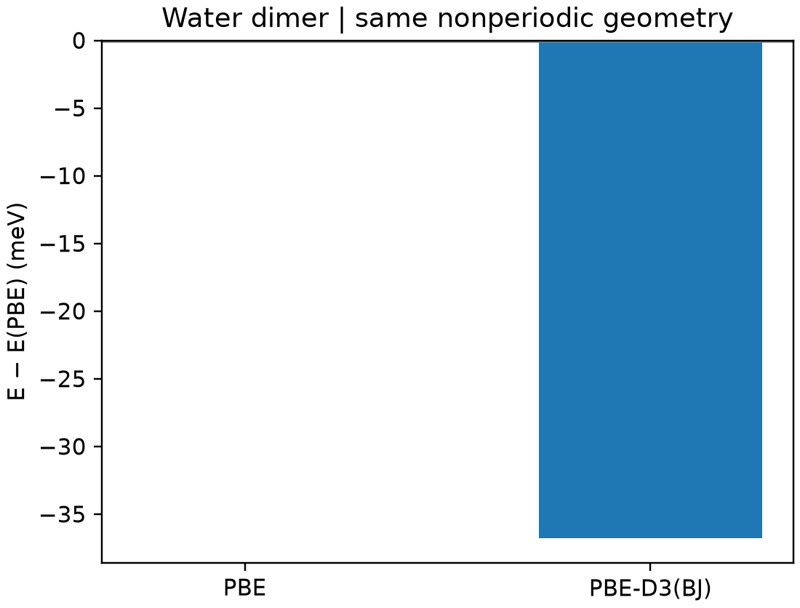

# CP2K 范德华修正

**适用环境：Linux + PBS（CP2K）；Windows / macOS / Linux 可绘图。**

在同一个水二聚体构型上打开 D3(BJ)，总能会降低多少？用固定坐标做两次单点，可以把色散修正从重新优化引起的能量变化中分离出来。若最终关心两分子的结合能，还要用同样的设置计算单体，把参考态的色散贡献也扣掉。

## 一、只给 PBE 输入加一项 D3(BJ)

[最小案例](../../../examples/cp2k/minimal/dispersion-d3)提供非周期的 [structure.xyz](../../../examples/cp2k/minimal/dispersion-d3/structure.xyz)、[PBE 输入](../../../examples/cp2k/minimal/dispersion-d3/cp2k.pbe.inp)、[D3 输入](../../../examples/cp2k/minimal/dispersion-d3/cp2k.d3.inp)和 [PBS 脚本](../../../examples/cp2k/minimal/dispersion-d3/job.pbs)。在 Multiwfn 生成的输入骨架上，将以下段加入 `DFT/XC`：

```text
&VDW_POTENTIAL
  DISPERSION_FUNCTIONAL PAIR_POTENTIAL
  &PAIR_POTENTIAL
    TYPE DFTD3(BJ)
    PARAMETER_FILE_NAME dftd3.dat
    REFERENCE_FUNCTIONAL PBE
  &END PAIR_POTENTIAL
&END VDW_POTENTIAL
```

`dftd3.dat` 使用 CP2K 安装的数据文件，与基组和势文件一样不放入案例。`REFERENCE_FUNCTIONAL` 为色散参数选择服务，不会替你更改电子结构部分的泛函。

安装 [Python 依赖](../../../examples/cp2k/minimal/dispersion-d3/requirements.txt)，加载 CP2K、确认数据文件可读后执行 `qsub job.pbs`。[run.py](../../../examples/cp2k/minimal/dispersion-d3/run.py)完成两组单点，[后处理](../../../examples/cp2k/minimal/dispersion-d3/postprocess.py)核对电子收敛、完整受力、净力及实际色散能，再检查它与同构型总能差一致。

## 二、从输出区分色散修正和结合能



先在 D3 分支的 `cp2k.out` 找到 `Dispersion energy:`，再用同一构型的 $E_{\mathrm{PBE+D3}}-E_{\mathrm{PBE}}$ 交叉核对。两者都约为 −36.77 meV，脚本要求两种取法相差不超过 $10^{-4}$ eV。

图由 [plot.py](../../../examples/cp2k/minimal/dispersion-d3/plot.py)读取实际结果生成。输入采用固定的未优化二聚体、PBE/DZVP-MOLOPT-SR-GTH、900/80 Ry 与非周期静电边界。这里显示整个二聚体的色散修正，不是二聚体结合能；后者还需同方案计算单体参考，并考虑几何及基组重叠误差。

若采用 $E_{AB}-E_A-E_B$ 表示结合能，D3 对这个量的贡献也按相同顺序相减。要把结合能与冻结构型的相互作用能区分开，应注明单体是否各自优化。做弱相互作用能的定量比较时，再检查基组、积分网格、色散截断和 BSSE 对能量差的影响。

色散、BSSE 和完整能量差的定义见[色散一致性检查](../../计算化学/色散校正、阻尼与一致性检查.md)。改用 D4 或非局域方案时，重新核对数据版本、参数、净电荷和多体设置，不仅替换名称。

参考：[CP2K 的 PAIR_POTENTIAL](https://manual.cp2k.org/trunk/CP2K_INPUT/FORCE_EVAL/DFT/XC/VDW_POTENTIAL/PAIR_POTENTIAL.html)。
