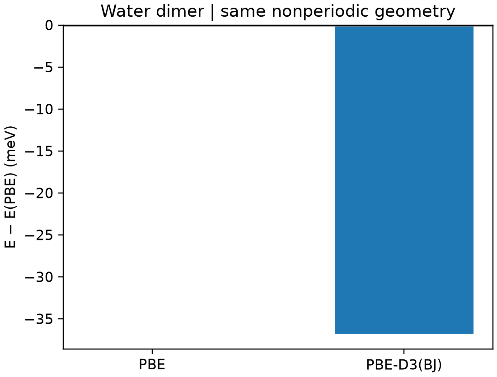

# CP2K 范德华修正

**适用环境：Linux + PBS（CP2K）；Windows / macOS / Linux 可绘图。**

色散修正常用于分子间作用、吸附和层状材料。以 D3(BJ) 为例，应为所用泛函选择相应参数，并让复合体系与参考态采用一致方案。

## 水二聚体的同构型对照

[最小案例](../../../examples/cp2k/minimal/dispersion-d3)提供非周期的 [structure.xyz](../../../examples/cp2k/minimal/dispersion-d3/structure.xyz)、[PBE 输入](../../../examples/cp2k/minimal/dispersion-d3/cp2k.pbe.inp)、[D3 输入](../../../examples/cp2k/minimal/dispersion-d3/cp2k.d3.inp)和 [PBS 脚本](../../../examples/cp2k/minimal/dispersion-d3/job.pbs)。在 Multiwfn 生成的输入骨架上，将以下段加入 `DFT/XC`：

```text
&VDW_POTENTIAL
  DISPERSION_FUNCTIONAL PAIR_POTENTIAL
  &PAIR_POTENTIAL
    TYPE DFTD3(BJ)
    PARAMETER_FILE_NAME dftd3.dat
    REFERENCE_FUNCTIONAL PBE
  &END PAIR_POTENTIAL
&END VDW_POTENTIAL
```

`dftd3.dat` 使用 CP2K 安装的数据文件，与基组和势文件一样不放入案例。`REFERENCE_FUNCTIONAL` 为色散参数选择服务，不会替你更改电子结构部分的泛函。

安装 [Python 依赖](../../../examples/cp2k/minimal/dispersion-d3/requirements.txt)，加载 CP2K、确认数据文件可读后执行 `qsub job.pbs`。[run.py](../../../examples/cp2k/minimal/dispersion-d3/run.py)完成两组单点，[后处理](../../../examples/cp2k/minimal/dispersion-d3/postprocess.py)核对电子收敛、完整受力、净力及实际色散能，再检查它与同构型总能差一致。



本例色散项约为 −36.77 meV，与两组总能差一致。

图由 [plot.py](../../../examples/cp2k/minimal/dispersion-d3/plot.py)读取实际结果生成。输入采用固定的未优化二聚体、PBE/DZVP-MOLOPT-SR-GTH、900/80 Ry 与非周期静电边界。这里显示整个二聚体的色散修正，不是二聚体结合能；后者还需同方案计算单体参考，并考虑几何及基组重叠误差。

放大体系或计算弱相互作用能时，仍需测试基组、积分网格、色散截断与参考态。不要将一次修正能对照当成模型精度验证。

参考：[CP2K 的 PAIR_POTENTIAL](https://manual.cp2k.org/trunk/CP2K_INPUT/FORCE_EVAL/DFT/XC/VDW_POTENTIAL/PAIR_POTENTIAL.html)。
