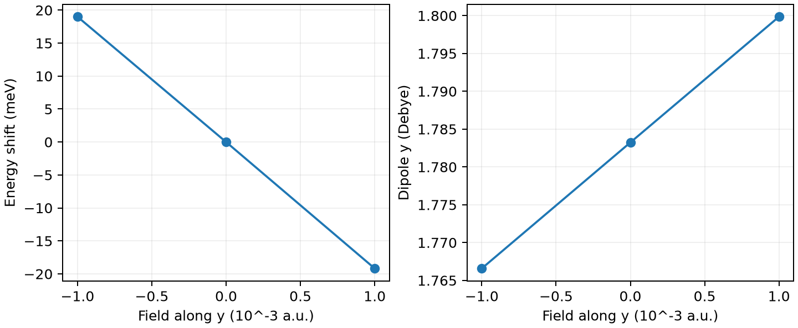

# CP2K 静电场响应

**适用环境：Linux + PBS（CP2K）；Windows / macOS / Linux 可绘图。**

对固定几何的孤立分子施加正、负小电场，可用偶极和能量的有限差分求极化率。以水分子的 y 方向为例：

$$\mu_y=-\frac{\partial E}{\partial F_y},\qquad
\alpha_{yy}=\frac{\partial\mu_y}{\partial F_y}=-\frac{\partial^2E}{\partial F_y^2}.$$

这里保持原子位置不变，得到电子响应；若每个电场下重新优化几何，还会包含结构弛豫的贡献。

## 定义静电势

[最小案例](../../../examples/cp2k/minimal/electric-field)采用非周期水分子 [structure.xyz](../../../examples/cp2k/minimal/electric-field/structure.xyz)，提供 [负场](../../../examples/cp2k/minimal/electric-field/cp2k.minus.inp)、[零场](../../../examples/cp2k/minimal/electric-field/cp2k.zero.inp)和 [正场](../../../examples/cp2k/minimal/electric-field/cp2k.plus.inp)输入。`DFT/EXTERNAL_POTENTIAL` 设置线性静电势：

```text
&EXTERNAL_POTENTIAL
  FUNCTION -F*(Y-Y0)
  PARAMETERS F Y0
  VALUES 0.001 9.44863062312885
&END EXTERNAL_POTENTIAL
```

不指定 `UNITS` 时使用 CP2K 内部原子单位：`F=0.001` 约为 0.05142 V/Å，`Y0` 为 bohr，等于晶胞中心的 5 Å。该势沿 y 递减，对应正 y 电场。此处为中性分子，参考原点不会改变总偶极；带电体系需另行处理原点和外场下的受力。

静态非周期场使用 `EXTERNAL_POTENTIAL`；`DFT/EFIELD` 面向时变场，周期体系的有限场则有独立的 Berry 相位方案，不宜直接套用此输入。

## PBS 作业与后处理

加载 CP2K，并使其能够找到 `BASIS_MOLOPT`、`GTH_POTENTIALS` 数据文件；安装 [依赖](../../../examples/cp2k/minimal/electric-field/requirements.txt)后提交 [job.pbs](../../../examples/cp2k/minimal/electric-field/job.pbs)：

```bash
qsub job.pbs
```

[run.py](../../../examples/cp2k/minimal/electric-field/run.py)顺序执行三个场强。输入开启 `MOMENTS ON` 和 `PERIODIC .FALSE.`，在输出中打印非周期偶极。[后处理](../../../examples/cp2k/minimal/electric-field/postprocess.py)将 Debye 转为偶极原子单位，分别计算能量二阶差分与偶极一阶差分，并检查两者是否一致。[plot.py](../../../examples/cp2k/minimal/electric-field/plot.py)绘图。



本例零场偶极约 1.7832 Debye，能量与偶极两种差分得到的 $\alpha_{yy}$ 均约 6.5467 原子单位（体积单位为 bohr³）。这些数值对应本例的 PBE、基组和固定几何设置，定量使用前应检查基组与场强收敛。

水有永久偶极，正、负电场下的能量变化因而可以不对称。求极化率时看的是能量曲率或偶极斜率，而非单侧能量差。

本例只考察 y 方向。计算完整张量需沿三个方向施场，并记录全部偶极分量；场强、基组、积分网格与 SCF 阈值也需分别检查收敛。

## 强场形变与离子诱导分别建模

强场下先检查线性或低阶响应展开是否仍适用，再跟踪几何、占据、电子态和密度尾部。SCF 难收敛、弥散轨道向外延伸或某张 ELF 图出现孤立区域，不能单独作为已发生场电离的证据；有限基组、边界及近似电子态都会影响表现。比较场强、基组与盒子，并采用适合电离或亚稳态问题的理论，不能把删去弥散函数后能够收敛当作体系重新稳定。

用阳离子靠近材料来产生局部场，与施加均匀外电场是不同模型。离子还会引入空间不均匀电场、交换排斥、极化、电荷转移和可能的配位，周期模型另有补偿及边界问题。即使形变或吸收峰相似，也不能据此宣称两者完全等效；应比较场分布、电子密度变化、态性质及实际几何。

受力解释使用相应哈密顿量下的总能量梯度。原子分区净电荷乘外场可作直观线索，但不普遍等于该原子的总量子力；内部成键、电子响应及分区约定都参与解释。沿几何优化或 downhill 路径显示的帧号也不是时间，形变可逆性的动力学与循环滞后需另作相应模拟或能量路径检查。

将场响应用于构型开关设计时，分别检查各场下两种状态的自由能差、相互转化势垒和目标光学响应。平衡布居反转只说明充分平衡后的偏好，不直接给出切换时间、撤场后的保持时间或循环可逆性；这些量需要对应外场下的路径、速率与环境模型。比较光学响应还要区分操控用静电场与探测光的频率、偏振，并说明张量是在有场还是撤场后的结构上计算。孤立分子的大超极化率及理论构型切换，只是材料候选的依据，器件性能还涉及取向、浓度、凝聚态耦合、损耗及稳定性。

## 第一超极化率的符号如何解释

沿固定 z 轴、固定几何讨论静态响应时，采用导数定义可写为

$$
\mu_z(F_z)=\mu_z(0)+\alpha_{zz}(0)F_z
+\frac12\beta_{zzz}(0)F_z^2+O(F_z^3),
\qquad
\beta_{zzz}(0)=\left.\frac{\partial\alpha_{zz}}{\partial F_z}\right|_0.
$$

因此，正的 $\beta_{zzz}$ 表示零场附近沿正 z 方向增大电场时，该方向的极化率增大。它不是“极化率为正”的另一种说法，也不是非线性响应强弱的无符号评分。比较分量前固定分子朝向与电场正方向；把 z 轴反向后，$\beta_{zzz}$ 会变号，而 $\alpha_{zz}$ 不变。张量范数、沿偶极方向的投影与某个 Cartesian 分量具有不同含义，不能互换符号结论。

有限差分估计可用 $[\alpha_{zz}(h)-\alpha_{zz}(-h)]/(2h)$，需检查多个 h、SCF 精度和电子态连续性，平衡截断误差与数值噪声；不能只用一个较强场下的变化替代零场导数。密度差、原子电荷和指定阈值下的体积变化可以辅助解释响应，但体积与极化率的经验相关性不足以决定所有体系的分量符号。这里讨论孤立分子的静态电子响应；晶体二阶响应还涉及周期模型、对称性、频率和单位约定，不直接用分子 $\beta$ 代替体相非线性极化率。静态与动态响应的区别也可参照 [ORCA 电响应手册](https://www.faccts.de/docs/orca/6.1/manual/contents/spectroscopyproperties/electric.html)。

## 用方向响应图检查各向异性

对单位方向 $\mathbf e$，线性诱导偶极除以场强后为 $\boldsymbol\alpha\mathbf e$，而沿场方向的响应为 $\mathbf e^T\boldsymbol\alpha\mathbf e$。两者分别是矢量和标量；有非对角元时，诱导偶极不一定平行于电场。静态对称极化率张量可对角化，报告主值与主轴，再比较平行、垂直于表面或分子平面的方向；只看三个对角元依赖当前坐标选择，不能据此忽略交叉响应。

单位球面图可在每个方向放置相应响应箭头。对第一超极化率，可用 $b_i(\mathbf e)=\sum_{jk}\beta_{ijk}e_je_k$ 展示方向依赖；按前述泰勒展开约定，二阶诱导偶极为 $F^2\mathbf b/2$。箭头起点在球面上的位置仅编码施场方向，不表示响应发生在该空间位置，也不是电子运动轨迹。结构旋转时同步变换张量；比较不同体系时统一箭头比例、色标、张量单位及静态／频率组合。将张量缩并成单个矢量会丢失部分方向信息；动态响应若含复数分量，还需定义振幅与相位的显示方式，不能直接当实矢量作图。

报告张量的汇总值时保留定义：静态各向同性平均极化率为 $\mathrm{Tr}(\boldsymbol\alpha)/3$，与最大主值、某轴分量和各向异性指标不同。“极化率体积”与 SI 极化率也有约定差别，通常前者对应后者除以 $4\pi\varepsilon_0$；不能只把单位标签换成 ų。超极化率的缩并向量、范数和沿偶极投影同样需写明公式；永久偶极接近零时，其方向不稳定或无定义，不宜依此比较投影。

动态张量同时记录频率组合，例如 $\beta(-2\omega;\omega,\omega)$ 与 $\beta(-\omega;\omega,0)$ 对应不同过程。静态导数的指标置换对称性不能无条件套到动态结果上；读取程序只输出的独立分量时，按对应过程恢复张量。跨程序比较还需核对输出朝向、导数归一化和符号约定，不按旧版本的符号修正经验统一乘以 −1。

## 与超瑞利散射实验比较时用哪个量

超瑞利散射（HRS）通过倍频散射考察分子的第一超极化率。与实验比较时，使用相应入射频率下的 $\beta(-2\omega;\omega,\omega)$ 张量，按散射几何与偏振约定进行取向平均；$\beta_\mathrm{HRS}$、退偏比与沿永久偶极的投影是不同量，不能把某个轴分量或张量缩并向量的模直接当成 HRS 值。退偏比应写明所取的两种偏振强度及其比值方向。

比较计算与溶液实验还需统一入射波长、环境模型、单位和响应定义；若进一步分解偶极与八极成分，应保留具体分解约定，不能仅由永久偶极大小推断这些贡献。原始研究示例见[非线性光学参考分子的实验与理论比较](https://doi.org/10.1063/1.3675848)。这里的分子取向平均也不代替晶体的宏观二阶响应，材料筛选仍需前述对称性与凝聚态条件。

## 密度响应与空间贡献分别积分

固定核坐标、电子数和坐标系，以电子数密度 $\rho$ 定义 $\rho_{zz}=\partial^2\rho/\partial F_z^2$。中心差分为 $[\rho(h)-2\rho(0)+\rho(-h)]/h^2$；在同一偶极定义下，$\beta_{zzz}=-\int z\rho_{zz}(\mathbf r)\,d\mathbf r$。因此 $\rho_{zz}$ 的正负区显示密度对电场的二阶变化，而 $-z\rho_{zz}$ 才是这一分量对应的空间贡献密度，两张图不能互换解读。线性极化率类似地使用密度的一阶场导数。

Multiwfn 的 `24 → 3` 提供相应分析；先核对当前版本所需文件、实际场强和符号，不将自动生成的 Gaussian 输入当成 CP2K 可直接运行的输入。自行处理 CP2K 输出时，所有场下使用相同几何、电子态、基组、网格和精度，检查密度差分的电子数积分应接近零，再将坐标加权积分与独立偶极差分所得总响应比较。二阶差分中的噪声按 $h^{-2}$ 放大，较小步长不必然更准。

全空间响应在这些条件下可不依赖原点，但局部贡献含显式坐标因子：平移原点会改变局部正负区及分区积分。比较原子、片段或空间区域时固定原点、坐标轴和分区规则，并报告区域外的剩余贡献；一个区域的贡献不能当作移除该区域后总响应的变化。等值面覆盖面积也不能替代有符号的体积分。周期体系中的位置算符和极化另有定义，不能直接将分子公式在任意切分的晶胞内积分后称为周期材料的响应分解。

## SOS 的态截断与模型误差分别检查

完全态求和（sum-over-states，SOS）用激发能和偶极矩阵元构造响应。线性极化率需要基态到激发态的跃迁信息；高阶响应通常还需要激发态永久偶极和激发态之间的跃迁矩阵元。只有吸收谱的峰位与振子强度，通常不足以恢复全部高阶张量；从截断组态系数重建矩阵元时，还要检查系数精度、归一化、态编号和相位的一致性。

实际只保留有限态集合时，逐步增加态数或能量上限，分别检查目标分量、缩并量与频率组合。静态极化率稳定之后，超极化率或近共振动态响应仍可能变化。能量分母接近共振时，还需处理阻尼、谱线宽度与复响应；无阻尼求和中的巨大数值本身不足以证明光学增强。

态数收敛解决的是当前模型内的截断误差。基组、电子结构近似和激发态矩阵元模型仍要独立检查，条件相容时可与解析响应或有限场结果对照。周期晶体的带间响应则需要对应的计算模型。

双能级模型保留基态与一个关键激发态，三能级模型再加入第二个激发态及态间耦合。选择关键态时，同时看目标方向的跃迁偶极、激发前后永久偶极之差、激发能及交叉项，不能只选最低能态或振子强度最大的态。将简化结果与充分收敛的 SOS 或相容的完整响应比较，报告遗漏项和抵消；某个态的独立项很小，其与其它态的交叉贡献仍可能重要。若仅分析一个分量，就将结论限定在该分量；要解释某个总量，还需验证该分量是否主导所定义的总量。不同结构间按态的性质追踪，避免能级交叉后仍按相同态编号作机制比较。

在静态、单一 z 方向和单个激发态主导的上述导数约定下，双能级式为 $\beta_{zzz}\approx6\Delta\mu_z|\mu_{0i,z}|^2/\Delta E_i^2$，各量采用原子单位。这里 $\Delta\mu_z=\mu_{ii,z}-\mu_{00,z}$ 是有符号分量差，不是两个偶极模长之差或差矢量的模；即使共线，反向或符号变化时这些量仍可不同。若将跃迁矩改写成振子强度，核对是否使用方向分量以及相应系数，不能把仅用于比例讨论的省略常数公式直接用于定量比较。激发态永久偶极还需与所用 SOS 矩阵元近似一致，明确采用弛豫还是非弛豫密度，不混用两套定义。

参考：[CP2K EXTERNAL_POTENTIAL](https://manual.cp2k.org/trunk/CP2K_INPUT/FORCE_EVAL/DFT/EXTERNAL_POTENTIAL.html)、[MOMENTS](https://manual.cp2k.org/trunk/CP2K_INPUT/FORCE_EVAL/DFT/PRINT/MOMENTS.html)。
