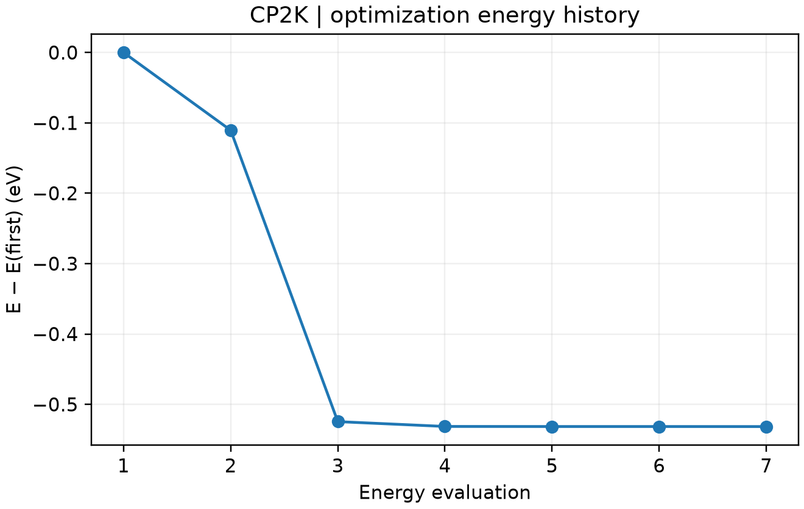

# CP2K 晶胞优化

**适用环境：Windows、macOS、Linux（查看和准备输入）；Linux + PBS（提交计算）。**

晶胞优化同时考虑原子受力与应力，用于求给定外压下的平衡晶格。这里使用 8 原子的金刚石型硅常规胞，演示从输入到 PBS 提交的完整流程。

## 准备与提交

案例包括 [structure.xyz](../../../examples/cp2k/minimal/cell-optimization/structure.xyz)、[cp2k.inp](../../../examples/cp2k/minimal/cell-optimization/cp2k.inp)、[job.pbs](../../../examples/cp2k/minimal/cell-optimization/job.pbs) 和[检查脚本](../../../examples/cp2k/minimal/cell-optimization/postprocess.py)。Multiwfn 中可选择同时优化结构和晶胞，生成后核对以下设置：

```text
&GLOBAL
  RUN_TYPE CELL_OPT
&END GLOBAL
&FORCE_EVAL
  STRESS_TENSOR ANALYTICAL
  # 其余 DFT 与 SUBSYS 设置见案例输入
&END FORCE_EVAL
&MOTION
  &CELL_OPT
    OPTIMIZER BFGS
    MAX_ITER 40
    EXTERNAL_PRESSURE 0
    PRESSURE_TOLERANCE 500
    KEEP_ANGLES TRUE
  &END CELL_OPT
&END MOTION
```

晶胞与静电边界均为 `XYZ`。本例采用对角化、Broyden 混合、额外空轨道和 300 K 电子展宽，降低小胞 Γ 点计算的自洽困难。正式晶格参数必须进一步收敛 k 点、基组和网格；此处的 Γ 点结果用于学习流程。

将文件放在集群工作目录，加载 CP2K 环境后执行 `qsub job.pbs`。

## 参数与结果判断

`EXTERNAL_PRESSURE`、`PRESSURE_TOLERANCE` 默认单位为 bar，本例 500 bar 为 0.05 GPa。`KEEP_ANGLES TRUE` 固定晶格夹角，并不自动固定三个边长相等。需要保持立方或其他晶体对称性时，应另外检查相应约束与最后的晶胞。

检查 `CELL OPTIMIZATION COMPLETED`、最终受力与压力偏差，以及 `cell-optimization-FINAL-*.xyz` 中的晶格。晶胞变化会改变网格，应力对基组和网格误差也更敏感；比较不同设置时需观察压力与平衡体积是否稳定。

CP2K 2026.2 已不接受旧输入中的 `CELL_OPT/TYPE`，晶胞优化采用直接优化方案，不应照抄旧版 `TYPE GEO_OPT`。晶胞向量约定及约束含义见 [CELL_OPT 手册](https://manual.cp2k.org/trunk/CP2K_INPUT/MOTION/CELL_OPT.html)。

查看过程时保留每一帧对应的晶胞。普通 XYZ 轨迹不含晶胞，不能用最终晶胞或查看器生成的包围盒解释全部优化步骤；可按[可视化教程](../基础与准备/CP2K结果文件与可视化.md#变胞与动力学要保留逐帧晶胞)选择携带晶胞的格式。



图中为八原子硅的实际能量评估轨迹。它展示 Γ 点小算例的优化过程，定量晶格参数仍需基组、网格与 k 点收敛测试。配套 [plot.py](../../../examples/cp2k/minimal/cell-optimization/plot.py)读取实际输出生成，结果检查后自动绘图；需安装 [requirements.txt](../../../examples/cp2k/minimal/cell-optimization/requirements.txt) 中依赖。
