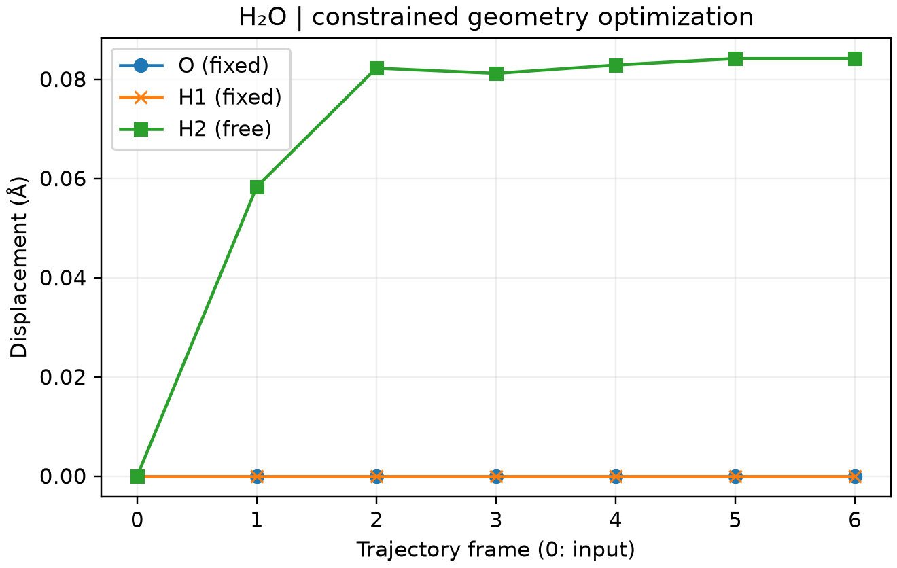

# CP2K 选择性结构优化

**适用环境：Linux + PBS（CP2K）；Windows / macOS / Linux 可准备结构、绘图。**

局部优化可固定部分原子，让其余区域在约束下寻找能量极小值。先用 Multiwfn 准备几何优化输入，再在 `MOTION` 中添加约束。

## 固定水分子中的两个原子

[最小案例](../../../examples/cp2k/minimal/selective-optimization)固定 O、H1，仅放松初始偏移的 H2，提供 [structure.xyz](../../../examples/cp2k/minimal/selective-optimization/structure.xyz)、[cp2k.inp](../../../examples/cp2k/minimal/selective-optimization/cp2k.inp)、[job.pbs](../../../examples/cp2k/minimal/selective-optimization/job.pbs)。

```text
&CONSTRAINT
  &FIXED_ATOMS
    LIST 1 2
    COMPONENTS_TO_FIX XYZ
  &END FIXED_ATOMS
&END CONSTRAINT
```

上述段放在 `&MOTION` 内，原子序号从 1 开始。约束分量按分数坐标定义；本例晶胞固定且正交，因此冻结 XYZ 等价于保持对应原子的笛卡尔位置不变。变晶胞或斜晶胞问题应重新检查其物理含义。

确认数据目录可读取基组和势文件，安装 [依赖](../../../examples/cp2k/minimal/selective-optimization/requirements.txt)，加载 CP2K 后执行：

```bash
qsub job.pbs
```

[后处理](../../../examples/cp2k/minimal/selective-optimization/postprocess.py)检查优化收敛、整条轨迹中固定原子不漂移，以及自由原子实际移动并达到受力阈值，再调用 [plot.py](../../../examples/cp2k/minimal/selective-optimization/plot.py)。已有输出可执行 `python3 postprocess.py`。



图中 O、H1 保持固定，H2 完成放松。输入使用显式居中的坐标，避免自动居中改变约束参考位置。固定原子上可有约束反力，因此不以所有原始受力均为零判断该问题是否收敛。本例使用 PBE、DZVP-MOLOPT-SR-GTH 和 900/80 Ry 网格，演示的是约束下的几何极小值，不是完全自由的水分子平衡结构。

参考：[CP2K 的 FIXED_ATOMS](https://manual.cp2k.org/trunk/CP2K_INPUT/MOTION/CONSTRAINT/FIXED_ATOMS.html)。
