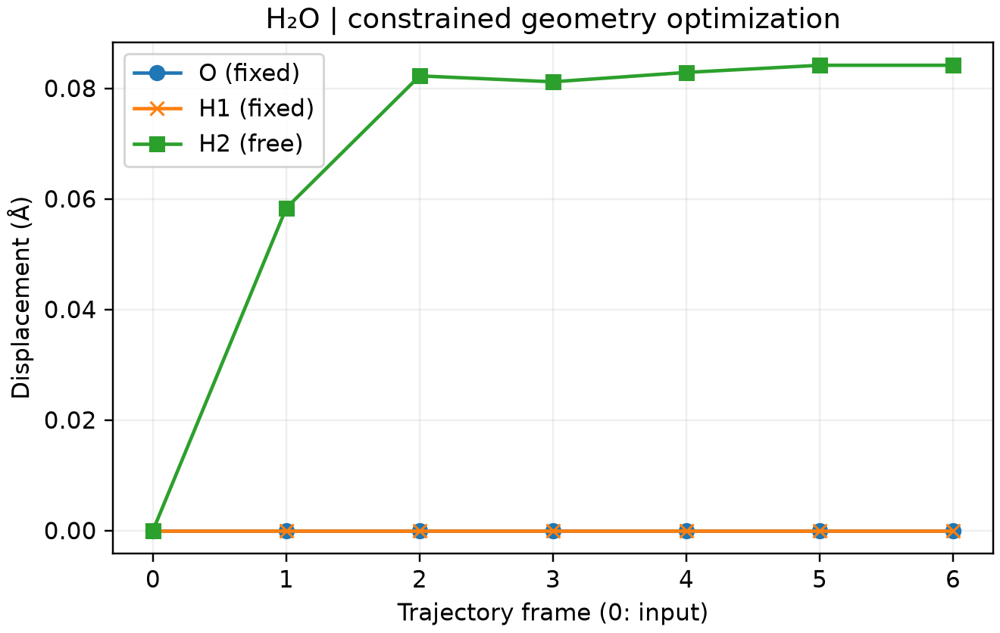

# CP2K 选择性结构优化

**适用环境：Linux + PBS（CP2K）；Windows / macOS / Linux 可准备结构、绘图。**

在比较吸附位点时，可以保留同一块基底的底层位置，只让吸附物和表层弛豫。这样得到的是共同约束下的几何，冻结层数也成为模型的一部分。如果关心基底自身的重构，就要放开相关自由度，再比较各自收敛的结构。本篇先用三个原子的水分子说明怎样核对约束是否落在了预期的原子上。

## 一、从几何优化输入中冻结 O 和 H1

[最小案例](../../../examples/cp2k/minimal/selective-optimization)固定 O、H1，仅放松初始偏移的 H2，提供 [structure.xyz](../../../examples/cp2k/minimal/selective-optimization/structure.xyz)、[cp2k.inp](../../../examples/cp2k/minimal/selective-optimization/cp2k.inp)、[job.pbs](../../../examples/cp2k/minimal/selective-optimization/job.pbs)。

```text
&CONSTRAINT
  &FIXED_ATOMS
    LIST 1 2
    COMPONENTS_TO_FIX XYZ
  &END FIXED_ATOMS
&END CONSTRAINT
```

从[几何优化输入](CP2K几何优化.md)出发，把这段放在 `&MOTION` 内，与 `&GEO_OPT` 同级。原子序号从 1 开始，按实际读入顺序核对。导出或拼接结构后若原子被重排，原来的 `LIST` 可能静默冻结另一组原子。约束分量按分数坐标定义；本例晶胞固定且正交，因此冻结 XYZ 等价于保持对应原子的笛卡尔位置不变。变晶胞或斜晶胞问题应重新检查其物理含义。

确认数据目录可读取基组和势文件，安装 [依赖](../../../examples/cp2k/minimal/selective-optimization/requirements.txt)，加载 CP2K 后执行：

```bash
qsub job.pbs
```

## 二、用轨迹和末步受力确认约束生效

算完后在输出所在目录运行 `python3 postprocess.py`。[后处理脚本](../../../examples/cp2k/minimal/selective-optimization/postprocess.py)先检查 SCF 和几何优化状态，再按输入中的原子顺序逐个比较保存帧与初始坐标。案例要求 O、H1 的最大坐标分量漂移不超过 $10^{-6}$ Å，初始偏移的 H2 到末帧至少移动 $10^{-3}$ Å，末步 H2 的最大受力分量不超过 0.024 eV/Å。位移下限针对这份刻意扰动的输入，已经接近驻点的初态可以几乎不动。



图中 O、H1 保持固定，H2 完成放松。输入坐标已显式居中，以免自动居中改变约束参考位置。固定原子可能存在约束反力；判断收敛时，应关注可动自由度，而非要求所有原始受力都为零。

本例采用 PBE、DZVP-MOLOPT-SR-GTH 和 900/80 Ry 网格。得到的是约束下的几何极小值，与完全自由水分子的平衡结构不同。

参考：[CP2K 的 FIXED_ATOMS](https://manual.cp2k.org/trunk/CP2K_INPUT/MOTION/CONSTRAINT/FIXED_ATOMS.html)。
