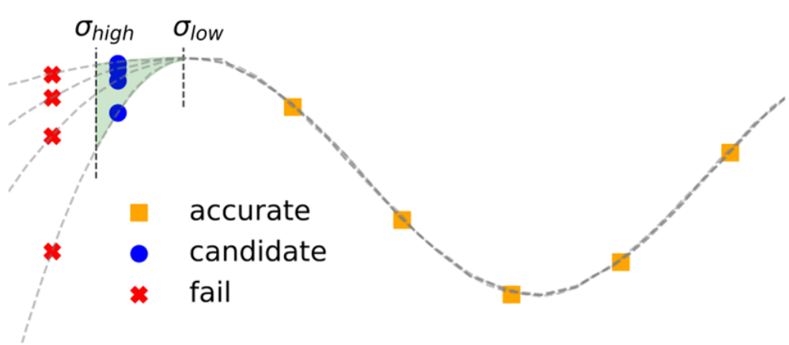
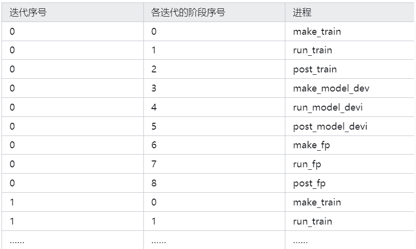
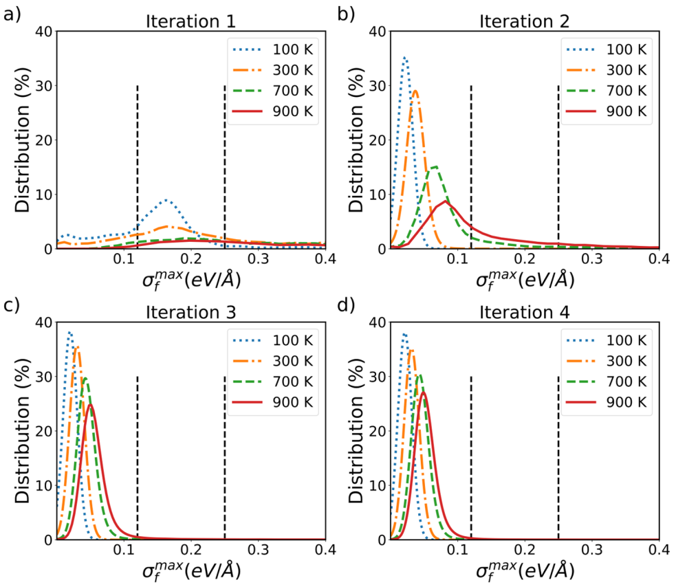

# DPGEN 入门

已有一个 [GeTe 的起始训练集](DeePMD入门.md)，在 300 K 跑得平稳，换到更高温度或压缩后的晶胞是否仍可靠？DP-GEN 用多份势共同评估探索轨迹的力，把模型分歧较大的构型送去做第一性原理标注，再加入下一轮训练。如果标签已经覆盖目标构型，直接训练和独立验收就可以。若覆盖缺口尚不明确，迭代探索能帮助把有限的标注预算用到可疑区域。

## 一、把探索条件和运行环境分开

这里保留原 Linux 集群的 DP-GEN 0.10.6 与 DeePMD-kit 2.2.7 配置。复用前在同一环境核对 `dpgen run -h`、`dp`、`lmp` 和第一性原理程序。若旧版离线包缺少运行库，应安装兼容的运行库或换一个相容的环境。遇到 PBS 作业头或状态解析错误，先对照当前 DPDispatcher 版本与站点的提交和查询输出。

### 两个 JSON 文件分别管什么

`param.json` 定义执行什么计算，例如体系、训练设置和探索条件；`machine.json` 定义运行环境、程序路径和资源。从任务根目录启动 `dpgen run param.json machine.json`，先检查相对数据路径是否存在，并用最小规模确认三类任务能提交、回收和解析。

<div align="left">

</div>

以常用的 `run` 为例，每次迭代涉及训练、探索和标记，对应 `machine.json` 中的 `train`、`model_devi` 和 `fp`。三个部分分别配置程序与计算环境。原示例把训练和探索放在 GPU 队列，VASP 标注放在 CPU 队列。下方与仓库的 [machine.json](../../inputs/deepmd/machine.json) 都是配置样例，命令路径、队列、环境脚本和设备分配按目标站点设置。

```json
{
"api_version": "1.0",
   	"deepmd_version": "2.2.7",
   	"train" : [{
     	"command": "/home/your-user/Software/deepmd-gpu/bin/dp",
      	"machine": {
         	"batch_type": "PBS",
           	"local_root" : "./",
          	"remote_root": "/home/your-user/dpgen_work/dpgen_run",
         	"context_type": "LocalContext"
    	},
     	"resources": {
          	"number_node": 1,
           	"cpu_per_node": 32,
         	"gpu_per_node": 2,
         	"queue_name": "gpu",
           	"group_size": 1,
          	"custom_flags": [
             	"#PBS -N deepmd",
               	"#PBS -l walltime=144:00:00",
               	"#PBS -S /bin/bash",
               	"#PBS -V"
        	],
         	"source_list": [
           		"/home/your-user/script/dpgen_source/dpmd.sh"
        	],
       		"envs": {
               	"CUDA_VISIBLE_DEVICES": "0,1",
             	"OMP_NUM_THREADS": "16"
         	}
  		}
}],
 	"model_devi": [{
     	"command": "/home/your-user/Software/deepmd-gpu/bin/lmp",
    	"machine": {
         	"batch_type": "PBS",
        	"local_root" : "./",
          	"remote_root": "/home/your-user/dpgen_work/dpgen_run",
        	"context_type": "LocalContext"
     	},
      	"resources": {
       		"number_node": 1,
          	"cpu_per_node": 32,
           	"gpu_per_node": 2,
           	"queue_name": "gpu",
        	"group_size": 8,
          	"custom_flags": [
              	"#PBS -N lammps",
               	"#PBS -l walltime=144:00:00",
             	"#PBS -S /bin/bash",
             	"#PBS -V"
          	],
         	"source_list": [
           		"/home/your-user/script/dpgen_source/lmp.sh"
 			],
          	"envs": {
             	"CUDA_VISIBLE_DEVICES": "0,1",
            	"OMP_NUM_THREADS": "8",
             	"LAMMPS_PLUGIN_PATH": "/home/your-user/Software/deepmd-gpu/lib/deepmd_lmp"
        	}
  		}
}],
  	"fp": [{
     	"command": "mpirun -np 24 /opt/software/vasp/vasp6.4.0/bin/vasp_gam",
     	"machine": {
        	"batch_type": "PBS",
         	"local_root" : "./",
       		"remote_root": "/home/your-user/dpgen_work/dpgen_run",
        	"context_type": "LocalContext"
     	},
    	"resources": {
         	"number_node": 1,
           	"cpu_per_node": 24,
         	"gpu_per_node": 0,
        	"queue_name": "manycores",
        	"group_size": 8,
        	"custom_flags": [
               	"#PBS -N vasp",
            	"#PBS -l walltime=600:00:00",
               	"#PBS -S /bin/bash",
              	"#PBS -V"
        	],
        	"source_list": [
              	"/home/your-user/script/dpgen_source/vasp.sh"
         	]
    	}
}]
}
```

## 二、用 GeTe 的三组初态检查探索范围

这个 `param.json` 将扰动、缩小到 0.96 倍和扩大到 1.04 倍的三组初态分别编号为 0、1、2。`model_devi_jobs` 中的每项对应一轮探索。第 0 轮只取第 0 组，结合五个温度和两个压力，形成十组温压条件，再按实际匹配到的初态数生成任务。LAMMPS 步长 0.002 ps 时，1,000 步是 2 ps，每 5 步留一帧，对应 10 fs。先用短轨迹核对构型和输出，再逐轮延长。这里保留旧版配置的字段，使用前按所选版本的参数文档核对。 [DP-GEN 运行参数](https://docs.deepmodeling.com/projects/dpgen/en/latest/run/param.html)

```json
{
 	"type_map": ["Ge","Te"],
  	"mass_map": [72.64,127.6],
   	"init_data_prefix": "./",
   	"init_data_sys": ["train/Ge64Te64/"],
   	"sys_configs_prefix": "./",
   	"sys_configs": [
   		["init/perturb/*/POSCAR"],
     	["init/scale_0.96/*/POSCAR"],
      	["init/scale_1.04/*/POSCAR"]
 	],
  	"numb_models": 4,
  	"_training_init_frozen_model": [
     	["./init_model/000/frozen_model.pb"],
      	["./init_model/001/frozen_model.pb"],
      	["./init_model/002/frozen_model.pb"],
      	["./init_model/003/frozen_model.pb"]
  	],
  	"model_devi_activation_func": [
["tanh","tanh"],
["tanh","gelu"],
["gelu","tanh"],
["gelu","gelu"]
],
  	"default_training_param": {
      	"model": {
         	"type_map": ["Ge","Te"],
          	"descriptor": {
          		"type": "se_e2_a",
          		"sel": [100,100],
          		"rcut_smth": 2.0,
           		"rcut": 6.0,
           		"neuron": [25,50,100],
          		"resnet_dt": false,
          		"type_one_side": true,
         		"axis_neuron": 12,
           		"seed": 1
    		},
      		"fitting_net": {
          		"neuron": [240,240,240],
          		"resnet_dt": true,
          		"seed": 1
      		}
 		},
  		"learning_rate": {
     		"type": "exp",
     		"start_lr": 0.001,
      		"decay_steps": 4000
   		},
  		"loss": {
     		"start_pref_e": 0.02,
     		"limit_pref_e": 1,
       		"start_pref_f": 1000,
      		"limit_pref_f": 1,
      		"start_pref_v": 0.0,
       		"limit_pref_v": 0.0
  		},
  		"training": {
     		"stop_batch": 100000,
       		"disp_file": "lcurve.out",
      		"disp_freq": 2000,
       		"numb_test": 4,
      		"save_freq": 2000,
       		"save_ckpt": "model.ckpt",
      		"disp_training": true,
       		"time_training": true,
     		"profiling": false,
   			"profiling_file": "timeline.json"
  		}
},
"model_devi_engine": "lammps",
"model_devi_dt": 0.002,
"model_devi_skip": 0,
"model_devi_f_trust_lo": 0.05,
"model_devi_f_trust_hi": 0.15,
"model_devi_clean_traj": 1,
"model_devi_jobs": [
  		{"sys_idx": [0],"temps": [300, 450, 600, 750, 900],"press": [1.0, 100.0], "trj_freq":   5, "nsteps":   1000, "ensemble": "npt", "_idx":     "00" },
  		{"sys_idx": [1],"temps": [300, 450, 600, 750, 900],"press": [1.0, 100.0], "trj_freq":   5, "nsteps":   1000, "ensemble": "npt", "_idx":     "01" },
  		{"sys_idx": [2],"temps": [300, 450, 600, 750, 900],"press": [1.0, 100.0], "trj_freq":   5, "nsteps":   1000, "ensemble": "npt", "_idx":     "02" },
  		{"sys_idx": [0],"temps": [300, 450, 600, 750, 900],"press": [1.0, 100.0], "trj_freq":  50, "nsteps":  10000, "ensemble": "npt", "_idx":     "03" },
 		{"sys_idx": [1],"temps": [300, 450, 600, 750, 900],"press": [1.0, 100.0], "trj_freq":  50, "nsteps":  10000, "ensemble": "npt", "_idx":     "04" },
  		{"sys_idx": [2],"temps": [300, 450, 600, 750, 900],"press": [1.0, 100.0], "trj_freq":  50, "nsteps":  10000, "ensemble": "npt", "_idx":     "05" },
  		{"sys_idx": [0],"temps": [300, 450, 600, 750, 900],"press": [1.0, 100.0], "trj_freq": 500, "nsteps": 100000, "ensemble": "npt", "_idx":     "06" },
      	{"sys_idx": [1],"temps": [300, 450, 600, 750, 900],"press": [1.0, 100.0], "trj_freq": 500, "nsteps": 100000, "ensemble": "npt", "_idx":     "07" },
      	{"sys_idx": [2],"temps": [300, 450, 600, 750, 900],"press": [1.0, 100.0], "trj_freq": 500, "nsteps": 100000, "ensemble": "npt", "_idx":     "08" }
  	],
   	"fp_style": "vasp",
  	"fp_pp_path": "./",
   	"fp_pp_files": ["POTCAR_Ge","POTCAR_Te"],
  	"fp_incar": "./INCAR",
  	"fp_accurate_threshold": 0.999,
  	"fp_accurate_soft_threshold": 0.99,
   	"shuffle_poscar": false,
  	"fp_task_max": 50,
  	"fp_task_min": 3,
   	"ratio_failed": 0.05
}
```

### 使用自己的 LAMMPS 模板

在 `model_devi_jobs` 下设置 `template` 时，探索步骤使用指定的 `lmp/input.lammps` 模板：

```text
"model_devi_jobs":  [{
    "sys_idx": [0],"trj_freq": 10,"_idx": "00",
      	"template":{"lmp": "lmp/input.lammps"},
       	"rev_mat":{
"lmp": {"V_NSTEPS": [20000], "V_TEMP": [300], "V_PRES": [1]},
          	"plm": {"V_TEMP":  [300], "V_STRIDE": [10]}
      	}}, …… ]
```

模板中的 `dump` 行需使用 `dump dpgen_dump`。在这一模式下，DPGEN 调用 `revise_lmp_input_dump` 写入 `trj_freq`，与在文件开头定义并引用 `DUMP_FREQ` 的方式不同。

## 三、沿一轮输出检查候选和标注

一轮先在 `00.train` 生成模型，再由 `01.model_devi` 探索并记录偏差，最后在 `02.fp` 标注选中的构型。下图给出了每个阶段的子步骤。

<div align="left">

</div>

`model_devi.out` 的 `max_devi_f` 是同一帧里原子力模型分歧的最大值。GeTe 示例的下界是 0.05 eV/Å，上界是 0.15 eV/Å。仅按该力判据，0.10 eV/Å 落在候选区，0.20 eV/Å 则要先查几何、相态或步长为何会产生很大的分歧。这两个数是读规则的示意。候选区中的构型还要经过当轮标注预算和选择规则。仓库的 [Al–Sc–N 配置](../../inputs/deepmd/JH_dpgen_alscn.json)用 0.10 和 0.25 eV/Å，阈值应结合体系、探索条件和独立参考验证来定。

从仓库根目录运行[偏差收集脚本](../../scripts/deepmd/collect_dpgen_deviations.py)，把示例路径替换为实际工作目录：

```bash
python scripts/deepmd/collect_dpgen_deviations.py /path/to/run/iter.000000/01.model_devi -o deviations.csv
```

CSV 保留了来源和步号，按任务目录回查温度、压力和初态再分组。原笔记的偏差图可以用来练习读分布。图（a）峰值约 0.15 eV/Å，只说明该批轨迹在这一范围内的模型分歧集中。若要校准阈值，从低偏差、候选区和高偏差分别抽少量结构做参考计算，比较模型分歧与实际误差。VASP 标签需用变形构型核对 `ENCUT` 和 `KSPACING`，按目标物性设定能量、力和 virial 精度。

<div align="left">

</div>

异常中止时，先保留 `record.dpgen` 和轮次目录，对照调度器状态以及当前阶段的输入、输出和回传记录。确认该阶段没有仍在运行的任务后，再按版本的恢复机制接续。候选数少时，核对是否复用了前一轮的训练结果以及本轮实际新增了哪些标签，再判断探索是否已覆盖目标条件。

## 四、汇总标签并检查下一轮真正获得了什么

迭代生成的数据分散在各轮目录中，可用 `dpgen collect` 汇总。先用 `dpgen collect -h` 查看说明，命令格式为 `dpgen collect JOB_DIR OUTPUT_DIR -p param.json`。其中 `JOB_DIR` 是包含 `iter.0000*` 的任务目录，`OUTPUT_DIR` 是收集后的目标目录。例如：

```bash
dpgen collect ./ ./collect -p param.json
```

上述命令会把当前文件夹下的数据收集到 `collect` 目录里。
`collect` 目录中，`init.*` 是初始训练集，`sys.*` 是 DPGEN 生成的训练集（按照 `param.json` 中的 `sys` 分类）。
汇总后按系统核对帧数、元素顺序和标签，再与各轮实际通过的第一性原理任务对账。要转出某个系统，可从仓库根目录运行 `python scripts/structure/deepmd_to_xyz.py /path/to/collect/sys.000 -o sys.000.xyz`。接回下一轮前，保留独立测试集，继续按[模型评估](DeePMD入门.md#导出模型并检查预测)检查目标构型。
