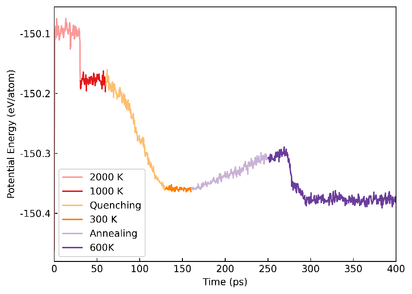

# DeePMD-kit 入门

**适用环境：Linux 集群。**

有了 GeTe 的 VASP 能量和受力，下一步是训练一个能在目标温压下用于分子动力学的势。第一道关在数据转换，类型或力的映射错了，训练仍可能跑完。第二道关在模型交付，要用独立构型确认模型能复现参考数据，再拿去跑轨迹。本文用 GeTe 讲训练和检查，末尾另用独立的 Sb 输入展示 LAMMPS 接入。

复用旧训练输入时，先识别 DeePMD-kit 版本和后端。2.0.3 手册对应当时的 TensorFlow 流程，冻结模型、训练配置和 LAMMPS 插件需要版本相容。迁移旧输入时先用同一小批结构对照每帧能量、力、virial 与元素顺序，再扩展到动力学。旧版语法见 [DeePMD-kit 2.0.3 手册](https://docs.deepmodeling.com/projects/deepmd/en/v2.0.3/)。

## 一、把 VASP 标签和原子顺序一起交给训练

数据可以经 `.xyz` 在不同训练格式之间转换：`vasp_to_xyz.py` 读取 VASP 数据，`xyz_to_deepmd.py` 写出 `.npy` 格式的 DP 训练集，`deepmd_to_xyz.py` 则将 DP 数据转回 NEP 使用的 `.xyz` 格式。各脚本的参数见下文。

### DP 训练集的目录结构

DP 训练集的目录结构如下：

```text
.
└── Ge64Te64
    ├── set.000
    │   ├── box.npy
    │   ├── coord.npy
    │   ├── energy.npy
    │   ├── force.npy
    │   └── virial.npy
    ├── type_map.raw
    └── type.raw
```

- **set.000**：存放这一数据分片的 NumPy 文件；
  - `box.npy`：储存系统的盒子信息；
  - `coord.npy`：储存原子的坐标；
  - `energy.npy`：储存系统的能量；
  - `force.npy`：储存原子所受的力；
  - `virial.npy`：储存系统的位力张量（能量量纲；ASE 应力需再取负并除以体积）；
- **type_map.raw**：将整数类型映射到原子名称；
- **type.raw**：包含原子整数类型的信息；

DP 按系统分类，例如上面的 `Ge64Te64` 就是一个系统。
系统内的所有构型都具有相同的原子类型和原子序号，因此只需为整个系统指定一次原子类型信息即可。

### 文件转换工具

按转换方向选择脚本：

- `vasp_to_xyz.py`：将 VASP 数据转化为 `.xyz` 格式。使用方法：

  ```bash
  python scripts/structure/vasp_to_xyz.py vasp_runs --frames all -o dataset.xyz
  ```

  从仓库根目录运行，`vasp_runs` 是含各计算子目录的根目录。按任务选择全部合格帧或默认的末帧，记录所用能量口径。

- `xyz_to_deepmd.py`：将 `.xyz` 格式的 NEP 训练集转化为 `.npy` 格式的 DP 训练集。使用方法：

  ```bash
  python scripts/structure/xyz_to_deepmd.py dataset.xyz -o train
  ```

  脚本按系统写出子目录。先查看实际目录名和元素映射，再填写训练配置中的 `systems`。

- `deepmd_to_xyz.py`：将 DP 训练集转化为 NEP 训练集。使用方法：

  ```bash
  python scripts/structure/deepmd_to_xyz.py train --format nep -o dataset_from_dp.xyz
  ```

  转换后抽一帧对照晶胞、原子顺序、总能和力。若要训练 virial，还要核对原始标签、输出和损失设置。

## 二、从截断半径决定邻居容量

数据准备完成后，用 `input.json` 指定模型、损失函数和训练设置。本例输入如下：

```json
{
    "model": {
        "type_map": ["Ge", "Te"],
        "descriptor": {
            "type": "se_e2_a",
            "rcut": 6.00,
            "rcut_smth": 0.50,
            "sel": [80, 80],
            "neuron": [25, 50, 100],
            "resnet_dt": false,
            "axis_neuron": 16,
            "seed": 1
        },
        "fitting_net": {
            "neuron": [240, 240, 240],
            "resnet_dt": true,
            "seed": 1
        }
    },
    "learning_rate": {
        "type": "exp",
        "decay_steps": 5000,
        "start_lr": 0.001,
        "stop_lr": 3.51e-8
    },
    "loss": {
        "type": "ener",
        "start_pref_e": 0.02,
        "limit_pref_e": 1,
        "start_pref_f": 1000,
        "limit_pref_f": 1,
        "start_pref_v": 0,
        "limit_pref_v": 0
    },
    "training": {
        "training_data": {
            "systems": ["./train/Ge64Te64/"],
            "batch_size": "auto"
        },
        "validation_data": {
            "systems": ["./validation/Ge64Te64/"],
            "batch_size": 1,
            "numb_btch": 3
        },
        "numb_steps": 500000,
        "seed": 10,
        "disp_file": "lcurve.out",
        "disp_freq": 1000,
        "save_freq": 10000
    }
}
```

上面的内嵌配置使用 6 Å 截断。仓库另存的 [GeTe 输入](../../inputs/deepmd/input_GeTe.json)使用 8 Å，且将验证段写成 `_validation_data`，复用前要换成实际的 `validation_data` 配置和独立目录。旧记录中 68、68 个近邻是按 8 Å 数出来的。若用上面的 6 Å 配置，应在数据齐备后按 6 Å 重新统计，并按 Ge、Te 的顺序为高密度构型留余量。`sel: "auto"` 可用作训练数据上的初值，仍需检查目标温压下的高密度样本。同样使用 `se_e2_a` 的[水配置](../../inputs/machine-learning/deepmd-water.json)把 `type_map` 写成 O、H，其 `sel` 的两项也按这个顺序对应，更多字段说明见 [DeePMD-kit 2.0.3 参数手册](https://docs.deepmodeling.com/projects/deepmd/en/v2.0.3/train/train-input.html)。

先在已分配资源、且能解析相对数据路径的任务目录运行 `dp train input.json`。确认首批输入和损失可读，再扩大训练预算。以上配置的 virial 权重始终是零，若目标包含应力或 NPT 体积，应单独核对压力与应力表现。并行作业按当前后端文档设置进程和设备分配，不能用 CPU 槽位数直接推断应启动的 GPU 进程数。

### 查看训练误差与恢复训练

按示例配置，每 1,000 步输出训练信息，每 10,000 步保存检查点。读 `lcurve.out` 时按文件头辨认训练和验证误差。验证集用于选模型，最终评估应另留独立测试数据。旧 TensorFlow 流程可用 `dp train --restart model.ckpt input.json` 接续已有检查点。若想从 PyTorch 的 `.pt` 模型微调，另按对应版本和后端的微调文档准备输入。

### 导出模型并检查预测

训练结束后，运行 `dp freeze -o graph.pb` 冻结模型。`-o` 指定输出文件名，此处生成当前目录下的 `graph.pb`。

可以使用命令 `dp compress -i graph.pb -o graph-compress.pb` 压缩 `graph.pb`。压缩后先复核能量和逐原子力，再用同一短跑与原模型比较显存占用和耗时。

如果准备了独立测试集，可以使用命令 `dp test -m graph-compress.pb -s ./test/ -d results` 检查训练模型的质量，它将在当前目录中输出名为 `results.e.out` 和 `results.f.out` 等文件。

也可以用 dpdata 读取参考数据并调用模型预测：

```python
import dpdata
training_systems = dpdata.LabeledSystem("./train/Ge108Te108/", fmt = "deepmd/npy")  # 得到训练数据点
predict = training_systems.predict("./graph.pb")  # 得到预测数据点
```

```python
import matplotlib.pyplot as plt
import numpy as np

# Data from the file results.e_peratom.out
with open("results.e_peratom.out", "r") as file:
    lines = file.readlines()
data_lines = [line for line in lines if not line.strip().startswith("#")]
x_data, y_data = zip(*[map(float, line.split()) for line in data_lines])

# Create the plot
plt.figure(figsize=(8, 8))
plt.scatter(x_data, y_data, label='Data points')
plt.plot([-4.15, -4.12], [-4.15, -4.12], color='red', linestyle='--', label='y=x (Diagonal)')
plt.xlabel('data_e (First Column)', fontsize=12)
plt.ylabel('pred_e (Second Column)', fontsize=12)
plt.title('Comparison of Data_e and Pred_e', fontsize=14)
plt.legend()
plt.grid(alpha=0.5)
plt.axis('equal')  # Ensure the x and y scales are the same
plt.tight_layout()
plt.savefig("e_peratom.png")
```

## 三、用描述符找覆盖缺口

可以使用 Chemiscope 可视化训练集中的原子局域环境。以下命令从仓库根目录运行，以 GeTe 的元素映射为例：

```bash
python scripts/structure/deepmd_to_ase.py train/ Ge Te -o ase_dataset.db
python scripts/deepmd/extract_deepmd_descriptors.py graph.pb ase_dataset.db Ge Te -a
python scripts/visualization/create_chemiscope_input.py -a 8 ase_dataset.db descriptors.npy energies.npy
```

三个入口依次为[数据库转换](../../scripts/structure/deepmd_to_ase.py)、[描述符提取](../../scripts/deepmd/extract_deepmd_descriptors.py)和 [Chemiscope 输入生成](../../scripts/visualization/create_chemiscope_input.py)。`-a 8` 指定原子局域环境的截断半径为 8 Å，须按实际环境范围选择；输出 `chemiscope.json.gz` 可在 [Chemiscope](https://chemiscope.org/) 查看。

数据库转换读取全部 `set.*` 分片，并保留能量与力。描述符与能量有两种对应方式：

- 加 `-a` 时，描述符按结构中的原子顺序拼接，配套能量为模型原子能。
- 不加 `-a` 时，每帧对应一行描述符，配套能量为输入结构的每原子参考能。结构描述符默认按原子求和，可用 `--aggregation mean` 改为均值；比较不同原子数的体系时需说明选择。

可视化脚本检查行数与有限值，并将常量描述符列归零。PCA 用来查看数据分布，不能直接衡量势函数精度。已有输出不会被覆盖，重新分析时请使用新目录或文件名。

## 四、先验证 Sb 模型，再跑相变轨迹

运行前准备初始结构 `coord.lmp`、对应体系的模型、输入文件 `lammps.in` 和提交脚本 `run_deepmd.pbs`。下面以 Sb 相变模拟为例，`pair_style` 行使用 `graph.pb`；若使用前面压缩得到的 `graph-compress.pb`，相应修改模型路径。`lammps.in` 如下：

```text
units       		metal
boundary      	p p p
atom_style     	atomic
neighbor       	2.0 bin
neigh_modify   	every 10 delay 0 check no
read_data      	coord.lmp
mass         	1 121.76000000
pair_style    		deepmd ./graph.pb
pair_coeff    	* *
variable       	run1   	equal  	60000
variable       	run2    	equal   	60000
variable       	run3    	equal   	140000
variable       	run4    	equal   	60000
variable       	run5    	equal   	180000
variable       	run6    	equal   	1000000
variable       	temp1  	equal  	2000.0
variable       	temp2 	equal  	1000.0
variable       	temp3 	equal  	300.0
variable        	temp4 	equal  	600.0
variable        	dt     	equal  	5.0e-4
variable        	tau    	equal  	${dt}*100
variable        	showt  	equal  	1000

velocity        	all create ${temp1} 12345
dump         	1 all custom ${showt} lammps.dump id type x y z

fix             	1 all nvt temp ${temp1} ${temp1} ${tau}
timestep        	${dt}
thermo_style    	custom step pe ke etotal temp press vol
thermo        	${showt}
run           	${run1}
write_restart  	nvt1.restart
unfix           	1

fix             	2 all nvt temp ${temp2} ${temp2} ${tau}
timestep        	${dt}
thermo_style    	custom step pe ke etotal temp press vol
thermo        	${showt}
run            	${run2}
write_restart   	nvt2.restart
unfix           	2

fix             	3 all nvt temp ${temp2} ${temp3} ${tau}
timestep        	${dt}
thermo_style    	custom step pe ke etotal temp press vol
thermo        	${showt}
run           	${run3}
write_restart   	nvt3.restart
unfix           	3

fix             	4 all nvt temp ${temp3} ${temp3} ${tau}
timestep        	${dt}
thermo_style    	custom step pe ke etotal temp press vol
thermo        	${showt}
restart         	5000 amorphous.restart
run            	${run4}
write_restart   	nvt4.restart
unfix           	4

fix             	5 all nvt temp ${temp3} ${temp4} ${tau}
timestep       	${dt}
thermo_style    	custom step pe ke etotal temp press vol
thermo        	${showt}
run            	${run5}
write_restart   	nvt5.restart
unfix           	5

fix             	6 all nvt temp ${temp4} ${temp4} ${tau}
timestep        	${dt}
thermo_style    	custom step pe ke etotal temp press vol
thermo       	${showt}
restart         	20000 smc.restart
run            	${run6}
write_restart   	nvt6.restart
unfix           	6
```

这里的 `metal` 单位下步长 0.0005 ps 即 0.5 fs，最后 100 万步是 500 ps。实际提交前先用 Sb 模型在同一构型上做零步对照，再小规模试跑。以下命令在已激活匹配版本的运行环境和已分配资源的目录执行：

```bash
lmp -in lammps.in > lammps.log
```

模拟过程中势能随时间的变化曲线如下图所示：

<div align="left">

</div>
