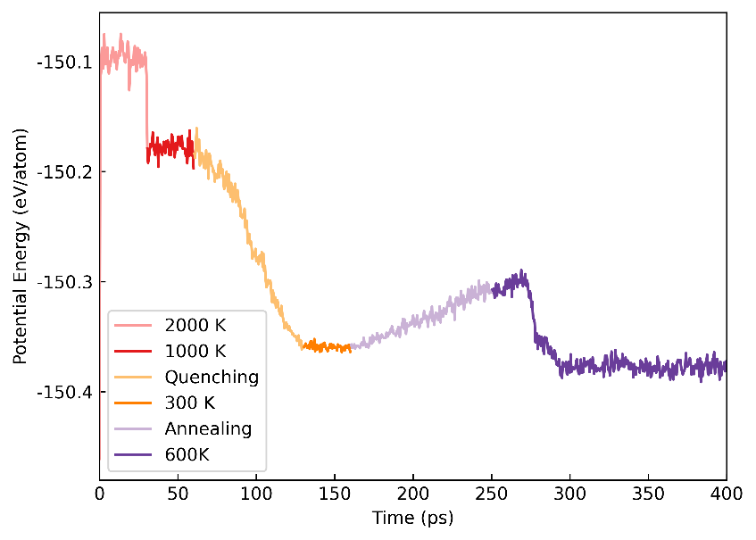

# DeePMD-kit 入门

**适用环境：Linux 集群。**

本文从已有 VASP 数据出发，介绍数据转换、DeePMD-kit 训练、模型检查和 LAMMPS 调用。训练部分使用 GeTe 数据，最后的分子动力学输入则是独立的 Sb 示例，使用时需分别准备对应体系的模型。

## 将计算数据整理为 DP 训练集

数据可以经 `.xyz` 在不同训练格式之间转换：`vasp_to_xyz.py` 读取 VASP 数据，`xyz_to_deepmd.py` 写出 `.npy` 格式的 DP 训练集，`deepmd_to_xyz.py` 则将 DP 数据转回 NEP 使用的 `.xyz` 格式。各脚本的参数见下文。

### DP 训练集的目录结构

DP 训练集的目录结构如下：

```text
.
└── Ge64Te64
    ├── set.000
    │   ├── box.npy
    │   ├── coord.npy
    │   ├── energy.npy
    │   ├── force.npy
    │   └── virial.npy
    ├── type_map.raw
    └── type.raw
```

- **set.000**：存放这一数据分片的 NumPy 文件；
  - `box.npy`：储存系统的盒子信息；
  - `coord.npy`：储存原子的坐标；
  - `energy.npy`：储存系统的能量；
  - `force.npy`：储存原子所受的力；
  - `virial.npy`：储存系统的位力张量（能量量纲；ASE 应力需再取负并除以体积）；
- **type_map.raw**：将整数类型映射到原子名称；
- **type.raw**：包含原子整数类型的信息；

DP 按系统分类，例如上面的 `Ge64Te64` 就是一个系统。
系统内的所有构型都具有相同的原子类型和原子序号，因此只需为整个系统指定一次原子类型信息即可。

### 文件转换工具

按转换方向选择脚本：

- `vasp_to_xyz.py`：将 VASP 数据转化为 `.xyz` 格式。使用方法：

  ```bash
  python vasp_to_xyz.py input_file output_file
  ```

  `input_file` 为 VASP 数据文件，`output_file` 为生成的 `.xyz` 格式文件。

- `xyz_to_deepmd.py`：将 `.xyz` 格式的 NEP 训练集转化为 `.npy` 格式的 DP 训练集。使用方法：

  ```bash
  python xyz_to_deepmd.py input_file output_dir
  ```

  `input_file` 为 `.xyz` 格式的训练集文件，`output_dir` 为生成的 DP 训练集目录。

- `deepmd_to_xyz.py`：将 DP 训练集转化为 NEP 训练集。使用方法：

  ```bash
  python deepmd_to_xyz.py input_dir output_file
  ```

  `input_dir` 为 DP 训练集目录，`output_file` 为生成的 `.xyz` 格式文件。

## 势函数训练

数据准备完成后，用 `input.json` 指定模型、损失函数和训练设置。本例输入如下：

```json
{
    "model": {
        "type_map": ["Ge", "Te"],
        "descriptor": {
            "type": "se_e2_a",
            "rcut": 6.00,
            "rcut_smth": 0.50,
            "sel": [80, 80],
            "neuron": [25, 50, 100],
            "resnet_dt": false,
            "axis_neuron": 16,
            "seed": 1
        },
        "fitting_net": {
            "neuron": [240, 240, 240],
            "resnet_dt": true,
            "seed": 1
        }
    },
    "learning_rate": {
        "type": "exp",
        "decay_steps": 5000,
        "start_lr": 0.001,
        "stop_lr": 3.51e-8
    },
    "loss": {
        "type": "ener",
        "start_pref_e": 0.02,
        "limit_pref_e": 1,
        "start_pref_f": 1000,
        "limit_pref_f": 1,
        "start_pref_v": 0,
        "limit_pref_v": 0
    },
    "training": {
        "training_data": {
            "systems": ["./train/Ge64Te64/"],
            "batch_size": "auto"
        },
        "validation_data": {
            "systems": ["./test/Ge64Ge64/"],
            "batch_size": 1,
            "numb_btch": 3
        },
        "numb_steps": 500000,
        "seed": 10,
        "disp_file": "lcurve.out",
        "disp_freq": 1000,
        "save_freq": 10000
    }
}
```

换用自己的体系时，可从这个输入调整元素、数据路径和模型参数，并检查它们是否适合目标数据。
设置 `input.json` 中的 `sel` 时，可以使用 `dp neighbor-stat -s train -r 8.0 -t Ge Te` 查看系统近邻数。
本例中，结果显示截断半径为 8 埃时，Ge、Te 的近邻原子数分别是 68、68。
考虑到 MD 模拟过程中可能存在一些极端几何形状，`sel` 应设置为比训练数据集更高的值，例如 `[80, 80]`。

准备好输入文件后，使用 `qsub run_deepmd.pbs` 提交任务开始训练。
`run_deepmd.pbs` 脚本如下所示：

```bash
#PBS -N deepmd
#PBS -l nodes=1:ppn=32
#PBS -l walltime=144:00:00
#PBS -q gpu
#PBS -S /bin/bash
#PBS -V
export INTEL_MPI_HOME=/opt/intel2020/compilers_and_libraries_2020.1.217/linux/mpi
export PATH=$INTEL_MPI_HOME/intel64/bin:$PATH
export MANPATH=$INTEL_MPI_HOME/man:$MANPATH
export LD_LIBRARY_PATH=$INTEL_MPI_HOME/intel64/lib:$LD_LIBRARY_PATH
NP=`cat $PBS_NODEFILE | wc -l`
NN=`cat $PBS_NODEFILE | sort | uniq | tee /tmp/nodes.$$ | wc -l`
cat $PBS_NODEFILE > /tmp/nodefile.$$
cd $PBS_O_WORKDIR
ulimit -s unlimited
export CUDA_VISIBLE_DEVICES=0,1
export OMP_NUM_THREADS=8
source activate /home/changruiwang-ICME/Software/deepmd-gpu
EXEC=/home/changruiwang-ICME/Software/deepmd-gpu/bin/dp
mpirun -machinefile $PBS_NODEFILE -np $NP $EXEC train input.json > output
```

### 查看训练误差与恢复训练

按本例设置，每 1000 步打印一次训练信息，每 10000 步将模型保存到检查点 `model.ckpt`。查看 `lcurve.out` 可跟踪误差变化：本例第四、第五列为能量的训练与测试误差，第六、第七列为力的训练与测试误差。可用 `dploss.py` 绘图。

训练异常停止后，可从已有检查点继续。将提交脚本中的 `$EXEC train input.json > output` 改为 `$EXEC train --restart model.ckpt input.json > output`。

训练中需要使用预训练模型时，可以在 `$EXEC train input.json ` 后面增加 `--finetune ../pretrain_model/model.pt` 选项，表示在模型 `../pretrain_model/model.pt` 的基础上微调。

### 导出模型并检查预测

训练结束后，运行 `dp freeze -o graph.pb` 冻结模型。`-o` 指定输出文件名，此处生成当前目录下的 `graph.pb`。

压缩模型能将 DPMD 的模拟速度再提高一个数量级，并且消耗更少的内存。
可以使用命令 `dp compress -i graph.pb -o graph-compress.pb` 压缩 `graph.pb`。

如果准备了验证集，可以使用命令 `dp test -m graph-compress.pb -s ./test/ -d results` 检查训练模型的质量，它将在当前目录中输出名为 `results.e.out` 和 `results.f.out` 等文件。

也可以用 dpdata 读取参考数据并调用模型预测：

```python
import dpdata
training_systems = dpdata.LabeledSystem("./train/Ge108Te108/", fmt = "deepmd/npy")  # 得到训练数据点
predict = training_systems.predict("./graph.pb")  # 得到预测数据点
```

```python
import matplotlib.pyplot as plt
import numpy as np

# Data from the file results.e_peratom.out
with open("results.e_peratom.out", "r") as file:
    lines = file.readlines()
data_lines = [line for line in lines if not line.strip().startswith("#")]
x_data, y_data = zip(*[map(float, line.split()) for line in data_lines])

# Create the plot
plt.figure(figsize=(8, 8))
plt.scatter(x_data, y_data, label='Data points')
plt.plot([-4.15, -4.12], [-4.15, -4.12], color='red', linestyle='--', label='y=x (Diagonal)')
plt.xlabel('data_e (First Column)', fontsize=12)
plt.ylabel('pred_e (Second Column)', fontsize=12)
plt.title('Comparison of Data_e and Pred_e', fontsize=14)
plt.legend()
plt.grid(alpha=0.5)
plt.axis('equal')  # Ensure the x and y scales are the same
plt.tight_layout()
plt.savefig("e_peratom.png")
```

## 训练集可视化

可以使用 Chemiscope 可视化训练集中的原子局域环境。以下命令从仓库根目录运行，以 GeTe 的元素映射为例：

```bash
python scripts/structure/deepmd_to_ase.py train/ Ge Te -o ase_dataset.db
python scripts/deepmd/extract_deepmd_descriptors.py graph.pb ase_dataset.db Ge Te -a
python scripts/visualization/create_chemiscope_input.py -a 8 ase_dataset.db descriptors.npy energies.npy
```

三个入口依次为[数据库转换](../../scripts/structure/deepmd_to_ase.py)、[描述符提取](../../scripts/deepmd/extract_deepmd_descriptors.py)和 [Chemiscope 输入生成](../../scripts/visualization/create_chemiscope_input.py)。`-a 8` 指定原子局域环境的截断半径为 8 Å，须按实际环境范围选择；输出 `chemiscope.json.gz` 可在 [Chemiscope](https://chemiscope.org/) 查看。

数据库转换读取全部 `set.*` 分片，并保留能量与力。描述符与能量有两种对应方式：

- 加 `-a` 时，描述符按结构中的原子顺序拼接，配套能量为模型原子能。
- 不加 `-a` 时，每帧对应一行描述符，配套能量为输入结构的每原子参考能。结构描述符默认按原子求和，可用 `--aggregation mean` 改为均值；比较不同原子数的体系时需说明选择。

可视化脚本检查行数与有限值，并将常量描述符列归零。PCA 用来查看数据分布，不能直接衡量势函数精度。已有输出不会被覆盖，重新分析时请使用新目录或文件名。

## 势函数用于分子动力学模拟

运行前准备初始结构 `coord.lmp`、对应体系的模型、输入文件 `lammps.in` 和提交脚本 `run_deepmd.pbs`。下面以 Sb 相变模拟为例，`pair_style` 行使用 `graph.pb`；若使用前面压缩得到的 `graph-compress.pb`，相应修改模型路径。`lammps.in` 如下：

```text
units       		metal
boundary      	p p p
atom_style     	atomic
neighbor       	2.0 bin
neigh_modify   	every 10 delay 0 check no
read_data      	coord.lmp
mass         	1 121.76000000
pair_style    		deepmd ./graph.pb
pair_coeff    	* *
variable       	run1   	equal  	60000
variable       	run2    	equal   	60000
variable       	run3    	equal   	140000
variable       	run4    	equal   	60000
variable       	run5    	equal   	180000
variable       	run6    	equal   	1000000
variable       	temp1  	equal  	2000.0
variable       	temp2 	equal  	1000.0
variable       	temp3 	equal  	300.0
variable        	temp4 	equal  	600.0
variable        	dt     	equal  	5.0e-4
variable        	tau    	equal  	${dt}*100
variable        	showt  	equal  	1000

velocity        	all create ${temp1} 12345
dump         	1 all custom ${showt} lammps.dump id type x y z

fix             	1 all nvt temp ${temp1} ${temp1} ${tau}
timestep        	${dt}
thermo_style    	custom step pe ke etotal temp press vol
thermo        	${showt}
run           	${run1}
write_restart  	nvt1.restart
unfix           	1

fix             	2 all nvt temp ${temp2} ${temp2} ${tau}
timestep        	${dt}
thermo_style    	custom step pe ke etotal temp press vol
thermo        	${showt}
run            	${run2}
write_restart   	nvt2.restart
unfix           	2

fix             	3 all nvt temp ${temp2} ${temp3} ${tau}
timestep        	${dt}
thermo_style    	custom step pe ke etotal temp press vol
thermo        	${showt}
run           	${run3}
write_restart   	nvt3.restart
unfix           	3

fix             	4 all nvt temp ${temp3} ${temp3} ${tau}
timestep        	${dt}
thermo_style    	custom step pe ke etotal temp press vol
thermo        	${showt}
restart         	5000 amorphous.restart
run            	${run4}
write_restart   	nvt4.restart
unfix           	4

fix             	5 all nvt temp ${temp3} ${temp4} ${tau}
timestep       	${dt}
thermo_style    	custom step pe ke etotal temp press vol
thermo        	${showt}
run            	${run5}
write_restart   	nvt5.restart
unfix           	5

fix             	6 all nvt temp ${temp4} ${temp4} ${tau}
timestep        	${dt}
thermo_style    	custom step pe ke etotal temp press vol
thermo       	${showt}
restart         	20000 smc.restart
run            	${run6}
write_restart   	nvt6.restart
unfix           	6
```

提交前，将训练脚本末尾的程序调用部分改为 LAMMPS 调用，再用 `qsub run_deepmd.pbs` 提交 MLMD 任务：

```bash
export LAMMPS_PLUGIN_PATH=/home/changruiwang-ICME/Software/deepmd-gpu/lib/deepmd_lmp
EXEC=/home/changruiwang-ICME/Software/deepmd-gpu/bin/lmp
mpirun -machinefile $PBS_NODEFILE -np $NP $EXEC -in *.in > output
```

模拟过程中势能随时间的变化曲线如下图所示：

<div align="left">

</div>
