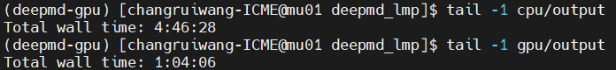
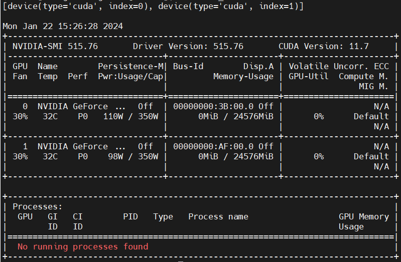

# DeePMD-kit 安装

**适用环境：Linux x86_64 集群。**

下面保留集群 3 的 DeePMD-kit 2.2.7 离线安装记录，软件路径和节点名对应原环境。

## 离线安装与环境激活

原环境安装时，先临时注释 `~/.bashrc` 中 Conda 的初始化设置，避免安装脚本覆盖，安装结束后再恢复。

访问 [官网](https://github.com/deepmodeling/deepmd-kit/releases) 下载离线安装脚本 `deepmd-kit-2.2.7-cpu-Linux-x86_64.sh`，拖入集群。
首先 `chmod 777 deepmd-kit-2.2.7-cpu-Linux-x86_64.sh` 增加脚本的可执行权限。
然后 `./deepmd-kit-2.2.7-cpu-Linux-x86_64.sh` 开始安装，一路根据提示操作即可。

安装器最后询问

```text
Do you wish to update your shell profile to automatically initialize conda?
```

时选择 `no`，保留原有的 shell 初始化方式。

安装完成后，使用命令

```bash
conda activate /home/changruiwang-ICME/Software/deepmd-kit
```

激活环境。

或者，创建一个软链接

```bash
ln -s /home/changruiwang-ICME/Software/deepmd-kit ~/anaconda3/envs/deepmd
```

这样就可以使用命令 `conda activate deepmd` 激活环境了。

## 原集群的 GPU 与 MPI 环境

原记录建议在 GPU 节点（`ssh gpu04`）安装。下图比较 DP 自带的 lmp 在集群 3 的 CPU、GPU 节点上模拟同一条轨迹的耗时：

<div align="left">

</div>

由于集群 3 里 cu60 后续节点（包括 gpu04）没有 module 的封装，所以 INTEL_MPI 环境需要自己导入，如下所示：

```bash
export INTEL_MPI_HOME=/opt/intel2020/compilers_and_libraries_2020.1.217/linux/mpi
export PATH=$INTEL_MPI_HOME/intel64/bin:$PATH
export MANPATH=$INTEL_MPI_HOME/man:$MANPATH
export LD_LIBRARY_PATH=$INTEL_MPI_HOME/intel64/lib:$LD_LIBRARY_PATH
```

原记录的集群 CUDA 版本为 11.7。用 `nvidia-smi` 查看 NVIDIA 驱动信息，原输出如下：

<div align="left">

</div>

## Docker 安装

```bash
docker pull ghcr.io/deepmodeling/deepmd-kit:latest_cu11
```
