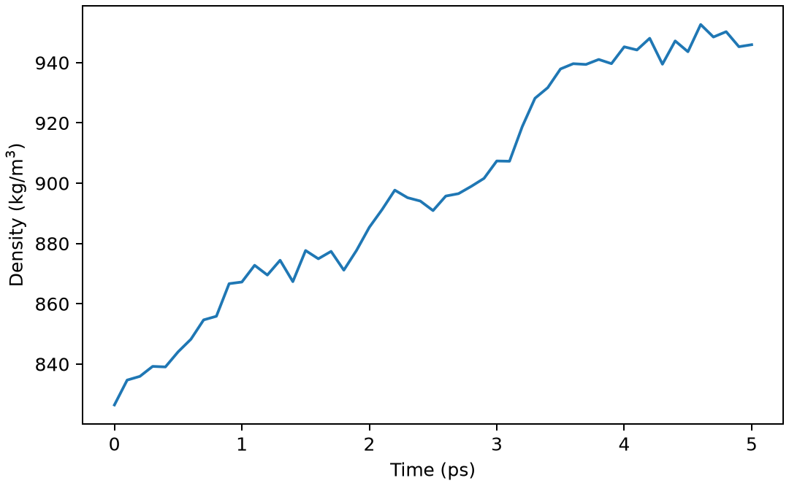

# GROMACS 恒压动力学与密度

**适用环境：Linux + PBS 运行计算；Windows / macOS / Linux 可准备结构与分析结果。**

NPT 动力学通过压控调整盒子，适合平衡体相体系的密度。小体系的瞬时压力可以大幅涨落，应关注统计平均、体积与结构变化。

本例沿用 TIP3P 水盒，最小化和 5 ps NVT 之后，再运行 5 ps NPT。后一个阶段通过 `grompp -t nvt.cpt` 读取检查点，配合 `continuation=yes`、`gen-vel=no` 延续已有状态；采用各向同性 C-rescale 压控，目标为 1 bar。

## 从 NVT 状态开始 NPT

[最小案例](../../../examples/gromacs/minimal/npt)包含：

- [structure.gro](../../../examples/gromacs/minimal/npt/structure.gro)
- [topol.top](../../../examples/gromacs/minimal/npt/topol.top)
- [em.mdp](../../../examples/gromacs/minimal/npt/em.mdp)
- [nvt.mdp](../../../examples/gromacs/minimal/npt/nvt.mdp)
- [npt.mdp](../../../examples/gromacs/minimal/npt/npt.mdp)
- [run.py](../../../examples/gromacs/minimal/npt/run.py)：组织计算步骤。
- [job.pbs](../../../examples/gromacs/minimal/npt/job.pbs)：单节点 PBS 作业。
- [postprocess.py](../../../examples/gromacs/minimal/npt/postprocess.py)：检查并提取结果。
- [requirements.txt](../../../examples/gromacs/minimal/npt/requirements.txt)：Python 分析依赖。

在集群加载 GROMACS。此小例采用单节点 thread-MPI `gmx`、1 个 MPI 任务与 2 个 OpenMP 线程；`GMX_EXEC` 可指定相应入口。`topol.top` 引用安装中的 AMBER99SB-ILDN 与 TIP3P 定义，案例不复制力场文件。若集群只提供外部 MPI 构建，需要按[基础笔记](GROMACS基础知识.md)调整启动器，不能把 `gmx_mpi` 直接代入当前 `-ntmpi` 命令。

在案例目录安装 Python 依赖并提交：

```bash
python3 -m pip install -r requirements.txt
qsub job.pbs
```

作业结束后会自动执行后处理。重新分析已有输出时，可单独运行 `python3 postprocess.py`。PBS 中的软件加载方式与资源语法按集群配置调整；此例不需要多节点。

## 压控方法与盒形自由度

| 设置 | 本例 | 选择依据 |
| --- | --- | --- |
| `pcoupl` | `C-rescale` | 随机体积重标定方案 |
| `pcoupltype` | `isotropic` | 体相水；膜体系等需另选自由度 |
| `tau-p` | 2 ps | 压力耦合时间，不是压缩率 |
| `compressibility` | 4.5e−5 bar⁻¹ | 水的近似设置；其他模型需核对 |
| `ref-p` | 1 bar | 与 GROMACS 压力单位一致 |
| 温度 | 300 K、v-rescale | 压控不替代温控 |

## 密度曲线是否仍在漂移

后处理从 `.edr` 提取密度、温度和势能，核对 NPT 时间为 5 ps。图可看到密度对初始盒子的响应；后半段平均值仅作短程流程检查，不能作为已收敛的水密度预测。

若盒子突然塌缩或膨胀，先检查初始结构、单位、力场和压力参数。对膜使用各向同性压控可能改变预期模型；不能照搬体相水的设置。

本例后半段平均密度约 930 kg/m³，图中仍可见从初态向高密度演化，5 ps 尚不足以作平衡密度结论。



图由案例的 `postprocess.py` 从计算输出生成。

正式研究应延长平衡，检查密度和结构不再系统漂移后再统计；压力误差需结合相关时间和独立样本，而非只看总帧数。

## 界面与孔道中的局部空间分布

盒子的平均质量密度只给出整体信息。若想知道表面水层、孔道或吸附位点附近的粒子分布，需要在指定参考系中统计轨迹。

先处理跨周期边界的结构与镜像，再选择参考：固定晶体表面通常保留晶格方向和表面法向；跟随溶质的局部溶剂壳层则需去除参考组的整体平移与转动。对整个柔性体系强行拟合，可能混入真实形变。处理后核对基底、粒子和显示结构是否仍处于同一坐标系。

[GROMACS 的 `gmx spatial`](https://manual.gromacs.org/documentation/2026.4/onlinehelp/gmx-spatial.html)可输出供 VMD 显示的 cube 格点。记录分析原子组、参考组、时间窗、格距和归一化设置；显示结构的原子列表与参与统计的粒子组分别核对。变胞轨迹还需明确统计在固定实空间网格还是随胞变化的坐标中进行，不能把盒子伸缩产生的展宽直接解释为粒子扩散。

[VMD VolMap](https://www-s.ks.uiuc.edu/Research/vmd/plugins/volmapgui/)的 `density` 用原子半径决定宽度的归一化高斯分布构造加权密度，`occupancy` 则统计格点是否被占据；后者逐帧平均得到占据比例，同一格点出现多个粒子也不等同于多倍占据。数密度、质量密度、相对体相归一化的分布和占据比例采用不同定义与单位，比较等值面前统一这些设置，并检查格距、平滑宽度及分块统计的稳定性。叠加透明球可以展示访问区域，但画面深浅还受球半径、透明度和视角影响，不能直接作为定量概率。

### 二维图：区分投影厚度与归一化

[`gmx densmap`](https://manual.gromacs.org/documentation/2026.4/onlinehelp/gmx-densmap.html)的平面模式沿 `-aver` 指定的方向平均；例如 `-aver z` 得到 x–y 图，`-xmin`、`-xmax` 限定的是 z 方向参与统计的区间，参数名中的 x 不代表固定选择笛卡尔 x 轴。它统计有限厚度区域，不能直接等同于某个高度的无厚度切片。保留区间上下限与单位；改变厚度可能混入不同吸附层。

默认 `-unit nm-3` 输出数密度，`nm-2` 省略平均方向或角向的归一化，`count` 输出每格计数。二维画布本身不能决定数据量纲。比较不同区域时统一归一化、格距、时间窗和色标，并用 `-od` 保存数值数据。叠加结构轮廓时使用同一坐标变换、原点、长度尺度与投影，不凭截图缩放去匹配原子。轴向—径向模式的轴由前两个参考组的质心确定，会平均掉角向信息；它适合分析沿孔道的分层，不能分辨相同半径上不同方位的位点。

### 分层氢键数：归属和平均方式先定义

统计表面水层或孔道中的氢键时，给出供体—受体距离、角度定义与阈值，并确认工具的角度是 D—H—A 夹角还是偏离线性的角度。按水氧、质心或“任一原子进入层内”归属分子会得到不同分层；最后一种还可能使同一水分子属于相邻多层。周期边界的邻居搜索与分子完整性需显式处理，不能仅靠避开盒边就替代周期分析。

统计的是独立氢键条数，还是每个水分子的参与次数？前者每条只计一次；后者中，层内—层内的氢键贡献 2 次参与，层内—层外贡献 1 次。分别统计供体、受体时需检查重复。

平均方式也要明确：逐帧先除以水数再平均，与全部参与次数除以全部水分子观测数，权重不同。空层帧的每水平均值无定义，应报告其比例与处理方法。用分块统计评估误差，几何氢键数则与键能、寿命分别解释。

进一步了解方法与文件规则，可看[GROMACS 基础知识](GROMACS基础知识.md)。参考：[GROMACS 压控参数](https://manual.gromacs.org/current/user-guide/mdp-options.html)。
