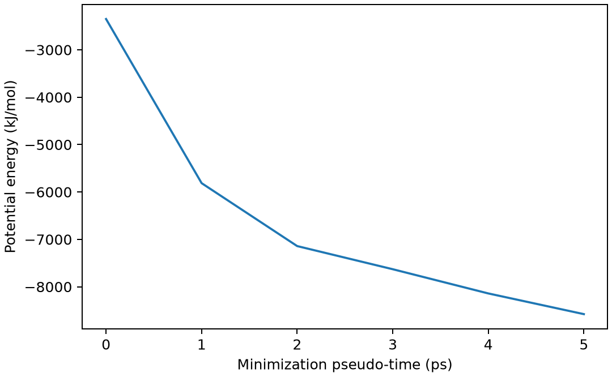

# GROMACS 能量最小化

**适用环境：Linux + PBS 运行计算；Windows / macOS / Linux 可准备结构与分析结果。**

能量最小化用于消除坏接触、降低受力，为动力学提供合理起点。它没有真实时间演化，也不能代替有限温度平衡。

## 模型与计算思路

采用边长 2 nm、221 个水分子的周期盒，坐标由 GROMACS 2026.4 自带 `spc216.gro` 经 `gmx solvate -box 2 2 2` 生成；势能模型由拓扑指定为 AMBER99SB-ILDN 配套 TIP3P。坐标模板名称不决定水的力场。

## 准备输入与环境

[最小案例](../../../examples/gromacs/minimal/energy-minimization)包含：

- [structure.gro](../../../examples/gromacs/minimal/energy-minimization/structure.gro)
- [topol.top](../../../examples/gromacs/minimal/energy-minimization/topol.top)
- [em.mdp](../../../examples/gromacs/minimal/energy-minimization/em.mdp)
- [run.py](../../../examples/gromacs/minimal/energy-minimization/run.py)：组织计算步骤。
- [job.pbs](../../../examples/gromacs/minimal/energy-minimization/job.pbs)：单节点 PBS 作业。
- [postprocess.py](../../../examples/gromacs/minimal/energy-minimization/postprocess.py)：检查并提取结果。
- [requirements.txt](../../../examples/gromacs/minimal/energy-minimization/requirements.txt)：Python 分析依赖。

在集群加载 GROMACS。此小例采用单节点 thread-MPI `gmx`、1 个 MPI 任务与 2 个 OpenMP 线程；`GMX_EXEC` 可指定相应入口。`topol.top` 引用安装中的 AMBER99SB-ILDN 与 TIP3P 定义，案例不复制力场文件。若集群只提供外部 MPI 构建，需要按[基础笔记](GROMACS基础知识.md)调整启动器，不能把 `gmx_mpi` 直接代入当前 `-ntmpi` 命令。

在案例目录安装 Python 依赖并提交：

```bash
python3 -m pip install -r requirements.txt
qsub job.pbs
```

作业结束后会自动执行后处理。重新分析已有输出时，可单独运行 `python3 postprocess.py`。PBS 中的软件加载方式与资源语法按集群配置调整；此例不需要多节点。

## 参数怎样选

| 设置 | 本例 | 含义 |
| --- | --- | --- |
| `integrator` | `steep` | 最速下降最小化 |
| `emtol` | 500 kJ mol⁻¹ nm⁻¹ | 最大力目标，不是能量变化阈值 |
| `emstep` | 0.01 nm | 最小化试探步长 |
| `nsteps` | 2000 | 上限，需检查实际收敛原因 |
| 非键处理 | PME、0.8 nm 实空间截断 | 为小盒演示选择；正式计算按力场推荐并测试 |

## 结果与检查

`run.py` 先执行 `grompp`，再执行 `mdrun`。后处理要求日志出现达到最大力阈值的信息，并通过官方 `gmx energy` 提取势能。`em.gro` 为后续动力学起点。

图的横轴为最小化器输出的伪时间标签，不应解释为分子运动时间。若能量不下降或最大力很大，先看坏接触、拓扑和约束；不能直接增加允许的 LINCS 警告。

本例保存的势能从约 −2349.5 降至 −8577.6 kJ/mol，最大力达到所设阈值。



图由案例的 `postprocess.py` 从计算输出生成。

拓扑中 `SOL 221` 与结构必须一致。复制结构却未同步分子数，是 `grompp` 常见错误；本案例附完整坐标与拓扑，外部力场由安装提供。

进一步了解方法与文件规则，可看[GROMACS 基础知识](GROMACS基础知识.md)。参考：[GROMACS MDP 参数](https://manual.gromacs.org/current/user-guide/mdp-options.html)。
