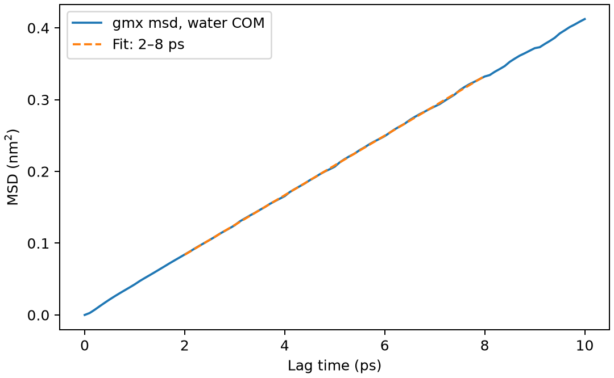

# GROMACS 均方位移与扩散系数

**适用环境：Linux + PBS 运行计算；Windows / macOS / Linux 可准备结构与分析结果。**

扩散系数来自长时均方位移的斜率。多时间起点可以改善统计，但不能消除短轨迹和有限尺寸带来的偏差。

## 水分子质心的 MSD 与拟合区间

水盒最小化后先做 5 ps NVT，再固定盒子运行 20 ps，保存间隔 0.1 ps。用官方 `gmx msd` 对每个水分子的质心计算 MSD，参考起点间隔 1 ps，最大延迟 10 ps，以 2—8 ps 区间拟合。

三维各向同性扩散满足 $D=\frac{1}{6}\frac{d\langle|\Delta\mathbf r(t)|^2\rangle}{dt}$。这里坐标单位 nm、时间 ps，因此斜率除以 6 得到 nm²/ps；1 nm²/ps=10⁻⁶ m²/s。

## 运行轨迹并准备分析

[最小案例](../../../examples/gromacs/minimal/diffusion)包含：

- [structure.gro](../../../examples/gromacs/minimal/diffusion/structure.gro)
- [topol.top](../../../examples/gromacs/minimal/diffusion/topol.top)
- [em.mdp](../../../examples/gromacs/minimal/diffusion/em.mdp)
- [nvt.mdp](../../../examples/gromacs/minimal/diffusion/nvt.mdp)
- [md.mdp](../../../examples/gromacs/minimal/diffusion/md.mdp)
- [run.py](../../../examples/gromacs/minimal/diffusion/run.py)：组织计算步骤。
- [job.pbs](../../../examples/gromacs/minimal/diffusion/job.pbs)：单节点 PBS 作业。
- [postprocess.py](../../../examples/gromacs/minimal/diffusion/postprocess.py)：检查并提取结果。
- [requirements.txt](../../../examples/gromacs/minimal/diffusion/requirements.txt)：Python 分析依赖。

在集群加载 GROMACS。此小例采用单节点 thread-MPI `gmx`、1 个 MPI 任务与 2 个 OpenMP 线程；`GMX_EXEC` 可指定相应入口。`topol.top` 引用安装中的 AMBER99SB-ILDN 与 TIP3P 定义，案例不复制力场文件。若集群只提供外部 MPI 构建，需要按[基础笔记](../基础与平衡/GROMACS基础知识.md)调整启动器，不能把 `gmx_mpi` 直接代入当前 `-ntmpi` 命令。

在案例目录安装 Python 依赖并提交：

```bash
python3 -m pip install -r requirements.txt
qsub job.pbs
```

作业结束后会自动执行后处理。重新分析已有输出时，可单独运行 `python3 postprocess.py`。PBS 中的软件加载方式与资源语法按集群配置调整；此例不需要多节点。

## 时间起点、延迟与周期处理

| 分析设置 | 选择原因 |
| --- | --- |
| `-sel "res_com of resname SOL"` | 每个水残基对应一分子，跟踪质心 |
| `-trestart 1` | 多时间起点，单位 ps |
| `-maxtau 10` | 限制最大延迟，避免极少起点支撑的长延迟尾部 |
| `-beginfit 2 -endfit 8` | 演示拟合窗口，实际需检查扩散区间 |
| 周期处理 | 使用原始轨迹和工具 PBC 处理，不逐帧居中后算位移 |

## 扩散系数对拟合窗口是否稳定

后处理先检查 20 ps 动力学和平均温度，再调用 `gmx msd`；Python 对原生 MSD 的指定窗口复算斜率并画图。`msd-analysis.log` 保留原生工具的拟合信息，`results.json` 保存 D。

线性区间内 D 应对窗口变化相对稳定。这个 2 nm、20 ps 的小例仅用于学习数据链；温控、初始密度、有限尺寸、采样长度都会影响数值，不能直接当作实验水自扩散系数。

本例 2—8 ps 拟合得到 D≈0.00692 nm²/ps（6.92×10⁻⁹ m²/s）。这与所用模型、未做充分密度平衡的初态及小盒短轨迹有关。



图由案例的 `postprocess.py` 从计算输出生成。

对多原子配体或聚合物，应明确是分子质心、特定原子还是链段扩散。体系整体漂移和周期展开也要检查；可结合独立重复、不同盒尺寸与更长轨迹评估误差。

## 轨迹连线用于看路径，不直接给扩散系数

在 VMD 中连接某粒子不同帧的位置，可帮助检查孔道跳跃、表面迁移或局部笼困。固定原子身份与时间窗，先选择连续展开坐标或明确的周期断线规则；直接连接包回主胞的坐标，会把跨边界事件画成穿过盒子的长线。动态距离选择可能让成员随帧改变，不能按列表位置把不同原子的点接在一起。结构对齐或逐帧居中也会改变所展示的运动，保留处理方式。

连线只连接保存的离散位置，抽帧后可能跨过真实的弯曲路径或跳跃中间态；检查最后一段没有超出实际帧数。折线总长度随保存和抽帧间隔改变，不是净位移，也不能用它除以时间代替 MSD 的扩散系数。比较不同体系的轨迹图时统一时长、采样间隔与空间比例，定量输运仍回到位移统计和误差分析。

进一步了解方法与文件规则，可看[GROMACS 基础知识](../基础与平衡/GROMACS基础知识.md)。参考：[GROMACS MSD 命令](https://manual.gromacs.org/current/onlinehelp/gmx-msd.html)。
