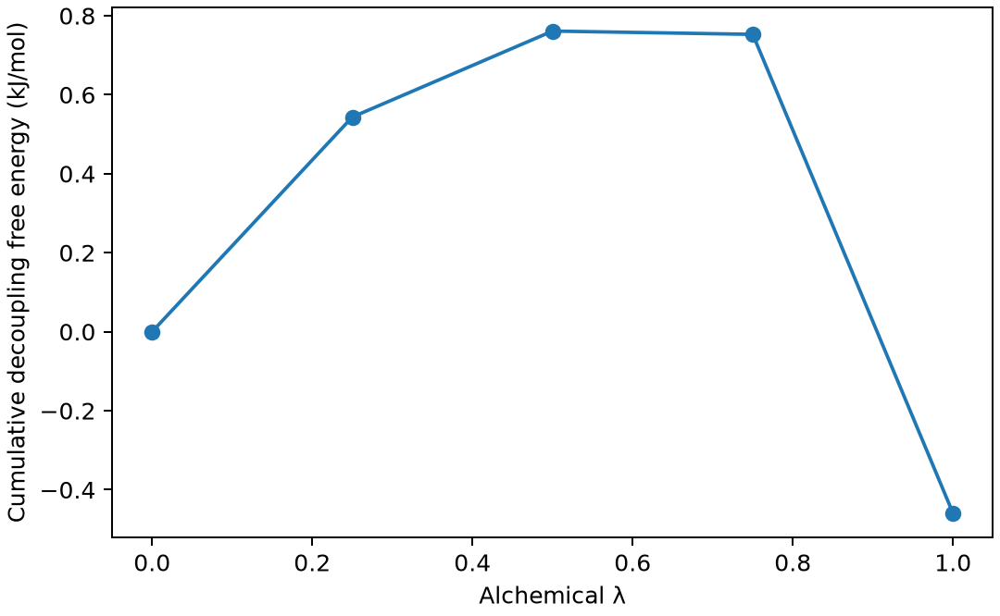

# GROMACS 炼金自由能与 BAR 分析

**适用环境：Linux + PBS 运行计算；Windows / macOS / Linux 可准备输入与分析结果。**

炼金自由能沿人为的哈密顿量参数 λ 改变相互作用，用于溶剂化、相对结合自由能等问题。λ 是计算路径，不是物理时间或实际反应进度。

## 方法与物理量

自由能差需要相邻 λ 态的能量分布有重叠。BAR 利用正反方向的能量差统计，通常比仅看平均 dH/dλ 更直接地暴露重叠不足；误差还受相关时间与平衡影响。

去耦粒子的 Lennard–Jones 相互作用时，普通线性缩放可能在端点出现奇异采样，soft-core 改变短程插值来缓解该问题。带电粒子还涉及电荷路径、长程静电与有限尺寸修正，不能照搬中性粒子方案。

## 最小模型与输入

在相同水盒中放一个中性 LJ Ar，使用 λ=0、0.25、0.5、0.75、1 五个状态，从全相互作用逐步去耦至无溶质-环境相互作用。电荷始终为零，只改变 vdW；每态独立最小化后运行 10 ps；未进行充分的 NPT 密度预平衡，这也是本例仅用于流程演示的原因之一。

[案例目录](../../../examples/gromacs/minimal/alchemical-free-energy)包含以下科学输入：

[em.mdp](../../../examples/gromacs/minimal/alchemical-free-energy/em.mdp)、[l0.gro](../../../examples/gromacs/minimal/alchemical-free-energy/l0.gro)、[l0.mdp](../../../examples/gromacs/minimal/alchemical-free-energy/l0.mdp)、[l0.top](../../../examples/gromacs/minimal/alchemical-free-energy/l0.top)、[l1.gro](../../../examples/gromacs/minimal/alchemical-free-energy/l1.gro)、[l1.mdp](../../../examples/gromacs/minimal/alchemical-free-energy/l1.mdp)、[l1.top](../../../examples/gromacs/minimal/alchemical-free-energy/l1.top)、[l2.gro](../../../examples/gromacs/minimal/alchemical-free-energy/l2.gro)、[l2.mdp](../../../examples/gromacs/minimal/alchemical-free-energy/l2.mdp)、[l2.top](../../../examples/gromacs/minimal/alchemical-free-energy/l2.top)、[l3.gro](../../../examples/gromacs/minimal/alchemical-free-energy/l3.gro)、[l3.mdp](../../../examples/gromacs/minimal/alchemical-free-energy/l3.mdp)、[l3.top](../../../examples/gromacs/minimal/alchemical-free-energy/l3.top)、[l4.gro](../../../examples/gromacs/minimal/alchemical-free-energy/l4.gro)、[l4.mdp](../../../examples/gromacs/minimal/alchemical-free-energy/l4.mdp)、[l4.top](../../../examples/gromacs/minimal/alchemical-free-energy/l4.top)、[stages.json](../../../examples/gromacs/minimal/alchemical-free-energy/stages.json)。

结构写在坐标文件或各输入的原子/晶胞段；`stages.json` 列出计算阶段。配套 [run.py](../../../examples/gromacs/minimal/alchemical-free-energy/run.py) 顺序组织任务，[job.pbs](../../../examples/gromacs/minimal/alchemical-free-energy/job.pbs) 提交作业，[postprocess.py](../../../examples/gromacs/minimal/alchemical-free-energy/postprocess.py) 检查结果并绘图。

## 参数与提交

加载单节点 thread-MPI GROMACS，`GMX_EXEC` 指定 `gmx`。本例每窗口使用 2 个 OpenMP 线程，拓扑引用安装中的 AMBER99SB-ILDN/TIP3P；外部 MPI 构建需相应调整启动器。

| 设置 | 本例选择 |
| --- | --- |
| `free-energy/init-lambda-state` | 启用自由能并指定当前状态索引 |
| `couple-moltype ARG` | 只去耦所指定溶质 |
| `vdw-lambdas/coul-lambdas` | vdW 逐级变化，电荷路径不变 |
| `sc-alpha/sc-power/sc-sigma` | 0.5 / 1 / 0.3 nm，soft-core 参数 |
| `calc-lambda-neighbors=-1` | 输出本例所有态的能差以便分析 |

拓扑中 Ar 参数是简化模型定义，不是经过验证的通用气体溶解度参数。

在干净案例目录安装[Python 依赖](../../../examples/gromacs/minimal/alchemical-free-energy/requirements.txt)并提交：

```bash
python3 -m pip install -r requirements.txt
qsub job.pbs
```

PBS 中的资源语法和软件加载方式按集群调整。计算结束后自动执行后处理；若只分析已保存的结果，运行 `python3 postprocess.py`。各阶段独立保存输出，便于定位失败步骤。

## 结果与判断

后处理丢弃前 2 ps，以原生 `gmx bar` 分析五组 dhdl 数据，保留各相邻态的详细结果、直方图与累计自由能。`bar-integral.xvg` 原生数值以 kT 表示，脚本显式转成 kJ/mol；图的横轴映射为实际 vdW λ。

本例去耦自由能约 −0.460 kJ/mol，原生分块误差约 0.319 kJ/mol。

总去耦自由能与原生分块误差写入 `results.json`。短轨迹下的分块误差不包含所有未平衡和慢相关误差，不能据此给出实验精度承诺。



图由案例后处理脚本读取实际计算输出生成。

## 扩展到实际研究

正式任务检查相邻态重叠、端点行为、有效样本与正反方向一致性，必要时增加 λ 点并延长采样。溶剂化或结合自由能还需完整热力学循环、参考态和修正；当前只演示一个溶液去耦分支，没有把它直接称为完整结合自由能。

参考：[GROMACS 自由能与分析手册](https://manual.gromacs.org/current/index.html)。
