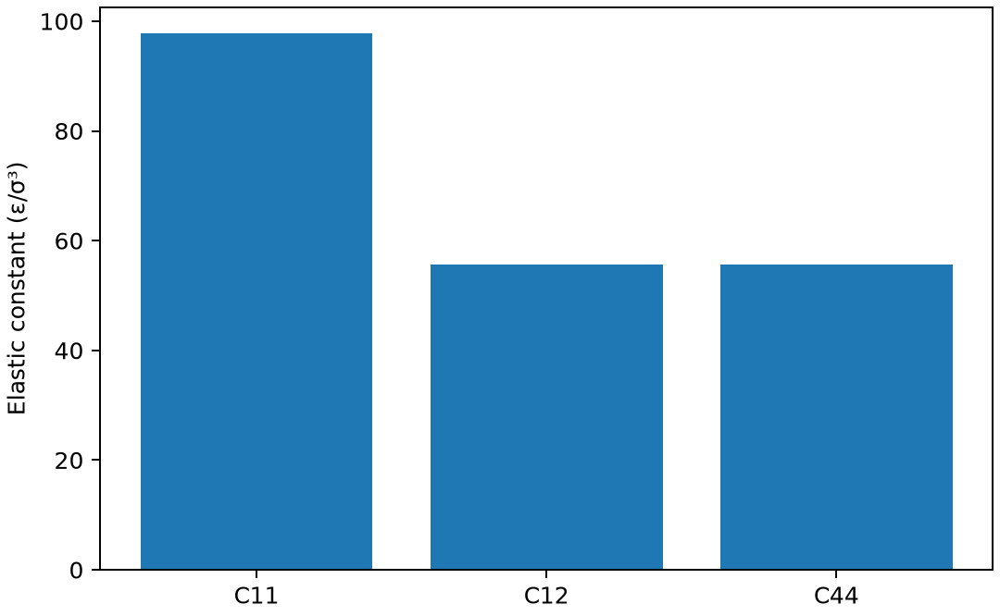

# LAMMPS 弹性常数与应力应变

**适用环境：Linux + PBS 运行计算；Windows / macOS / Linux 可准备输入与分析结果。**

弹性常数描述小应变下的应力响应。计算前必须说明温度、内部弛豫、压力与应变定义，否则数值相近也可能对应不同物理量。

## 应力符号与剪切应变的约定

线性弹性关系为 σij=Cijkl εkl。LAMMPS 的压力张量与拉伸为正的应力符号相反，中心差分时必须处理符号。工程剪切 γxy=2εxy，提取 C44 时也要保持一致。

对立方晶体只有 C11、C12、C44 三个独立分量。这里固定温度为零，通过最小化比较应变前后响应；不等于有限温度等温或绝热弹性张量。

## 对 LJ 晶体施加正负小应变

使用 256 原子的 fcc LJ 晶体，先通过各向同性 box/relax 将初始压力降到零，再施加 x 轴 ±0.001 法向应变与 xy ±0.001 工程剪切。各分支固定应变后的盒子，仅最小化原子坐标。

[案例目录](../../../examples/lammps/minimal/elastic-tensor)包含以下科学输入：

[prepare.in](../../../examples/lammps/minimal/elastic-tensor/prepare.in)、[sminus.in](../../../examples/lammps/minimal/elastic-tensor/sminus.in)、[splus.in](../../../examples/lammps/minimal/elastic-tensor/splus.in)、[stages.json](../../../examples/lammps/minimal/elastic-tensor/stages.json)、[xminus.in](../../../examples/lammps/minimal/elastic-tensor/xminus.in)、[xplus.in](../../../examples/lammps/minimal/elastic-tensor/xplus.in)。

结构写在坐标文件或各输入的原子/晶胞段；`stages.json` 列出计算阶段。配套 [run.py](../../../examples/lammps/minimal/elastic-tensor/run.py) 顺序组织任务，[job.pbs](../../../examples/lammps/minimal/elastic-tensor/job.pbs) 提交作业，[postprocess.py](../../../examples/lammps/minimal/elastic-tensor/postprocess.py) 检查结果并绘图。

## 参数与提交

加载 LAMMPS，`LMP_EXEC` 可指定程序。此处使用脚本中定义的 LJ 模型，不需外部势文件；复杂材料应选择经过验证的势函数。

| 操作 | 目的 |
| --- | --- |
| 初始盒子弛豫 | 避免用显著预应力状态代替零压参考 |
| 中心差分 | 同时利用正负应变，减少非线性误差 |
| 固定变形盒子最小化 | 获得此方案下允许内部松弛的响应 |
| `change_box ... xy` | 使用倾斜量与盒长构造工程剪切 |
| LJ 单位 | 弹性模量以 ε/σ³ 表示，不自动是 GPa |

在干净案例目录安装[Python 依赖](../../../examples/lammps/minimal/elastic-tensor/requirements.txt)并提交：

```bash
python3 -m pip install -r requirements.txt
qsub job.pbs
```

PBS 中的资源语法和软件加载方式按集群调整。计算结束后自动执行后处理；若只分析已保存的结果，运行 `python3 postprocess.py`。各阶段独立保存输出，便于定位失败步骤。

## 提取立方晶体的三个独立分量

后处理由压力中心差分提取 C11≈97.7130、C12≈55.6278、C44≈55.6272（ε/σ³），体积模量约 69.6562。并检查零压立方体系的稳定性条件 C11−C12>0、C11+2C12>0、C44>0。

本例成对势中 C12 与 C44 接近，不能推广为所有真实材料的关系。稳定性条件通过也不证明势函数能正确再现实验弹性。



图由案例后处理脚本读取实际计算输出生成。

## 扩展到实际研究

实际材料需测试超胞、势、应变幅度与最小化阈值，并明确晶体对称性。含复杂基元时比较固定内部坐标与内部弛豫的区别；有限温度响应还要处理采样与应力涨落。可用 Atomsk/ASE 建模，OVITO 检查变形后结构是否仍处于同一相。

### Alkemie 中的有限温度加载

从三维周期原子体系的系统设置、最小化和平衡开始，按想控制的量选择末端组件。四种组件继承平衡末态的坐标和速度。

| 组件 | 加载与边界条件 | 读取结果 |
| --- | --- | --- |
| 单轴压缩 | NVT 下逐步缩短加载轴，固定横向尺寸 | 轴向应力与负工程应变 |
| 简单剪切 | NVT 下逐步改变一个晶胞倾斜量，固定晶胞边长 | 剪切应力与工程剪应变 |
| 恒应力蠕变 | 恒温，沿加载轴控压，固定横向尺寸和倾斜量 | 轴向应变随时间的变化 |
| 阶跃应变应力松弛 | 瞬时伸长加载轴并重映射坐标，随后在固定变形盒中运行 NVT | 固定应变下应力随时间的变化 |

`mechanics.dat` 保存时间、工程应变、应力与温度。蠕变组件的目标压力沿用 LAMMPS 符号，正值施加压缩。结果中的应力为压力张量分量的相反数，`metal` 单位转换为 GPa，`lj` 单位保留 ε/σ³。剪切用倾斜量的变化除以加载前的对应盒长，例如 γxy=Δxy/Ly。分析蠕变速率时，应检查初始控压瞬态后是否出现稳定斜率。比较压缩或剪切曲线时，记录加载速率与控温参数。

命令细节见 [LAMMPS fix deform](https://docs.lammps.org/fix_deform.html)、[change_box](https://docs.lammps.org/change_box.html) 与 [fix npt](https://docs.lammps.org/fix_nh.html)。

「有限温等温弹性常数」从同一个平衡末态出发，分别对六个 Voigt 应变方向施加正负扰动。每个变形盒先单独平衡，再在 NVT 下采样平均压力张量。用正负分支的平均应力差除以两者的应变差，得到等温刚度矩阵。将未对称化的 $C_{ij}$ 与 $C_{ji}$ 相互核对，并改变采样时长和应变幅度，判断统计误差与非线性误差。[LAMMPS 有限温弹性方法](https://docs.lammps.org/Howto_elastic.html)

### 固定面内晶格计算广义层错能

「广义层错能」模板以 $z$ 为滑移面法向。准备取向正确的周期体相，把分割位置放在两个原子层之间，再沿指定面内方向逐点平移上半晶体。周期晶胞的 $xz$ 和 $yz$ 倾斜量随位移同步改变，使跨周期边界的两侧保持匹配。每点仅弛豫法向坐标，能量减去零位移参考值，再除以一处滑移面的面积。若终点位移是面内晶格平移，层错能应回到零附近。分析局部极小和不稳定层错能前，先核对晶面取向、滑移方向、法向厚度和位移点数。

参考：[LAMMPS 弹性常数方法](https://docs.lammps.org/Howto_elastic.html)。
