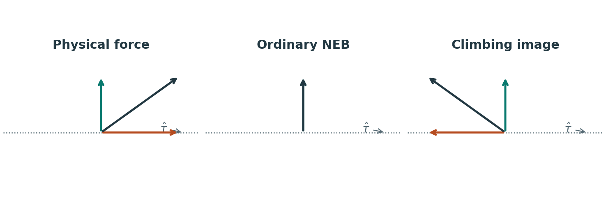

# LAMMPS NEB 计算

**适用环境：Linux（NEB 多副本计算）。**

NEB 用一串副本表示反应路径。`fix neb` 定义副本之间的附加力，`neb` 驱动路径最小化；下面先看命令，再结合投影力理解两个优化阶段。

## 两个命令怎样配合

### fix neb

`fix neb` 为多副本优化定义附加的 nudging force，其中弹簧项用于控制副本间距。这些力在 `neb` 的最小化过程中施加。

`fix ID group-ID neb Kspring keyword value`

- Kspring：弹簧系数（单位根据 parallel 的值确定）
- parallel：如何计算 nudging force，即 $F_{\|}$
  - neigh：通过前后相邻两个 replica 之间的距离计算，$F_{\|}=K \text { spring } \cdot\left(\left|R_{i+1}-R_i\right|-\left|R_i-R_{i-1}\right|\right)$，单位是 force/distance。(default)
  - ideal：根据目前位置（reaction coordinate）与理想位置之间的偏差来计算力
  - equal：在 climbing 之前（即下面的 NEB 第一步）用 ideal 方式计算，保证距离相等；climbing 时通过能量差来计算力。
- perp Kspring2：垂直于路径方向的 nudging force 弹簧常数，$F_{\perp}=K_{\text {spring } 2} \cdot F\left(R_{i-1}, R_i, R_{i+1}\right)\left(R_{i+1}+R_{i-1}-2 R_i\right)$。$F\left(R_{i-1}, R_i, R_{i+1}\right)$ 是与三点夹角有关的函数，当三点一线时为 0，当成锐角时为 1。default=0。
- end：设置作用在第一个和最后一个 replica 上的力，**默认这两个 replica 不受额外的力**。这个关键字可以使用两次，分别向 first 和 last 添加力
  - estyle：
    - first：向 first replica 施加力，*ETarget* is set to the initial energy of the replica
    - last：向 last replica 施加力，*ETarget* is set to the initial energy of the replica
    - last/efirst：向 last replica 施加力，并且设置其 target energy 为 first replica 的能量
    - last/efirst/middle：与 last/efirst 相同，加上防止 middle replica 的能量低于 first replica

### neb

`neb etol ftol N1 N2 Nevery file-style arg keywords values`

- etol：能量收敛条件，每个 replica 都要达到收敛标准，这里的能量计算不包括 replica 之间的 nudging forces 贡献
- ftol：力收敛条件，每个 replica 都要达到收敛标准，这里的力计算包括 replica 之间的 nudging forces 贡献
- N1：初始 NEB 的最大迭代步数
- N2：爬坡 NEB 的最大迭代步数
- Nevery：在两个阶段中，每隔 Nevery 时间步，每个 replica 的势能及其沿反应路径的归一化距离（反应坐标 RD）将被输出到主日志 `log.lammps` 文件中。N1 和 N2 都必须为 Nevery 的倍数。
- file-style：
  - final：需要存在指定的文件，文件中指定 NEB atom 或 group 最终的坐标。NEB 计算时以这个作为 last replica，middle replica 的初始位置通过 first replica 和 last replica 插值得到。
  - each：为每个 replica 指定单独的坐标文件，文件名可以使用变量。除了 first replica 外都会读取对应的文件。这种方式便于控制初始扩散路径，但需要逐副本准备坐标。
  - none：不指定文件，各副本需预先通过 `read_data`、`read_restart` 或 `read_dump` 取得自己的初始结构
- verbosity：设置输出主日志 `log.lammps` 的输出信息，不影响分区日志。每隔 Nevery 输出一次
  - terse：timestep, the maximum force of a replica, the maximum force per atom (in any replica), potential gradients in the initial, final, and climbing replicas, the forward and backward energy barriers, the total reaction coordinate (RDT).
  - default：除了 terse 中的还额外输出反应坐标和每个 replica 的势能
  - verbose：额外输出一些每个 replica 的信息，梯度之类的

```text
neb 0.1 0.0 1000 500 50 final coords.final
neb 0.0 0.001 1000 500 50 each coords.initial.$i				# each要用变量文件名
neb 0.0 0.001 1000 500 50 none verbose
```

这里的时间步长服务于阻尼动力学最小化，区别于真实 MD 的物理步长。官方文档指出，约为常规动力学步长 10 倍的设置常可加快 NEB 收敛，实际仍需检查优化稳定性。

`fix neb` 和 `neb` 两个命令需要联用。

## 原理

NEB 计算分为两步，每一步都是一个 minimization 过程：

用 `min_style` 选择 `quickmin` 或 `fire`。`cg/sd/hftn` 的内部迭代方式不适合这里的多副本同步，不能直接用于此流程。

### 第一步：优化整体路径

首先，n 个 replicas 朝着最小能量路径（minimum energy path，MEP）弛豫直到收敛，这时的能量收敛指的是所有 replicas 中的能量都达到收敛标准。

这个阶段先优化整体路径形状，不精确定位路径上的最高能量点（鞍点）。

### 第二步：爬坡定位鞍点

在初始路径被优化之后，第二阶段是**climbing image NEB**，它精细化路径以更准确地定位鞍点，鞍点对应于 MEP 上的最高能态。

选择能量最高的副本作为爬坡副本，修改其受力，使它沿路径向高能方向移动、向路径垂直方向弛豫，从而逼近鞍点。其余副本继续调整路径与间距。

每个 replica 的力通过下面的公式计算：
$$
F_i=-\nabla V+\left(\nabla V \cdot T^{\prime}\right) T^{\prime}+F_{\|}+F_{\perp}
$$

- $-\nabla V$：当前副本自身势能面的原子力；副本间的人工耦合另由弹簧项描述
- $\nabla V \cdot T^{\prime}$：消除平行于路径的梯度分量，因为沿着路径的力会使得点之间分布不均匀
- $F_{\|}$：在切线方向人为施加的 nudging force，为了保证不同 replicas 之间距离相等
- $F_{\perp}$：在垂直于切线方向施加的 nudging force，防止路径形成尖锐的扭折
- $T^{\prime}$：在第 i 个 replica 处的单位切向量

在 NEB 计算的第二阶段，将能量最高的 replica 的力修改为：
$$
F_i=-\nabla V+2\left(\nabla V \cdot T^{\prime}\right) T^{\prime}+F_{\perp}
$$
然后进行弛豫过程。



图中黑箭头表示物理力经过切向投影后的结果，橙、绿箭头分别为切向和垂直分量。只看物理力项时，普通副本去掉切向分量，爬坡副本反转切向分量。弹簧和附加防扭折项未画出。

## 注意事项

1. 必须用 [atom_modify map](https://docs.lammps.org/atom_modify.html) 命令定义原子映射，因为对于 `atom_style atomic` 原子类型映射不是默认的。
2. `quickmin`、`fire` 等阻尼动力学[最小化器](https://docs.lammps.org/min_style.html)通过积分步骤调整原子位置与速度，因此需要设置合适的 [timestep](https://docs.lammps.org/timestep.html)，并检查路径优化的稳定性。
3. 下方是输入的 replica 文件格式，原子 ID 顺序无所谓

```text
7
174  6.86775 9.49992 9.62069
175  9.46441 6.90709 9.62317
301  6.87004 6.90631 12.2171
304  8.44266 8.48312 11.1965
306  10.5121 8.48457 13.2624
331  8.44223 10.5435 13.2633
337  10.5124 10.5437 11.1959
```

4. 不要求 replica 文件中的原子与 fix NEB 命令定义的组中的 NEB 原子相对应，不是每个 NEB 原子都需要在输入文件中，并且非 NEB 原子也可以在文件中列出。
5. 如果输入脚本中的 `dump` 命令定义了一个包含*universe*或*uloop*样式 `variable` 的文件名，那么将为每个副本创建一个 dump 文件（每个转储命令）。

力的定义与两阶段流程见[LAMMPS fix neb 手册](https://docs.lammps.org/fix_neb.html)，文件选项见[neb 手册](https://docs.lammps.org/neb.html)。

## 在 Alkemie 中串行计算缺陷迁移

「最小化 → 缺陷迁移能垒（CI-NEB）」使用固定三维周期晶胞和 `metal` 单位。导入含初态缺陷的 LAMMPS 原子数据文件，按文件中的原子 ID 输入终态位移，每行四列为 ID、Δx、Δy、Δz，位移以 Å 为单位。例如，空位跳跃可让近邻原子移动到空位，端点优化再弛豫其余原子。

计算节点的 Python 需要能导入 ASE。ASE 负责端点、图像和爬坡优化，单个 LAMMPS 进程依次给出各图像的势能和力。结果提供正反向能垒、相对于初态的能量路径、最大 NEB 力及 `migration-path.traj`。判断路径时，应在轨迹中核对实际发生的跳跃，并检查图像数、力阈值和超胞尺寸。对称等价的端点可用末态相对能量接近零来交叉检查。

## Python 脚本

`neb_combine.py`：从各 replica 的 dump 文件中提取 NEB 原子，再与第一个 replica 的非 NEB 原子合并为一个 dump 文件。

`neb_final.py`：从各 replica 的 dump 文件中提取最后一帧，合并为一个 dump 文件。
