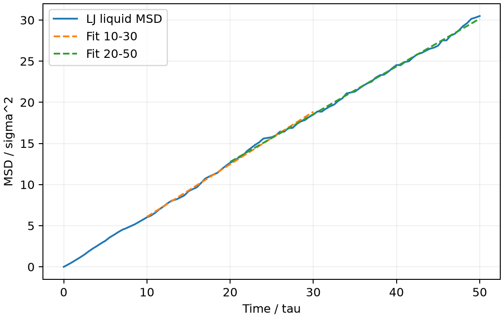

# LAMMPS 均方位移与扩散系数

**适用环境：Linux + PBS（LAMMPS）；Windows / macOS / Linux 可绘图。**

扩散系数应从平衡采样中 MSD 的长时斜率求取，不能把早期弹道运动或体系整体漂移直接当成扩散。三维各向同性体系满足

$$D=\frac16\frac{\mathrm d}{\mathrm dt}\left\langle|\mathbf r(t)-\mathbf r(0)|^2\right\rangle.$$

二维的分母则为 4；若只分析一个笛卡尔分量，分母为 2。

[交互演示](https://wangchr1617.github.io/research-handbook/#msd)。在示意曲线上移动拟合窗口，比较弹道区与扩散区给出的斜率。

## 小型 LJ 液体

[最小案例](../../../examples/lammps/minimal/lj-diffusion)的 [in.lammps](../../../examples/lammps/minimal/lj-diffusion/in.lammps)使用 256 个 LJ 粒子，约化密度 0.75，先在目标温度 1.2 下 NVT 平衡 5000 步，再用 NVE 采样 10000 步。步长为 0.005，生产阶段共 50 个约化时间单位。

```text
compute motion all msd com yes
fix sample all ave/time 100 1 100 c_motion[1] c_motion[2] c_motion[3] c_motion[4] file msd.dat format "%20.12g"
```

`com yes` 去除整个计算组的质心漂移；`c_motion[4]` 为三方向之和。LAMMPS 会用周期镜像标志处理跨边界位移；另存 `xu yu zu` 展开坐标，可独立复算 MSD。这里不使用 `average yes`，后者适合围绕平均位置振动的固体，而非扩散粒子。

加载 LAMMPS，安装 [依赖](../../../examples/lammps/minimal/lj-diffusion/requirements.txt)，在干净目录提交 [PBS 文件](../../../examples/lammps/minimal/lj-diffusion/job.pbs)：

```bash
qsub job.pbs
```

## 检查时间轴、漂移与拟合区间

[后处理](../../../examples/lammps/minimal/lj-diffusion/postprocess.py)由实际展开坐标重新计算 MSD，与原生输出比较，并检查 NVE 总能变化。[plot.py](../../../examples/lammps/minimal/lj-diffusion/plot.py)展示两个拟合窗口。



本例生产阶段平均约化温度约 1.226，NVE 总能的最大变化范围约为每原子 0.00144 ε。两个窗口给出的约化扩散系数分别约为 0.1064（10—30）和 0.0967（20—50），已能看出短轨迹的窗口依赖。

高线性拟合优度不等于扩散系数已收敛。正式研究还需更长轨迹、多个时间起点和独立重复，检查尺寸效应与温度稳定性；高黏度液体尤其需要避开笼困平台。使用 `units metal` 时，MSD 单位是 Ų、时间是 ps；本例 `units lj` 的 $D^*$ 则以 $\sigma^2/\tau$ 为单位。

可用 OVITO 查看展开轨迹及是否仍有晶格结构；扩散拟合应以数值时间轴和实际单位为准。

扩散也可用速度自相关的 Green–Kubo 积分交叉检查。在三维各向同性体系中，若速度已去除质心漂移，$D=\tfrac13\int_0^\infty\langle\mathbf v(t)\cdot\mathbf v(0)\rangle\,\mathrm dt$。MSD 看长时斜率，速度法要求输出间隔能解析短时衰减并检查积分平台。两种估计都应使用相同的粒子组、维度、状态点和时间单位。

## 在 Alkemie 中采样速度自相关

「最小化 → 平衡 → NVE 速度自相关」沿用平衡末态的坐标、晶胞和速度。平衡阶段的初始速度可用 `velocity all create ... mom yes` 去除质心运动。生产段从零重新计时，用 `compute vacf` 记录以生产起点为参考的三维速度点积平均。`vacf.dat` 依次保存步号、生产时间、总 VACF 和体系总能，结果页同时显示 VACF、梯形积分除以 3 和相对首帧的总能变化。

短作业可先检查首帧 VACF 为正、采样时刻等间距、总能漂移足够小。要估计扩散系数，再用更长的液体轨迹和多个时间起点检查积分平台。使用 `metal` 时，积分除以 3 的单位为 Ų/ps。使用 `lj` 时，单位为 σ²/τ。参见 [LAMMPS compute vacf](https://docs.lammps.org/compute_vacf.html)。

「自扩散系数」组件在 NVE 段采样去除质心漂移的固定时间原点 MSD。拟合区间用生产时长的比例指定。结果同时给出斜率、$R^2$ 与实际拟合起止时间，三维扩散系数取斜率除以 6。先查看曲线选择长时线性区，再比较多个拟合窗口和独立轨迹。`metal` 的扩散系数输出为 m²/s，`lj` 输出为 σ²/τ。

参考：单斌、陈征征、陈蓉《计算材料学》配套仓库[第七章 7.3—7.4](https://github.com/stanfordbshan/CompMatBook/tree/main/edition-1-2023/Chapter07)；[LAMMPS compute msd](https://docs.lammps.org/compute_msd.html)。本例采用重新编写的三维液体模型。
