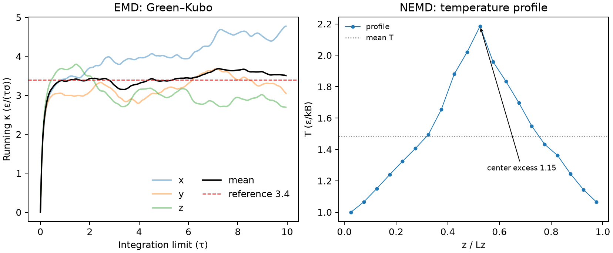

# LAMMPS 热导率的 EMD 与 NEMD 计算

**适用环境：Linux + PBS（LAMMPS 30 Sep 2026）；Windows / macOS / Linux 可后处理与绘图。**

热导率不能像温度那样从一帧轨迹直接读出。平衡态方法（EMD）从热流涨落的自相关积分得到 κ；非平衡方法（NEMD）人为建立温度梯度，再由 Fourier 定律求 κ。两条路线的误差来源不同，在同一状态点上互相核对，比只看一个数字可靠。

本文用 LJ 液体跑通两条路线：EMD 得 3.502，NEMD 得 3.425，参考值约 3.4（约化单位 ε/(τσ)）。配套案例在 [thermal-conductivity](../../../examples/lammps/thermal-conductivity/README.md)，包含两套输入、运行脚本、后处理与本次输出。

## 两条路线在算什么

用热通量密度 $\mathbf j$ 写 Fourier 定律

$$
\mathbf j = -\kappa \nabla T .
$$

EMD 不施加梯度，而是让体系在平衡态下自由涨落，用 Green–Kubo 关系

$$
\kappa = \frac{1}{3Vk_BT^2}\int_0^\infty
\left\langle \mathbf{J}_{\rm ext}(0)\cdot \mathbf{J}_{\rm ext}(t)\right\rangle {\rm d}t
$$

把热流的自相关积分换成 κ。这里 $\mathbf{J}_{\rm ext}$ 是广延热流（能量·速度），不是已经除以体积的通量；若用 $\mathbf{j}=\mathbf{J}_{\rm ext}/V$，前因子改为 $V/(3k_BT^2)$。两种写法差一个 $V^2$，抄脚本时最容易在这里出错。

NEMD 反过来：在冷热区之间持续输运能量，等温度剖面稳定后，用

$$
j=\frac{\Delta E}{2A\Delta t},\qquad
\kappa=\frac{j}{\Delta T/(L_z/2)}
$$

求 κ。因子 2 来自周期性 z 方向的两个热流方向，$L_z/2$ 是热区到冷区的距离。LAMMPS 的 `fix thermal/conductivity` 用速度交换实现这件事。

| | EMD（Green–Kubo） | NEMD（Müller-Plathe） |
| --- | --- | --- |
| 平衡态 | 是 | 否 |
| 施加的扰动 | 无 | 每若干步交换冷热层速度 |
| 读取量 | 热流自相关 | 累积交换能、温度剖面 |
| 主要误差 | 相关长尾、统计噪声 | 稳态、非线性、有限尺寸 |
| 有限尺寸问题 | 盒子与相关时间 | 横向面积、梯度大小 |

## 参考体系与输入

两套输入都取 LJ 液体：约化密度 $\rho^*=0.6$、温度 $T^*=1.35$、截断 $r_c=2.5\sigma$。这个状态点与 Evans 1986 的 LJ 结果以及 LAMMPS `examples/KAPPA` 的对照值一致，便于检查。

| 参数 | EMD | NEMD |
| --- | --- | --- |
| 原子数 | 4000（$10^3$ 个 FCC 常规胞） | 8000（$10\times10\times20$） |
| 盒子 | 立方，$L=18.82\sigma$ | $L_x=L_y=18.82\sigma$，$L_z=37.64\sigma$ |
| 平衡 | NVT 5000 步 | NVT 5000 步 |
| 生产 | NVE 100000 步（500 τ） | NVE 40000 步（200 τ），前置 20000 步稳态 |
| 采样 | 每 10 步，200 个延迟点 | 20 个 z 层，每 10 步交换 |

`lattice fcc 0.6` 在 LJ 单位下表示约化数密度 0.6，不是晶格常数 0.6。程序据此得到晶格常数 $a=(4/0.6)^{1/3}=1.882\sigma$，所以 $10\times10\times10$ 的盒子边长是 $18.82\sigma$，体积 6666.7 $\sigma^3$。若把 0.6 当晶格常数，体积会差近 30 倍，κ 的单位换算随之全错。

先跑 EMD：

```bash
lmp -in in.emd -log log.emd
```

再跑 NEMD：

```bash
lmp -in in.nemd -log log.nemd
```

在配套案例目录执行。配套 `run.py` 会依次执行并检查日志是否正常结束，`postprocess.py` 负责解析与绘图。

## EMD：采样热流自相关

本例用 NVT 准备平衡初态，再在 NVE 生产段采样，避免控温器直接改变热流的动力学相关。

```lammps
compute myKE all ke/atom
compute myPE all pe/atom
compute myStress all stress/atom NULL virial
compute flux all heat/flux myKE myPE myStress
fix JJ all ave/correlate 10 200 2000 &
    c_flux[1] c_flux[2] c_flux[3] type auto file profile.heatflux ave running
variable scale equal 10*dt/1.35/1.35/vol
variable k11 equal trap(f_JJ[3])*${scale}
variable k22 equal trap(f_JJ[4])*${scale}
variable k33 equal trap(f_JJ[5])*${scale}
variable kappa equal (v_k11+v_k22+v_k33)/3.0
```

`compute heat/flux` 需要三个逐原子量：动能、势能和应力。LJ 对势用 `stress/atom NULL virial` 即可；多体势还应确认应力定义是否包含全部贡献。`fix ave/correlate` 每 10 步采一次，记录 200 个延迟点，每 2000 步输出一个运行平均块。`trap(f_JJ[3])` 对延迟点序号做梯形积分，乘以 `10*dt` 才变成时间积分；最后除以体积和 $T^2$，三个方向取平均。

本次运行得到：

| 量 | 数值 |
| --- | --- |
| κ（三方向平均） | 3.502 |
| κx、κy、κz | 4.770、3.047、2.690 |
| 由 `profile.heatflux` 独立积分 | 3.507 |
| 平均温度 | 1.349 |
| 体积 | 6666.7 $\sigma^3$ |



左图是三条 running κ 与它们的平均。曲线在 3.5–4.4 之间起伏，末值 3.502 只是 500 τ 采样上的一个估计；三个方向的末值范围是 2.690–4.770，说明统计误差并不小。右图是 NEMD 的温度剖面，下面单独讨论。

判断 EMD 是否可信，先看相关函数是否衰减到零、积分是否出现平台，再看分块平均的涨落。单看最后一个数，很容易把噪声当成收敛值。需要更高精度时，应延长生产段、用多个独立初态（不同随机种子）重复，并对 blocks 做误差估计。

## NEMD：冷热层速度交换

NEMD 输入先用 NVT 平衡，再切到 NVE，并在生产段重新定义 `fix thermal/conductivity`，使累积能量从零开始：

```lammps
compute layers all chunk/atom bin/1d z lower 0.05 units reduced
fix 2 all ave/chunk 10 100 1000 layers v_temp file profile.nemd
fix 3 all thermal/conductivity 10 z 20
variable tdiff equal f_2[11][3]-f_2[1][3]
```

`fix thermal/conductivity` 每 10 步在冷层和热层之间交换速度，等价于把能量从冷端搬到热端；`f_3` 是累积交换能。20 个 z 层中，第 1 层是冷端，第 11 层是热端，`f_2[11][3]-f_2[1][3]` 就是两者温差。生产段用

```lammps
variable kappa equal (f_3/(time-${start_time})/(lx*ly)/2.0)*(lz/2.0)/f_ave
```

计算 κ：`f_3` 除以生产时间得到能量速率，再除以横向面积 `lx*ly` 和因子 2，乘热区到冷区的距离 `lz/2`，除以平均温差 `f_ave`。`f_ave` 是 `fix ave/time ... ave running` 对温差的运行平均，避免用某一帧的瞬时值。

本次结果：

| 量 | 数值 |
| --- | --- |
| κ | 3.425 |
| 生产段累积交换能 | 30322.9 ε |
| 平均温差 | 1.176 ε/kB |
| 横向面积 | 354.22 $\sigma^2$ |
| $L_z$ | 37.64 $\sigma$ |
| 生产时间 | 200 τ |

温度剖面（右图）在中心处约 2.18，两端约 1.0，中心比两端平均高 1.15。这个扰动约为平均温度 1.35 的 85%，两条周期传热路径组成近三角形剖面，应分别检查各支的线性区。此时用“中心-端点温差除以 $L_z/2$”得到的只是一个有效梯度，3.425 不能当作已收敛的线性响应热导率。它与 EMD 的 3.502 相差 2.2%，说明两套设置在数量级上自洽，但不足以证明任何一个已经收敛。

要得到可发表的 NEMD 值，至少做三件事：减小扰动（降低交换频率或能量速率）、增大横向面积以降低梯度、把 $L_z$ 加到足够长并检查中心区是否线性；然后对温差和热流做时间平均，报告有限尺寸外推与统计误差。LAMMPS 自带示例也明确说明这些脚本只作演示，不保证完全平衡或高精度。

## 两种方法怎样互相对照

| 方法 | κ（ε/(τσ)） | 与 3.4 的偏差 |
| --- | --- | --- |
| EMD Green–Kubo | 3.502 | +3.0% |
| NEMD Müller-Plathe | 3.425 | +0.7% |
| 参考（Evans 1986） | 3.4 | — |

对照参考值时，需统一势函数、截断、体系尺寸与状态点。报告热导率时同时给出统计不确定度与尺寸依赖。

## 常见错误与检查

- **把 `compute heat/flux` 当成通量。** 它返回广延量，积分后还要除以体积；若先除了体积，Green–Kubo 前因子会差 $V^2$。
- **忘记 `trap` 的时间步长。** `trap` 对数组下标积分，必须乘采样间隔 `10*dt`，否则 κ 会差一个常数因子。
- **在 EMD 生产段继续控温。** 本案例用无控温器的 NVE 轨迹计算热流自相关。
- **把 `lattice fcc 0.6` 当晶格常数。** LJ 单位下它是数密度；体积、面积和 κ 的单位换算都依赖这一点。
- **NEMD 生产段没有清零能量。** 重新定义 `fix thermal/conductivity` 后 `f_3` 才从零累积；否则会把平衡段的能量算进热流。
- **只看温差和热流的末值。** 先确认剖面稳定、温差稳定、NVE 能量守恒，再看 κ；剖面弯曲时，全局公式只是有效值。
- **混用单位。** 换成 `metal` 或 `real` 后，$\kappa$ 的前因子、$k_B$ 和时间单位都要重推，不能把 LJ 的数值直接搬过去。

EMD 的检查顺序：NVE 能量漂移 → 相关函数衰减 → 积分平台 → 分块/分方向误差。NEMD 的检查顺序：温度剖面是否线性 → 温差是否稳定 → 能量收支是否闭合 → 尺寸与扰动是否足够小。对照两种方法时，结合统计不确定度、尺寸和扰动依赖来解释差值。发现偏差时，先查单位和体积，再查稳态与有限尺寸。

## 复现与扩展

案例目录提供 `run.py`、`postprocess.py`、`job.pbs` 与 `requirements.txt`：

```bash
python3 -m pip install -r requirements.txt
python3 run.py
python3 postprocess.py
```

所附日志记录的是 macOS arm64 上的运行，设置为 1 个 MPI 进程、6 个 OpenMP 线程，EMD 约 2 分钟，NEMD 约 3 分钟。`postprocess.py` 会核对 `profile.heatflux` 的独立积分与日志末值，并把结果写入 `results.json`、`result.png`。PBS 的资源与 LAMMPS 加载方式按集群调整。

想把这套流程用到实际材料，先替换势函数与结构，再重新检查平衡、相关时间和温度梯度；金属、氧化物与聚合物的热输运机制不同，LJ 的数值不能直接外推。声子主导的晶体可参考 [VASP 晶格热导率计算](../../VASP/振动与热力学/VASP晶格热导率计算.md)，机器学习势的 HNEMD 路线可参考 [GPUMD 热导率案例](../../../examples/gpumd/thermal-conductivity/HNEMD热导率计算.ipynb)。黏度的 Green–Kubo 实现与本文结构相近，可对照 [LAMMPS 的 GreenKubo 黏度](LAMMPS的GreenKubo黏度.md)。

## 参考

- LAMMPS 文档：[Howto kappa](https://docs.lammps.org/Howto_kappa.html)、[compute heat/flux](https://docs.lammps.org/compute_heat_flux.html)、[fix thermal/conductivity](https://docs.lammps.org/fix_thermal_conductivity.html)、[fix ave/correlate](https://docs.lammps.org/fix_ave_correlate.html)。
- D. J. Evans, *Thermal conductivity of the Lennard-Jones fluid*, Phys. Rev. A **34**, 1449 (1986). [doi:10.1103/PhysRevA.34.1449](https://doi.org/10.1103/PhysRevA.34.1449)
- F. Müller-Plathe, *A simple nonequilibrium molecular dynamics method for calculating the thermal conductivity*, J. Chem. Phys. **106**, 6082 (1997). [doi:10.1063/1.473271](https://doi.org/10.1063/1.473271)
- D. Frenkel, B. Smit, *Understanding Molecular Simulation*, 2nd ed., Academic Press, 2002，第 4、7 章关于 Green–Kubo 与热输运的讨论。
