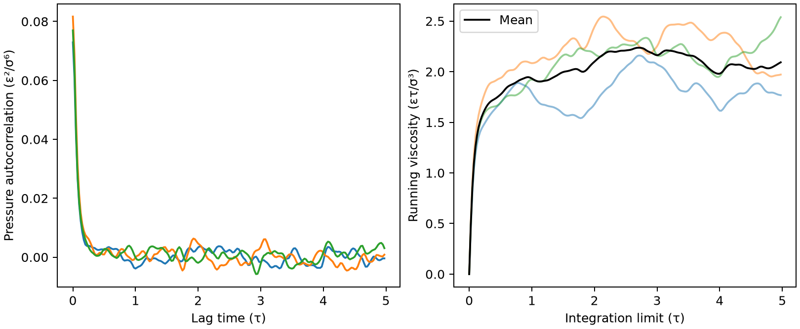

# LAMMPS 的 GreenKubo 黏度

**适用环境：Linux + PBS 运行计算；Windows / macOS / Linux 可准备输入与分析结果。**

Green–Kubo 由平衡态剪切压力涨落求黏度，避免直接施加宏观流动；代价是相关函数和积分平台通常需要较长采样。

## 从剪切压力相关函数求黏度

各向同性体系可将三个剪切分量平均。对于压力张量，η=V/(kBT)·∫⟨Pαβ(0)Pαβ(t)⟩dt。若使用体积乘过的应力通量，前因子会不同，不能从别的脚本只复制一段单位换算。

本例为 LJ 约化单位，kB=1；黏度单位为 ετ/σ³。积分上限处的一个数值不是自动收敛的输运系数，必须看平台、统计误差及采样长度。

## 用 LJ 液体建立平衡采样

256 个 LJ 粒子，约化密度 0.75、目标温度 1.2，先 NVT 平衡 5000 步，再以 NVE 采样 20000 步，步长 0.005。用原生 `fix ave/correlate` 同时计算 pxy、pxz、pyz 自相关，每 5 步采样、200 个延迟点。

[案例目录](../../../examples/lammps/minimal/green-kubo-viscosity)通过 [stages.json](../../../examples/lammps/minimal/green-kubo-viscosity/stages.json)组织计算阶段。

结构写在坐标文件或各输入的原子/晶胞段；`stages.json` 列出计算阶段。配套 [run.py](../../../examples/lammps/minimal/green-kubo-viscosity/run.py) 顺序组织任务，[job.pbs](../../../examples/lammps/minimal/green-kubo-viscosity/job.pbs) 提交作业，[postprocess.py](../../../examples/lammps/minimal/green-kubo-viscosity/postprocess.py) 检查结果并绘图。

## 参数与提交

加载 LAMMPS，`LMP_EXEC` 可指定程序。此处使用脚本中定义的 LJ 模型，不需外部势文件；复杂材料应选择经过验证的势函数。

| 参数 | 对结果的影响 |
| --- | --- |
| 平衡段 | 排除初始晶格/温度松弛 |
| NVE 生产 | 避免直接强控温改变相关动力学；仍需检查能量漂移 |
| 采样间隔 | 应解析快速衰减，不能只追求少输出 |
| 相关长度 | 太短漏积分尾部，太长噪声增大 |
| 三个剪切通道 | 各向同性平均并观察通道分散 |

在干净案例目录安装[Python 依赖](../../../examples/lammps/minimal/green-kubo-viscosity/requirements.txt)并提交：

```bash
python3 -m pip install -r requirements.txt
qsub job.pbs
```

PBS 中的资源语法和软件加载方式按集群调整。计算结束后自动执行后处理；若只分析已保存的结果，运行 `python3 postprocess.py`。各阶段独立保存输出，便于定位失败步骤。

## 积分末值与平台怎样区分

后处理读取最后一个运行平均自相关块，检查计数并以梯形积分得到三条 running viscosity。当前平均温度约 1.258，相关上限 4.975 τ；三通道末值约 1.77、1.97、2.54，平均约 2.09（约化单位）。

通道分散与积分曲线形状比末值更值得看。本例短轨迹没有提供可靠的收敛误差，不应把 2.09 当作高精度 LJ 黏度。



图由案例后处理脚本读取实际计算输出生成。

## 扩展到实际研究

延长采样、比较相关窗口、采用多个独立初态并做分块分析，检查尺寸效应和 NVE 能量漂移。使用 metal/real 单位时重新推导压力、体积、时间与 kB 的换算；不要把约化单位前因子直接代入 SI。

在 Alkemie 的「Green–Kubo 剪切黏度」组件中，延迟点数包含零延迟。最长延迟是采样间隔乘以延迟点数减一，再乘积分步长。`correlation.dat` 保存三个剪切压力通道的自相关及各延迟的样本对数，`transport-state.dat` 保存积分步长、体积和生产段平均温度。结果页的累计积分便于选择平台，`metal` 的黏度以 Pa·s 输出。

离子电导率组件沿用相同采样方式，相关信号改为电荷流 $\mathbf I=\sum_i q_i\mathbf v_i$。在 `metal` 单位下导入电中性的 `atom_style charge` 数据文件，核对电荷和势函数。三个方向的自相关积分平均后除以 $Vk_BT$，输出 S/m。电荷流先对粒子求和再求相关，因此包含不同离子运动之间的交叉项。

参考：[LAMMPS 黏度与 Green–Kubo](https://docs.lammps.org/Howto_viscosity.html)。
