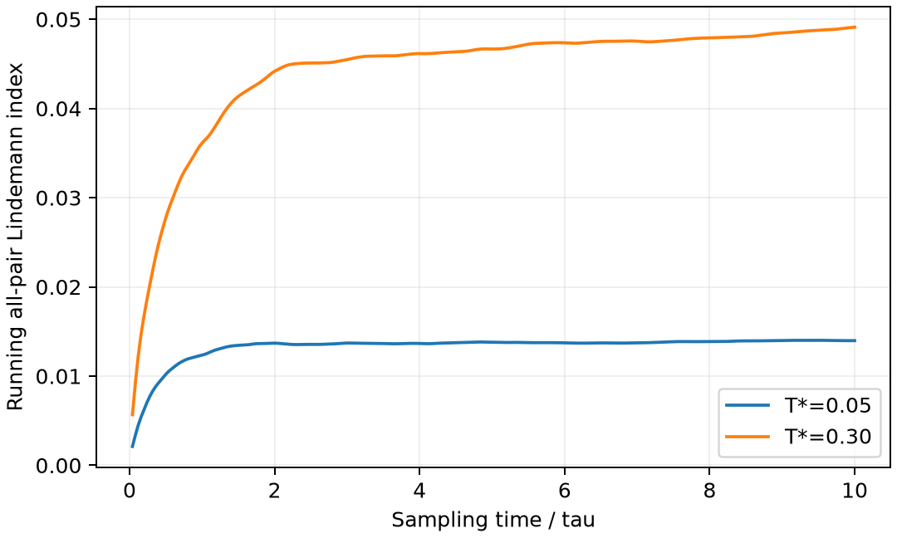

# LAMMPS 团簇与 Lindemann 指标

**适用环境：Linux + PBS（LAMMPS）；Windows / macOS / Linux 可绘图。**

Lindemann 指标用原子间距离的相对涨落描述结构的活动程度。对自由团簇，使用成对距离可避免把团簇整体平移、转动误判为内部结构变化。

## 自由 LJ 团簇

[最小案例](../../../examples/lammps/minimal/cluster-lindemann)使用 [cluster.data](../../../examples/lammps/minimal/cluster-lindemann/cluster.data) 中的 55 粒子二十面体结构。[in.lammps](../../../examples/lammps/minimal/cluster-lindemann/in.lammps)设置自由边界，先能量最小化，再分别在 $T^*=0.05$、0.30 下用 Langevin 热浴采样。每个温度平衡 5000 步、采样 5000 步，步长为 0.002。

加载 LAMMPS，安装 [依赖](../../../examples/lammps/minimal/cluster-lindemann/requirements.txt)，在干净目录执行 `qsub job.pbs`（[PBS 文件](../../../examples/lammps/minimal/cluster-lindemann/job.pbs)）。可用 OVITO 打开 `cluster.*.dump` 观察结构与表面原子的运动。

## 从实际轨迹计算距离涨落

本例采用全部原子对的平均定义：

$$\delta=\frac{2}{N(N-1)}\sum_{i<j}
\frac{\sqrt{\langle r_{ij}^2\rangle-\langle r_{ij}\rangle^2}}
{\langle r_{ij}\rangle}.$$

[后处理](../../../examples/lammps/minimal/cluster-lindemann/postprocess.py)检查粒子数与采样帧数，以固定原子 id 对齐轨迹，并流式更新 1485 个原子对的均值和方差。这样不必保存“全部帧×全部原子对”的距离数组。自由团簇采用普通距离，不使用周期最小镜像。

[plot.py](../../../examples/lammps/minimal/cluster-lindemann/plot.py)绘制随采样时间累积的指标：

每个温度共 251 帧，最终指标约为 0.0140 和 0.0491，升温后内部距离涨落增大。曲线开头偏小，是统计窗口刚建立时的自然结果，不能当成真实结构随时间逐步“熔化”的证据。

不同文献可能只统计近邻、给每个原子定义局部指标，或使用不同时间窗口，数值和经验阈值不能直接互换。全对指标还依赖团簇形状、原子交换与观测时长；本例两个温度不足以定位熔点。正式研究应结合温度扫描、能量、结构与蒸发检查，并确认团簇始终远离盒边界。

参考：单斌、陈征征、陈蓉《计算材料学》配套仓库[第七章 7.12 纳米颗粒熔化](https://github.com/stanfordbshan/CompMatBook/tree/main/edition-1-2023/Chapter07)。本例采用独立生成的 LJ 团簇和重新编写的流式分析。
