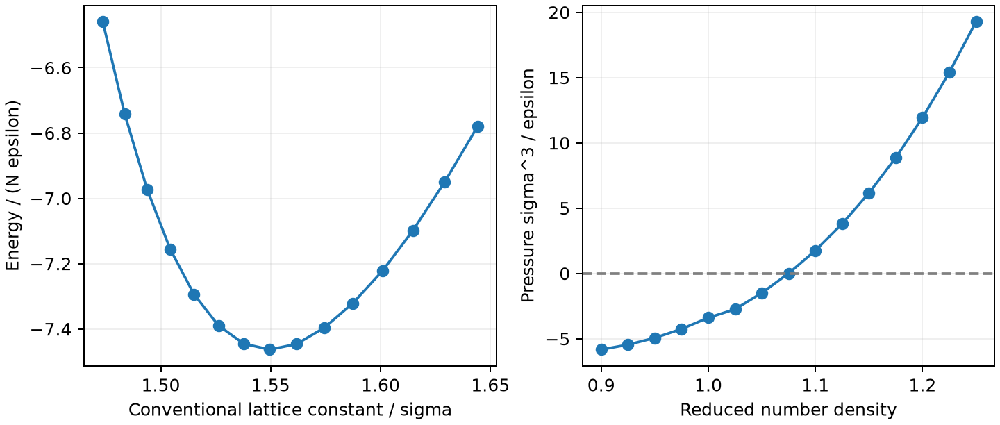

# LAMMPS 晶格常数与凝聚能

**适用环境：Linux + PBS（LAMMPS）；Windows / macOS / Linux 可绘图。**

以 fcc Lennard–Jones（LJ）固体为例，扫描晶格尺寸，找到每原子势能的极小值。该过程对应零温静态晶格，不包含振动与热膨胀。

## 先分清密度和晶格常数

在 `units lj` 下，`lattice fcc 1.10` 中的 `1.10` 是约化数密度 $\rho^*=N\sigma^3/V$，不是边长。常规 fcc 晶胞含四个原子，因此

$$a/\sigma=(4/\rho^*)^{1/3}.$$

而在 `units metal` 下，`lattice fcc 3.62` 才表示以 Å 为单位的晶格常数。只看 `lattice` 命令的数字，很容易混淆这两种含义。

## 运行最小扫描

[最小案例](../../../examples/lammps/minimal/lj-equation-of-state)的 [in.lammps](../../../examples/lammps/minimal/lj-equation-of-state/in.lammps)使用 4×4×4 常规晶胞，共 256 个原子，扫描 15 个密度点。势为 `lj/cut 2.5`，并开启 `pair_modify shift yes`；截止半径处平移为零，未加入尾修正。改变截断或平移方式会改变能量，比较结果时要统一。

```text
thermo_modify norm no
run 0
variable alat equal lx/4
variable epa equal pe/count(all)
```

`run 0` 计算静态能量。`pe/count(all)` 明确取每原子能，避免把全体系能量误叫作单原子凝聚能。这里以分离 LJ 原子的零势能为参考，晶体每原子能为负；若把凝聚能定义为拆散晶体所需的正能量，则取其相反数。

加载 LAMMPS，安装 [Python 依赖](../../../examples/lammps/minimal/lj-equation-of-state/requirements.txt)，在干净目录提交 [PBS 作业](../../../examples/lammps/minimal/lj-equation-of-state/job.pbs)：

```bash
qsub job.pbs
```

[后处理](../../../examples/lammps/minimal/lj-equation-of-state/postprocess.py)核对密度换算，用 ASE 的 LJ 计算器独立复算每个点，并检查扫描区间包围极小值。[plot.py](../../../examples/lammps/minimal/lj-equation-of-state/plot.py)生成下图。



本例最低采样点约为 $a/\sigma=1.54959$，每原子能约 $-7.46326\epsilon$；极小值附近五点二次拟合得到约 1.55071。压力也从负值跨过零，与静态平衡的判断相符。局部二次拟合便于定位，正式求体模量应使用适当的状态方程并检查采样密度。

LJ 约化单位不能直接标成 Å、eV 或 K。若映射到 Ar，需先指定并说明所用的 $\sigma$、$\epsilon$ 和质量参数；该简单两体模型也不能代表任意金属的凝聚性质。

参考：单斌、陈征征、陈蓉《计算材料学》配套仓库[第七章 7.3 晶格扫描](https://github.com/stanfordbshan/CompMatBook/tree/main/edition-1-2023/Chapter07)；[LAMMPS lattice](https://docs.lammps.org/lattice.html)。本例重新编写输入与后处理，采用更小的静态模型。
