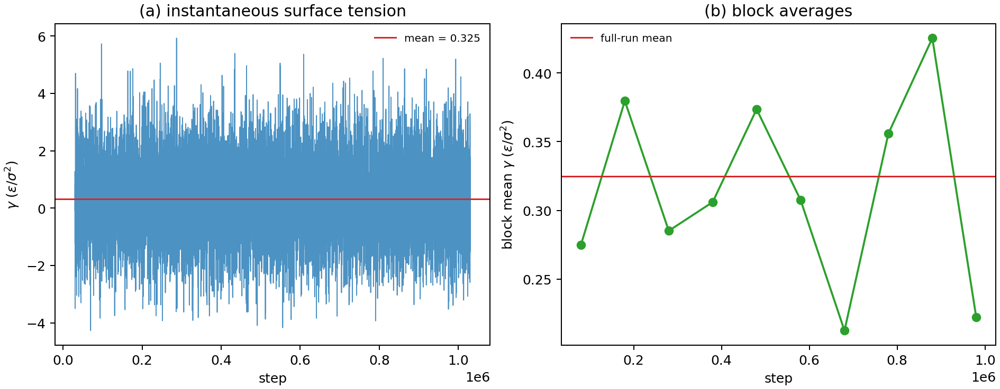

# LAMMPS 表面张力与润湿

**适用环境：Linux + PBS（LAMMPS 30 Sep 2026）；Windows / macOS / Linux 可后处理与绘图。**

表面张力把“多出一个表面要花多少能量”变成一个可测量的量。它决定液滴是铺开还是成珠、纳米孔里是否毛细凝结、气泡能否稳定存在。润湿则是同一件事的另一面：固-液、固-气、液-气三个界面能竞争，接触角由 Young 方程给出。

本文先用 LJ 液体的自由液膜演示压力张量法，再说明接触角与润湿的建模方式。示例的绝对值受尺寸和轨迹长度限制，只用于检查公式与流程，不能当作材料参数。

## 固体表面能与共格界面能

Alkemie 的「双自由表面能」从周期体相出发，沿 $z$ 加入真空间隙并在固定面内晶格下弛豫。上下表面等价时，单面过剩能为 $(E_{\rm slab}-E_{\rm bulk})/(2A)$，其中 $A$ 为一个表面的面积，两个状态有相同的粒子数和组成。真空间隙应大于短程势的截断距离，并检查表面能对真空厚度和板层厚度的收敛。

「共格界面能」使用法向为 $z$ 的周期超胞，以原子类型 1 和 2 标记两相。分别用同一势函数和与界面一致的面内应变计算参考体相每原子能量 $e_A$、$e_B$。界面平均过剩能为 $(E_{AB}-N_Ae_A-N_Be_B)/(nA)$，其中 $n$ 是超胞中的界面数。若超胞含两种不同终止的界面，结果是二者的面积平均。

## 表面张力的定义

对平衡液–气界面，表面张力是增加单位界面面积所需的可逆功，其中 $A$ 为总界面面积。

$$
\gamma=\left(\frac{\partial F}{\partial A}\right)_{T,V,N}.
$$

单位是能量/面积，也等价于力/长度。LJ 单位下是 $\epsilon/\sigma^2$；换算到 SI 时，$1\ \epsilon/\sigma^2$ 的数值取决于 $\epsilon$（J）和 $\sigma$（m）。

表面张力不是一个“表面层原子受到的力”，而是整个界面区域的积分。用局部压力张量理解更直接：法向压力 $P_N$ 在平衡时处处相等，切向压力 $P_T$ 在界面区被削弱；两者之差沿 $z$ 积分就是 $2\gamma$（两个界面）。

## 压力张量法

构造一个在三维周期盒中沿 $z$ 设置低密度层，形成两个液–气界面。平衡后

$$
\gamma=\frac{L_z}{2}\left[P_{zz}-\frac{P_{xx}+P_{yy}}{2}\right],
$$

其中 $L_z$ 是盒子长度，因子 $1/2$ 对应上下两个液-气界面。$P_{zz}$ 是法向，$P_{xx}$ 与 $P_{yy}$ 是切向分量，面内各向同性时，两者的长时间平均应接近。LAMMPS 的 `thermo_style custom pxx pyy pzz` 直接给这三个分量，单位由 `units` 决定。

这个公式要求：

- 低密度层足以分隔周期镜像，平衡后可有蒸气压；
- 液膜足够厚，两个界面不重叠；
- 体系达到力学平衡，温度稳定；
- 采样足够长，因为压力分量的涨落很大。

## 输入与运行

配套案例在 [surface-tension](../../../examples/lammps/surface-tension/README.md)。核心输入节选如下。完整的建盒、原子创建、势参数和初速度见案例输入。

```lammps
lattice         fcc 0.8          # LJ 单位下 0.8 是约化数密度
region          box block 0 6 0 6 0 24
region          liquid block 0 6 0 6 6 18
pair_style      lj/cut 2.5
fix             nvt all nvt temp 0.85 0.85 1.0
run             30000
unfix           nvt
fix             nve all nve
variable        gamma equal 0.5*lz*(pzz-0.5*(pxx+pyy))
fix             ave all ave/time 10 100 1000 v_gamma ave running
run             1000000
```

`lattice fcc 0.8` 在 LJ 单位下表示约化密度 0.8，LAMMPS 会自己换算晶格常数；写成 `fcc 1.70998` 会得到密度约 1.71 的固体，这是最常见的错误之一。运行前先看日志里的 `Created ... atoms` 和盒子长度，确认密度。

`fix ave/time` 的时间平均才是要报告的 $\gamma$；瞬时值涨落可达 ±3 $\epsilon/\sigma^2$，单帧没有意义。`ave running` 给累计平均，便于观察是否漂移。

## 结果怎样读

本次示例（LJ，平衡目标温度 0.85，生产段平均温度 0.840，1800 原子，生产 100 万步）得到 $\gamma\approx0.325\ \epsilon/\sigma^2$。10 个分块平均在 0.21–0.43 之间波动，块间标准差约 0.07；这个尺寸仍不足以给出高精度值，但公式、单位和采样流程是通的。

要得到可比较的值，需要：

- 加大横向面积，减小周期镜像和毛细波影响；
- 加厚液膜，让两个界面独立；
- 延长生产段，直到分块平均不再漂移；
- 做有限尺寸外推，报告拟合误差；
- 检查温度、密度和法向压力是否稳定。

文献中的 LJ 表面张力随温度、截断和长程修正变化；不要拿一个没有说明条件的数字直接比较。



分块均值来自每 100 步输出的生产段热力学表。水平线是 LAMMPS 在生产段每 10 步采样得到的累计平均，两者采样频率不同。

### 局部压力剖面

原子维里分箱、Irving–Kirkwood 路径和穿面法按不同方式分配局部相互作用。横跨气液界面时，切向压力的峰形可能依分配约定而变化。比较时记录动能与维里项、分箱厚度、长程贡献及符号。用相同定义下的法向机械平衡、整体压力和界面积分核对剖面。旧脚本中的 `stress/spatial` 属于特定实现，迁移时按模型支持的相互作用选择 [stress/cartesian](https://docs.lammps.org/compute_stress_cartesian.html) 或 [stress/mop/profile](https://docs.lammps.org/compute_stress_mop.html)。

## 从表面张力到润湿

把液滴放在固体表面上，三个界面能满足 Young 方程：

$$
\gamma_{sv}=\gamma_{sl}+\gamma_{lv}\cos\theta,
$$

$\theta$ 是接触角。$\theta<90^\circ$ 为亲液（铺展），$\theta>90^\circ$ 为疏液（成珠）；$\theta\to0$ 完全润湿，$\theta\to180^\circ$ 完全不润湿。

[交互演示](https://wangchr1617.github.io/research-handbook/#young-angle)。调节界面能差与液–气表面张力，观察接触角何时跨过 90°，以及有限角解的边界。

真实表面还有粗糙度和化学不均匀性：

- **Wenzel 态**：液体填满粗糙结构，表观接触角满足 $\cos\theta^*=r\cos\theta$，$r$ 是粗糙度因子；亲液更亲、疏液更疏。
- **Cassie–Baxter 态**：液滴坐在粗糙结构的顶部，下面截留空气，$\cos\theta^*=f_s\cos\theta_s+f_v\cos\theta_v$；超疏水常属于这一类。

接触角不是唯一判据：接触角滞后（前进/后退角之差）决定液滴是否容易滚动；线张力在纳米液滴中不可忽略。

## 用 LAMMPS 模拟润湿

常见做法：

1. **sessile drop**：在固体壁上放一个纳米液滴，跑 NVT/NVE，提取液滴轮廓，用圆拟合求接触角。壁面用 `fix wall/lj93` 或固定原子层；液-固相互作用强度决定亲疏液。
2. **液膜法**：在壁上铺一层液膜，在有弯曲弯月面的几何中测量曲率或压差，用 Young–Laplace 方程约束界面形状，再由接触线处的几何得到接触角。
3. **分离法**：分别算固-气、固-液、液-气界面能，代入 Young 方程。界面能的计算比直接跑液滴便宜，但对界面结构和表面终止敏感。

液滴模拟的常见坑：液滴太小，线张力主导；固定壁面无法充当热浴，需要为流体设置合适的温控方式；液-固参数与液-液参数不匹配，接触角不可控；模拟时间不够，液滴还没铺展到平衡。

## 检查清单

- `lattice` 在 LJ 单位下是密度还是晶格常数？日志中的原子数和盒子长度是否与目标密度一致？
- 低密度层够厚吗？沿法向是否形成稳定的液相与蒸气区？
- 生产段是否用 NVE？控温器是否改变了界面结构？
- 瞬时 $\gamma$ 的涨落有多大？分块平均是否漂移？
- 液膜厚度、横向尺寸是否做过收敛检查？
- 润湿模拟中，液-固相互作用参数、壁面温度、液滴尺寸是否报告？
- 接触角是用哪种方法得到的？前进/后退角是否区分？

## 参考

- J. S. Rowlinson, B. Widom. *Molecular Theory of Capillarity*. Oxford University Press, 1982.
- LAMMPS 文档：[compute pressure](https://docs.lammps.org/compute_pressure.html)、[fix ave/time](https://docs.lammps.org/fix_ave_time.html)、[fix wall/lj93](https://docs.lammps.org/fix_wall_lj93.html)。
- T. Young. An essay on the cohesion of fluids. *Phil. Trans. R. Soc. Lond.*, 1805, 95: 65. [doi:10.1098/rstl.1805.0005](https://doi.org/10.1098/rstl.1805.0005)
- R. N. Wenzel. Resistance of solid surfaces to wetting by water. *Ind. Eng. Chem.*, 1936, 28: 988. [doi:10.1021/ie50320a024](https://doi.org/10.1021/ie50320a024)
- A. B. D. Cassie, S. Baxter. Wettability of porous surfaces. *Trans. Faraday Soc.*, 1944, 40: 546. [doi:10.1039/TF9444000546](https://doi.org/10.1039/TF9444000546)
