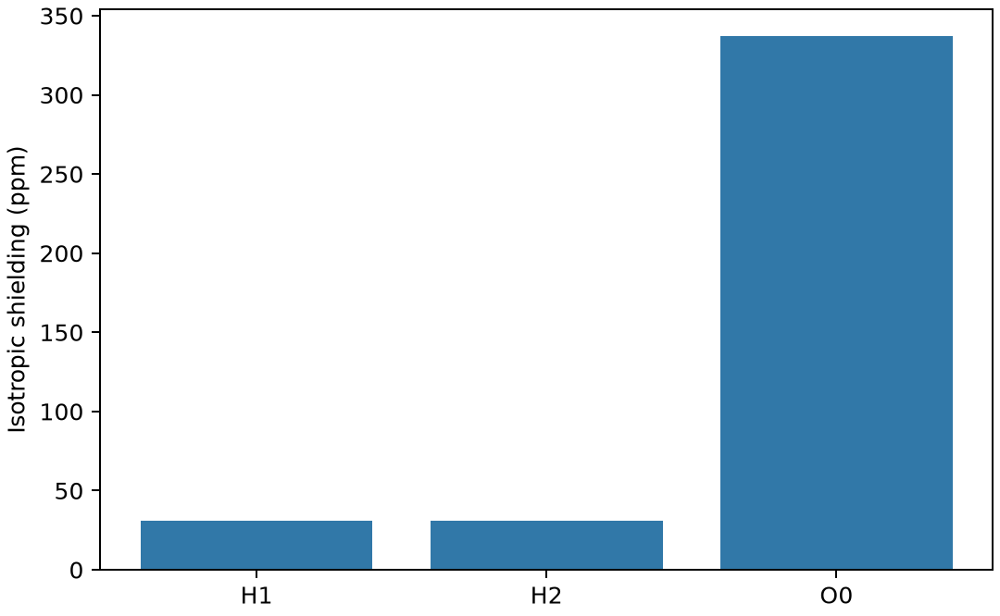

# ORCA 核磁共振屏蔽

**适用环境：Linux + PBS 运行计算；Windows / macOS / Linux 可准备输入与分析结果。**

NMR 计算首先得到核磁屏蔽张量；实验常报告相对于参考物的化学位移。两者相关，但数值与符号不能直接混用。

## 方法与物理量

各向同性屏蔽为屏蔽张量三个主值的平均，常以 ppm 报告。简单参考关系可写作 δ≈σref−σsample，具体转换还受参考定义、实验尺度及拟合方式影响。

屏蔽对核附近电子结构、几何、基组与环境敏感。重元素附近还要注意相对论及 SOC 对性质的影响；普通轨道基组未必像专用屏蔽基组那样适合核区响应。

## 最小模型与输入

对固定中性水分子采用 PBE0/pcSseg-1，计算 H 和 O 的屏蔽。pcSseg-1 是面向屏蔽性质的基组；这里不重新优化几何，以便将输入集中在响应模块。

[案例目录](../../../examples/orca/minimal/nmr-shielding)包含以下科学输入：

[shielding.inp](../../../examples/orca/minimal/nmr-shielding/shielding.inp)、[stages.json](../../../examples/orca/minimal/nmr-shielding/stages.json)、[structure.xyz](../../../examples/orca/minimal/nmr-shielding/structure.xyz)。

结构写在坐标文件或各输入的原子/晶胞段；`stages.json` 列出计算阶段。配套 [run.py](../../../examples/orca/minimal/nmr-shielding/run.py) 顺序组织任务，[job.pbs](../../../examples/orca/minimal/nmr-shielding/job.pbs) 提交作业，[postprocess.py](../../../examples/orca/minimal/nmr-shielding/postprocess.py) 检查结果并绘图。

## 参数与提交

加载 ORCA 及其匹配的 MPI 环境，`ORCA_EXEC` 可指定驱动绝对路径。每步使用一个进程和 1000 MB 主要工作区，驱动外不加 `mpirun`；基组来自程序安装。

| 设置 | 作用 |
| --- | --- |
| `NMR` 与 `%eprnmr` | 启动并指定核屏蔽性质 |
| `Nuclei = all H/O { shift }` | 选择元素与目标性质；此处 shift 请求的是屏蔽相关输出 |
| 坐标块顺序 | **坐标必须位于 `%eprnmr` 核选择块之前** |
| `TightSCF` | 减少电子响应中的数值误差 |

若输出只有能量而没有目标核的响应，应检查核选择与方法支持情况。

在干净案例目录安装[Python 依赖](../../../examples/orca/minimal/nmr-shielding/requirements.txt)并提交：

```bash
python3 -m pip install -r requirements.txt
qsub job.pbs
```

PBS 中的资源语法和软件加载方式按集群调整。计算结束后自动执行后处理；若只分析已保存的结果，运行 `python3 postprocess.py`。各阶段独立保存输出，便于定位失败步骤。

## 结果与判断

原生屏蔽汇总给出两个 H 的各向同性屏蔽约 31.093 ppm，O 约 337.320 ppm；对称等价 H 的结果相同，提供一个简单一致性检查。

图画的是屏蔽，不是以 TMS 为零点的化学位移，也不是含线宽的实验 NMR 谱。后处理保留核编号、元素、各向同性值和各向异性值，避免只凭元素名丢失原子对应关系。



图由案例后处理脚本读取实际计算输出生成。

## 扩展到实际研究

实际样品需考虑构象、溶剂、温度平均和参考物，样品与参考应采用一致计算方案。查看张量和轨道响应应优先使用 ORCA 原生输出；Multiwfn 可补充分析电子结构，但不能仅由静态电荷密度替代完整磁响应。

参考：[ORCA NMR 手册](https://www.faccts.de/docs/orca/6.1/manual/contents/spectroscopyproperties/nmr.html)。
