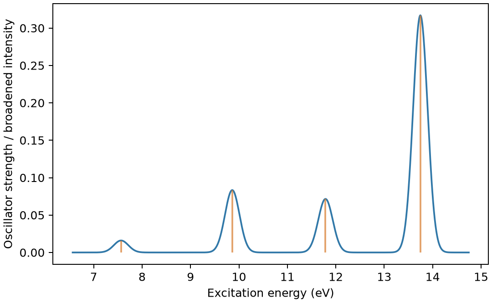

# ORCA 电子激发与吸收谱

**适用环境：Linux + PBS 运行计算；Windows / macOS / Linux 可准备结构与分析结果。**

TDDFT 求解给定基态附近的电子激发；吸收谱还需要跃迁强度。把若干能级差直接画成吸收峰，通常不能替代这一响应计算。

## 用水分子演示五个单重激发

用固定几何水分子演示五个单重激发。采用 PBE0/def2-SVP，`%tddft` 中设 `nroots 5`、`tda false`，明确使用完整 TDDFT。这个小体系便于学习数据链；缺少弥散函数和仅少量激发态的设置不用于定量描述水的完整吸收光谱。

## 准备 TDDFT 输入并运行

[最小案例](../../../examples/orca/minimal/tddft)包含：

- [orca.inp](../../../examples/orca/minimal/tddft/orca.inp)
- [structure.xyz](../../../examples/orca/minimal/tddft/structure.xyz)
- [run.py](../../../examples/orca/minimal/tddft/run.py)：组织计算步骤。
- [job.pbs](../../../examples/orca/minimal/tddft/job.pbs)：单节点 PBS 作业。
- [postprocess.py](../../../examples/orca/minimal/tddft/postprocess.py)：检查并提取结果。
- [requirements.txt](../../../examples/orca/minimal/tddft/requirements.txt)：Python 分析依赖。

在集群加载 ORCA 及其匹配的 MPI 环境。`ORCA_EXEC` 可指定 ORCA 驱动的绝对路径；作业使用一个进程、`%maxcore 1000`，PBS 申请 2 GB 内存。ORCA 由驱动启动，不在外面加 `mpirun`；基组由程序安装提供。

在案例目录安装 Python 依赖并提交：

```bash
python3 -m pip install -r requirements.txt
qsub job.pbs
```

作业结束后会自动执行后处理。重新分析已有输出时，可单独运行 `python3 postprocess.py`。PBS 中的软件加载方式与资源语法按集群配置调整；此例不需要多节点。

## 激发态数、近似与基组

| 设置 | 选择依据 |
| --- | --- |
| `nroots` | 覆盖目标能区，不能仅按固定态数套用 |
| `tda false` | 使用完整响应；TDA 是另一种近似，应明确说明 |
| 泛函 | 电荷转移、Rydberg 与局域激发的误差不同 |
| 基组 | 弥散态需关注弥散函数与基组收敛 |
| 环境 | 溶剂和几何会影响激发能；垂直激发不等于发射 |

## 激发能与强度要一起看

后处理读取 ORCA 6.1 的电偶极吸收表，保留 eV、nm 与无量纲振子强度。第一激发能约 7.5656 eV、振子强度约 0.0160；有的态振子强度为零，不能据此认为该电子态不存在。

ORCA 此任务末尾的 `FINAL SINGLE POINT ENERGY` 为所选第一激发态的总能；脚本另从 `E(SCF)` 保存基态能，避免将两者混淆。基态能与单点案例约 −76.27350518 Hartree 一致。



图由案例的 `postprocess.py` 从计算输出生成。

图中的竖线表示离散跃迁。为了方便观察，曲线使用标准差 0.15 eV 的高斯展宽；这是显示设置，并非计算得到的寿命或实验线宽。需要判断激发态的空间性质时，可用 Multiwfn 进一步分析受支持的激发态数据与跃迁特征。

## 什么时候需要振动分辨的电子光谱

给垂直电子跃迁加窄的高斯展宽，只改变显示线形。要解释振动级数与温度引起的谱带变化，需要计算初、末电子态之间的振动跃迁及其强度。Franck–Condon（FC）近似把电子跃迁偶极矩视为核坐标的常量；Herzberg–Teller（HT）项考虑其随振动坐标的一阶变化，对弱允许或对称性禁阻跃迁尤其重要。

ORCA 6.1 的 ESD 绝热 Hessian 路线使用基态与目标激发态各自的优化几何和 Hessian。先核对电子态、原子顺序、坐标与单位，调用 ESD 的几何须匹配基态 Hessian；两态模式的混合与位移见[正常模式复核](../../计算化学/Hessian、正常模式与频率复核.md)。这一分子谐振模型用于有限簇时，还需判断低频运动与环境的影响；周期材料的声子辅助光谱应另选相应模型。

具体设置见 [ORCA ESD 手册](https://www.faccts.de/docs/orca/6.1/manual/contents/spectroscopyproperties/esd.html)。

## 加入 SOC 后怎样跟踪态与检查收敛

对含重元素的有限簇或分子，旋轨耦合（SOC）会混合不同自旋多重度的标量相对论电子态。跟踪混合态时，联合查看本征矢中的 `Root`、`Spin`、`Ms` 与权重：原先一个三重态的成分可以分布到多个 SOC 态，按能量序号直接配对会丢失这一信息。打印阈值以下的成分也属于本征态；比较组成时使用一致的阈值。

参与 SOC 对角化的单重态、三重态构成截断的态空间。逐步增加态数，检查目标能区内混合态的能量、组成和振子强度是否稳定；只覆盖绘图能区或固定套用某个态数，都不能保证收敛。作图时从同一张 SOC 修正跃迁表读取能量与强度，先核对能量零点和表头，再决定是否需要参考能修正。

SOC 矩阵元可能是复数，读取时保留实部、虚部、分量定义与单位。把各分量模平方求和后开方可以汇总耦合大小，完整混态计算还需要矩阵元的相位。垂直吸收沿用基态几何；讨论发射还需相应激发态几何及跃迁信息，单个耦合数值不能直接给出发光寿命。具体输出示例见 [ORCA SOC 教程](https://www.faccts.de/docs/orca/6.1/tutorials/spec/SOC.html)。

进一步了解方法与文件规则，可看[ORCA 基础知识](../基础与结构/ORCA基础知识.md)。参考：[ORCA TDDFT 手册](https://www.faccts.de/docs/orca/6.1/manual/contents/spectroscopyproperties/tddft.html)。
