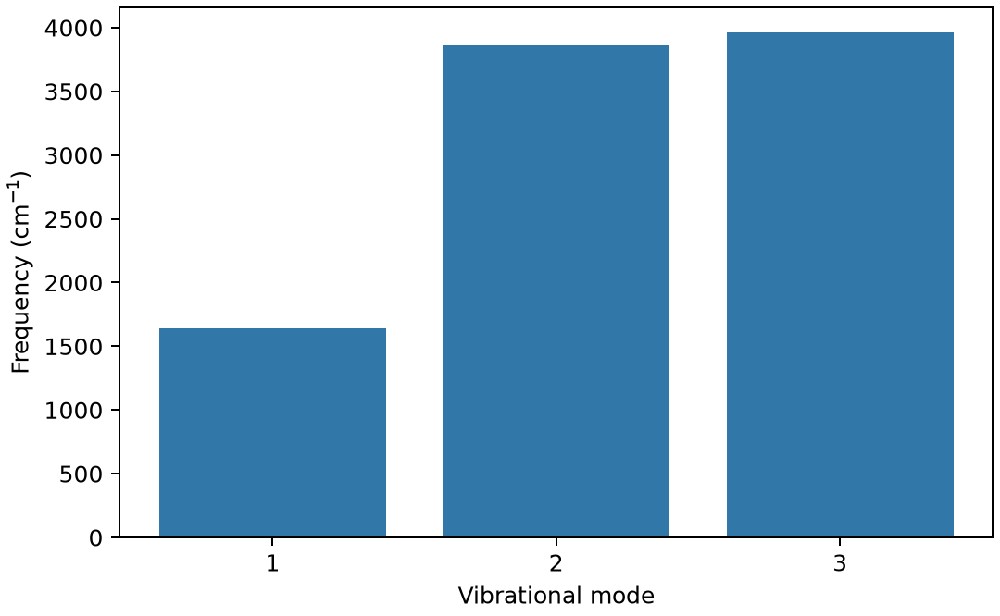

# ORCA 几何优化与振动频率

**适用环境：Linux + PBS 运行计算；Windows / macOS / Linux 可准备结构与分析结果。**

优化寻找势能面的驻点，频率用于判断驻点类型，并提供谐振近似下的振动和热修正。只有优化结束还不足以证明找到了稳定极小值。

本例沿用[单点案例](ORCA单点能与波函数分析.md)中的中性水分子，初始键长为 1 Å，执行 `Opt Freq`：先优化几何，再计算 Hessian。

水有三个原子，为什么只画出三条振动频率？因为非线性分子的 3N 个自由度中，有三个对应整体平移、三个对应整体转动，剩下 3N−6=3 个才是振动自由度。

## 运行水分子优化与频率计算

[最小案例](../../../examples/orca/minimal/geometry-frequency)包含：

- [orca.inp](../../../examples/orca/minimal/geometry-frequency/orca.inp)
- [structure.xyz](../../../examples/orca/minimal/geometry-frequency/structure.xyz)
- [run.py](../../../examples/orca/minimal/geometry-frequency/run.py)：组织计算步骤。
- [job.pbs](../../../examples/orca/minimal/geometry-frequency/job.pbs)：单节点 PBS 作业。
- [postprocess.py](../../../examples/orca/minimal/geometry-frequency/postprocess.py)：检查并提取结果。
- [requirements.txt](../../../examples/orca/minimal/geometry-frequency/requirements.txt)：Python 分析依赖。

在集群加载 ORCA 及其匹配的 MPI 环境。`ORCA_EXEC` 可指定 ORCA 驱动的绝对路径；作业使用一个进程、`%maxcore 1000`，PBS 申请 2 GB 内存。ORCA 由驱动启动，不在外面加 `mpirun`；基组由程序安装提供。

在案例目录安装 Python 依赖并提交：

```bash
python3 -m pip install -r requirements.txt
qsub job.pbs
```

作业结束后会自动执行后处理。重新分析已有输出时，可单独运行 `python3 postprocess.py`。PBS 中的软件加载方式与资源语法按集群配置调整；此例不需要多节点。

## 优化与电子收敛设置

| 设置 | 作用 |
| --- | --- |
| `Opt` | 优化坐标；不是扫描所有构象 |
| `TightOpt` | 较严格的梯度/位移标准 |
| `Freq` | 在当前方法下计算振动；支持方式与方法有关 |
| `TightSCF` | 减少电子数值误差对梯度与 Hessian 的影响 |

柔性分子应先搜索构象，再分别优化；过渡态需用相应搜索方法，不是给普通 `Opt` 多跑几步。

## 优化结束后怎样判断驻点类型

后处理同时检查正常结束、优化收敛和频率数量。本例最终电子能约 −76.27644588 Hartree，三个振动频率约为 1642.9、3865.1、3964.6 cm⁻¹，未作经验缩放。

用 Chemcraft、Avogadro 或相容工具查看振动模式。极小值不应有实质虚频；若出现小虚频，先看模式并检查几何、网格和收敛精度。过渡态则需一个对应目标反应坐标的虚频，并验证路径连接。



图由案例的 `postprocess.py` 从计算输出生成。

图中展示三个振动模式。谐振近似下的频率与实验谱峰可能存在模型差异，热力学校正还依赖温度、标准态与低频处理。用于溶液反应时，需要交代如何处理气相自由能校正与溶液条件的差别。

## 在 Alkemie 中复用 Hessian

「几何优化 → 频率 → 热化学」把这三个步骤连起来。频率节点使用优化后坐标，热化学节点读取上游的 Hessian 和频率输出，按选定温度和压力重算热修正。若只需要频率，可在已知结构上添加频率组件。对于需要多个温压点的比较，可用同一份 Hessian 分别评估，并同时记录温度、压力、频率方法和低频处理。检查频率输出的正常结束与驻点类型后，再引用焓和自由能。

进一步了解方法与文件规则，可看[ORCA 基础知识](ORCA基础知识.md)。参考：[ORCA 几何与振动章节](https://www.faccts.de/docs/orca/6.1/manual/index.html)。
