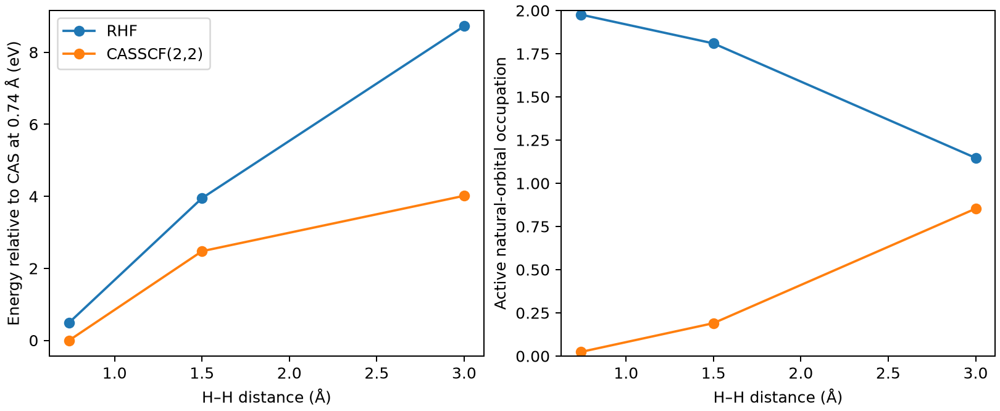

# ORCA 多参考 CASSCF 解离曲线

**适用环境：Linux + PBS 运行计算；Windows / macOS / Linux 可准备输入与分析结果。**

断键时，一个闭壳层行列式可能无法正确表达电子分布。CASSCF 用选定活性空间中的多个组态描述静态相关，是理解多参考方法的直接入口。

## 活性空间与自然轨道占据

CAS(n,m) 表示把 n 个活性电子分配到 m 个活性空间轨道中。在这个空间内做完整组态相互作用，并同时优化轨道。活性空间外的双占据轨道和空轨道仍有未包含的动态相关，后续需要根据任务决定是否补充。

在这个断键例子中，成键与反键自然轨道的占据接近 2/0 时，描述更接近单参考；随键拉长而接近 1/1 时，多个组态的重要性增加。自然轨道占据是诊断线索之一，复杂体系仍需结合轨道性质选择活性空间。

## 拉长 H₂ 的键，比较 HF 与 CASSCF

对 H₂ 的 0.74、1.50 和 3.00 Å 三个键长分别计算限制性 HF 与 CASSCF(2,2)，使用 def2-SVP、中性单重态。活性空间覆盖 σ 成键与 σ* 反键轨道；几何直接写在各输入中，避免坐标来源不明确。

[案例目录](../../../examples/orca/minimal/casscf-dissociation)包含以下科学输入：

[cas-074.inp](../../../examples/orca/minimal/casscf-dissociation/cas-074.inp)、[cas-150.inp](../../../examples/orca/minimal/casscf-dissociation/cas-150.inp)、[cas-300.inp](../../../examples/orca/minimal/casscf-dissociation/cas-300.inp)、[rhf-074.inp](../../../examples/orca/minimal/casscf-dissociation/rhf-074.inp)、[rhf-150.inp](../../../examples/orca/minimal/casscf-dissociation/rhf-150.inp)、[rhf-300.inp](../../../examples/orca/minimal/casscf-dissociation/rhf-300.inp)、[stages.json](../../../examples/orca/minimal/casscf-dissociation/stages.json)、[structure.xyz](../../../examples/orca/minimal/casscf-dissociation/structure.xyz)。

结构写在坐标文件或各输入的原子/晶胞段；`stages.json` 列出计算阶段。配套 [run.py](../../../examples/orca/minimal/casscf-dissociation/run.py) 顺序组织任务，[job.pbs](../../../examples/orca/minimal/casscf-dissociation/job.pbs) 提交作业，[postprocess.py](../../../examples/orca/minimal/casscf-dissociation/postprocess.py) 检查结果并绘图。

## 活性空间设置与运行

加载 ORCA 及其匹配的 MPI 环境，`ORCA_EXEC` 可指定驱动绝对路径。每步使用一个进程和 1000 MB 主要工作区，驱动外不加 `mpirun`；基组来自程序安装。

| 设置 | 本例 | 迁移时要检查 |
| --- | --- | --- |
| `nel/norb` | 2 / 2 | 电子数与化学相关轨道是否齐全 |
| `mult/nroots` | 1 / 1 | 自旋与态平均/态专属的选择 |
| 键长 | 三点 | 教学扫描；反应势能面需更密采样 |
| 基组 | def2-SVP | 基组与动态相关误差未消除 |

复杂体系常需要先看轨道并手动安排活性空间。保持沿扫描路径的轨道性质连续，避免不同点切换到不同解。

在干净案例目录安装[Python 依赖](../../../examples/orca/minimal/casscf-dissociation/requirements.txt)并提交：

```bash
python3 -m pip install -r requirements.txt
qsub job.pbs
```

PBS 中的资源语法和软件加载方式按集群调整。计算结束后自动执行后处理；若只分析已保存的结果，运行 `python3 postprocess.py`。各阶段独立保存输出，便于定位失败步骤。

## 观察占据与能量随键长变化

后处理从原生输出提取自然轨道占据和能量。CASSCF 占据从 0.74 Å 的约 1.9764/0.0236，变为 3 Å 的约 1.1468/0.8532，清楚显示断键时的多组态性质。

能量图以 0.74 Å 的 CASSCF 能量为公共零点；限制性 HF 的远距解离误差明显。三个点并未构成精细势能曲线，也不直接给出含零点能的解离能。



图由案例后处理脚本读取实际计算输出生成。

## 扩展到实际研究

使用 Multiwfn、Chemcraft 等检查活性轨道的空间性质，而不是只看轨道序号。实际问题可进一步考虑 NEVPT2/CASPT2 等动态相关修正，并检查态平均、活性空间增大和轨道旋转的影响。提高 CAS 大小会迅速增加组态数，应优先保证化学完整性。

参考：[ORCA 多参考方法](https://www.faccts.de/docs/orca/6.1/manual/index.html)。
