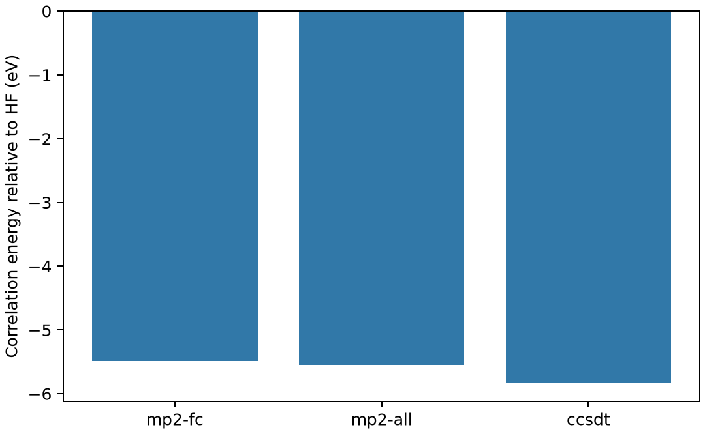

# ORCA 电子关联与冻结核

**适用环境：Linux + PBS 运行计算；Windows / macOS / Linux 可准备输入与分析结果。**

ORCA 的分子电子关联方法适合在合理参考态上提高能量精度。选择 MP2、CCSD(T) 或局域近似前，应先判断是否存在显著的多参考特征。

## 全电子计算为什么还会冻结核

HF 用单行列式平均场描述电子，MP2 在此基础上加入二阶微扰相关；CCSD 通过指数展开处理单、双激发，`(T)` 再加入非迭代三激发修正。这些方法各有适用条件。近简并、断键和过渡金属多态问题中，应先检查单参考描述是否可靠。

“显式表示全部电子”和“在相关计算中关联全部电子”是两件事。全电子计算的相关步骤常默认冻结化学芯电子，以节约成本；这些芯轨道仍在 SCF 中显式求解，只是不参与相应的相关激发。ECP 则用有效算符替代部分芯电子，采用的是另一种近似。

## 用水分子比较四种计算

用固定水分子几何和同一 cc-pVDZ 基组，比较 HF、冻结核 MP2、`NoFrozenCore` MP2 与冻结核 CCSD(T)。水共 10 个显式电子；默认冻结核分支冻结 O 的 1s 两个电子。此例规模很小，采用常规相关方法便于观察差异。

[案例目录](../../../examples/orca/minimal/correlated-methods)包含以下科学输入：

[ccsdt.inp](../../../examples/orca/minimal/correlated-methods/ccsdt.inp)、[hf.inp](../../../examples/orca/minimal/correlated-methods/hf.inp)、[mp2-all.inp](../../../examples/orca/minimal/correlated-methods/mp2-all.inp)、[mp2-fc.inp](../../../examples/orca/minimal/correlated-methods/mp2-fc.inp)、[stages.json](../../../examples/orca/minimal/correlated-methods/stages.json)、[structure.xyz](../../../examples/orca/minimal/correlated-methods/structure.xyz)。

结构写在坐标文件或各输入的原子/晶胞段；`stages.json` 列出计算阶段。配套 [run.py](../../../examples/orca/minimal/correlated-methods/run.py) 顺序组织任务，[job.pbs](../../../examples/orca/minimal/correlated-methods/job.pbs) 提交作业，[postprocess.py](../../../examples/orca/minimal/correlated-methods/postprocess.py) 检查结果并绘图。

## 核对冻结核设置并运行

加载 ORCA 及其匹配的 MPI 环境，`ORCA_EXEC` 可指定驱动绝对路径。每步使用一个进程和 1000 MB 主要工作区，驱动外不加 `mpirun`；基组来自程序安装。

| 分支 | 含义与检查 |
| --- | --- |
| HF | 作为同基组参考能 |
| MP2-FC | 核对输出 `Freezing NCore=2` |
| MP2-all | `NoFrozenCore`，显式关联全部电子 |
| CCSD(T) | 常规单参考相关计算，保持相同几何与基组 |

cc-pVDZ 不是专门的芯价相关基组。要定量研究芯价相关，应进一步采用合适的 core-valence 基组并做基组收敛。

在干净案例目录安装[Python 依赖](../../../examples/orca/minimal/correlated-methods/requirements.txt)并提交：

```bash
python3 -m pip install -r requirements.txt
qsub job.pbs
```

PBS 中的资源语法和软件加载方式按集群调整。计算结束后自动执行后处理；若只分析已保存的结果，运行 `python3 postprocess.py`。各阶段独立保存输出，便于定位失败步骤。

## 相关能变化怎样解读

HF 能约 −76.02679364 Hartree，冻结核 MP2 约 −76.22842341，全电子相关 MP2 约 −76.23076197，CCSD(T) 约 −76.24102417。图展示它们相对 HF 的相关能，而非不同化学物种的反应能。

本例解除冻结核使 MP2 总能进一步降低约 0.0636 eV。反应能是否改善，取决于该修正在各反应组分之间如何抵消，不能直接沿用这一总能变化量。



图由案例后处理脚本读取实际计算输出生成。

## 扩展到实际研究

正式计算应检查基组收敛、参考态与振幅/单参考诊断。DLPNO-CCSD(T) 可扩大适用规模，但 PNO 阈值、辅助基组、三激发变体和基组误差需分别评估；不能用很紧的局域阈值掩盖不合适的参考态。明显断键或近简并时可看[多参考 CASSCF](ORCA多参考CASSCF解离曲线.md)。

参考：[ORCA 关联方法手册](https://www.faccts.de/docs/orca/6.1/manual/index.html)。
